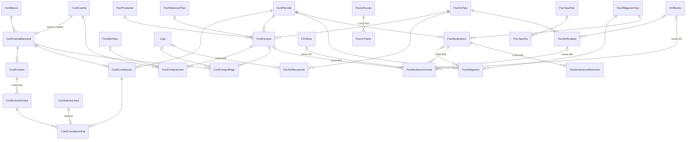
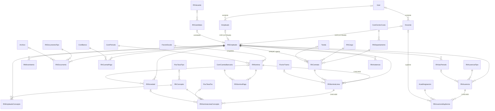
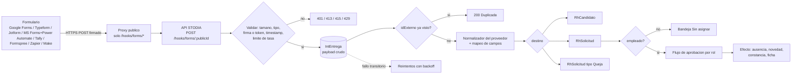
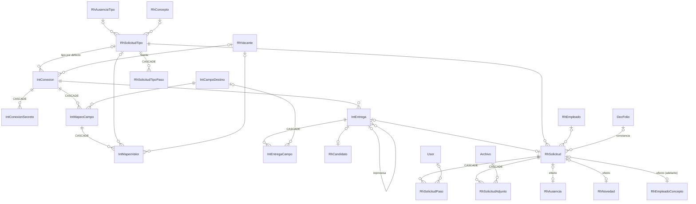
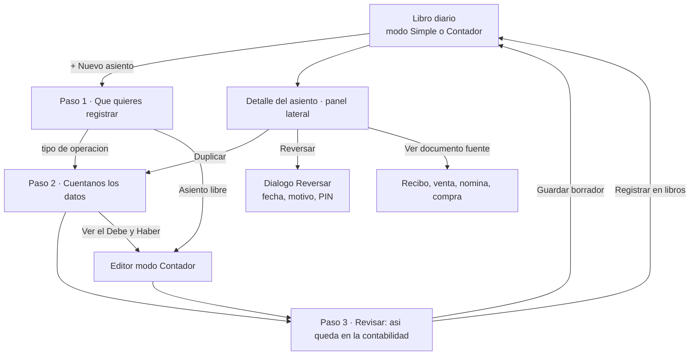

# STODIA · Contabilidad y RRHH: análisis, modelo de datos y plan de integración

> Documento de ANÁLISIS Y DISEÑO. No se modificó código, schema ni datos del sistema. Entrada: `Contabilidad y RRHH.dc.html` (prototipo x-dc de 746 líneas: 13 secciones de markup, 1 clase de lógica). Contexto: escuela dominicana, una instancia por colegio, SQL Server (dev) / SQLite (Docker).
> Convención de marcas: **SIMULADO** = el prototipo lo muestra pero no hace nada real. **A VALIDAR** = norma/tasa fiscal o laboral dominicana que no está en el HTML o de la que no hay certeza: se modela como dato configurable y versionado, nunca como constante en código, y requiere confirmación de contador/abogado. **A CONFIRMAR** = dato del sistema actual que hay que comprobar al implementar.

## Índice

0. Resumen ejecutivo
1. Inventario fiel del HTML
2. Modelo de datos real
3. Solicitudes vía integración con creadores de formularios
4. Rediseño autodidáctico de «Asientos contables»
5. Integración al sistema (rutas, roles, licencia, ciclo, PDFs, API, seeds, impacto)
6. Plan de ejecución, pruebas y decisiones del usuario
Anexo A. Plan de cuentas dominicano propuesto (seed)
Anexo B. Script de Google Apps Script listo para copiar

---

## 0. Resumen ejecutivo

**Qué es el HTML.** Un prototipo navegable de 12 pantallas + 1 ventana (Configuración › Integraciones y Webhooks) + 2 modales (recibo de pago, JSON de ejemplo). Todo el estado vive en memoria (`state`, `emps`, `accts`); ninguna acción persiste, ninguna cifra sale de la base de datos del colegio. El único cálculo con lógica real es la nómina (AFP, SFS, ISR por tramos, aportes patronales), el balanceo del editor de asientos, el emparejamiento por monto de la conciliación y la validación a mano de 2 errores del 606.

**Qué hay que hacer para que sea 100 % funcional** (decisiones de arquitectura, justificadas en §2 y §5):

1. **Contabilidad por año fiscal** (no por ciclo lectivo), con el ciclo lectivo como *dimensión analítica* opcional en cada línea. Libro diario inmutable (reversar en vez de borrar), numeración correlativa sin huecos por tipo y año, balanceo garantizado por CHECK + trigger + validación.
2. **Asientos automáticos por reglas configurables** (`ContRegla` ↔ evento del sistema: cargo devengado, cobro, anulación, beca, venta de kiosko, monedero, nómina…) alimentadas por una **bandeja de eventos idempotente** (`ContEvento`, outbox), no por llamadas directas dentro de cada módulo.
3. **RRHH sin duplicar personas**: nueva `RhEmpleado` = *ficha laboral 1:1* que apunta (XOR) a `Docente` o `Empleado` existentes (32 + 13 = 45 personas), con CHECK y dos índices únicos filtrados. La identidad (nombre, cédula, correo, teléfono, `userId`) sigue en su tabla de origen.
4. **Parámetros fiscales y laborales en tablas versionadas por vigencia** (tasas TSS, topes, escala ISR, salario mínimo, ITBIS, retenciones, política de vacaciones, prestaciones), cada fila con `estadoValidacion` (Pendiente/Validado) y fuente. Nada de 0.0287 en el código.
5. **Solicitudes por integración con formularios** (Google Forms, Typeform, Jotform, Microsoft Forms vía Power Automate, Tally, Formspree, Zapier/Make): endpoint público de webhook con firma HMAC, idempotencia, bitácora de entregas con payload crudo y reintentos, mapeo de campos configurable con asistente y plantillas por proveedor (§3).
6. **La «ventana de configuración»** de integraciones se abre desde el encabezado de RRHH y desde Configuración, conserva el diseño de las 4 tarjetas del prototipo, y gana las pestañas Conexiones / Mapeo / Entregas (§3.9).
7. **Asientos autodidácticos** (§4): asistente por tipo de operación en lenguaje de negocio, plantillas que proponen debe/haber, selector de cuentas con descripción, vista previa «qué sube y qué baja» + forma T, indicador DEBE = HABER en tiempo real, modo Simple / Contador.

**Cifras del diseño.** 82 tablas nuevas (transversales 3, contabilidad 17, bancos 6, fiscal 14, parámetros 5, RRHH 25, integraciones y solicitudes 12; desglose en §2.12). El modelo actual (76 tablas, 116 FK) pasaría a 158 tablas. El detalle de conteo, FK y reglas está en §2.

---

## 1. Inventario fiel del HTML

### 1.1 Carcasa de la aplicación (shell)

| Elemento | Contenido | Origen del dato | Real / SIMULADO |
|---|---|---|---|
| Cabecera oscura (56 px) | Logo `assets/stodia-mark.svg`, «Colegio Los Pinos» / «Stodia · Contabilidad y RRHH» | Texto fijo | SIMULADO: debe venir de `SisConfig 'perfil'` (como el resto del sistema) |
| Chip «Período 2026-10 · Abierto» | Candado + texto | Texto fijo | SIMULADO: es la fecha de trabajo y el estado de `ContPeriodo` (y permite cambiar de período) |
| Selector «Rol» | Super Admin / Contador / Encargado RRHH / Auditor (solo lectura) | `state.role` | SIMULADO: dispositivo de demo; en producción el rol viene del JWT |
| Barra lateral (232 px) | Grupos Contabilidad (6), Recursos Humanos (4), Configuración (1) | `nav` armado en `renderVals` según rol | Real en estructura; el filtro por rol es mock |
| Aviso «Modo auditor: sin acciones de escritura» | Solo con rol auditor | `notReadOnly` | — |
| Toast (2,6 s) | Mensaje inferior derecho | `toast()` | UI real |

**Reglas de rol implícitas** (de `canAcc`, `canHr`, `canSal`, `ro`):

| Rol | Contabilidad | RRHH | Configuración › Integraciones | Datos salariales | Escritura |
|---|---|---|---|---|---|
| admin (Super Admin) | Sí | Sí | Sí | Sí (con registro) | Sí |
| contador | Sí | No (el grupo no aparece) | No | No | Sí |
| rrhh (Encargado RRHH) | No | Sí | Sí | Sí | Sí |
| auditor | Sí (`canAcc = role !== 'rrhh'`) | No | No | No | No (`ro` = true): botones primarios al 45 % de opacidad y `guard()` responde «Modo auditor: acción no permitida» |

Observación: con rol `auditor` el prototipo muestra Contabilidad pero **no** RRHH; un auditor real (interno/externo) normalmente necesita lectura de ambos (ver roles propuestos en §5.3).

`guard()` es el «botón de mentira» del prototipo: si no es auditor, responde «Acción registrada (prototipo)» y **no hace nada**. Lo usan: **Nueva cuenta**, **Crear asiento de comisión**, **Nuevo empleado**, **Nueva solicitud** (vacaciones) y el botón «Mostrar datos» salarial para roles sin permiso.

### 1.2 Mock: variables y arreglos (todo en memoria) → entidades reales

#### 1.2.1 `state` (estado de UI y de datos)

| Variable | Estructura / ejemplo | Para qué sirve | Entidad real |
|---|---|---|---|
| `role` | `'admin'` | rol simulado | JWT `Rol` |
| `screen` | `'accDash'`… 13 ids (`accDash, accPlan, accJournal, accEntry, accBank, accDgii, accReports, hrDash, hrEmp, hrFile, hrPay, hrLeave, cfgHooks`) | pantalla activa | rutas del router |
| `expanded` | `{'1':true,'1.1':true,'2':true,'4':true}` | nodos abiertos del catálogo | solo UI |
| `planQ`, `empQ` | texto | buscadores | solo UI |
| `openAs` | `'AS-2026-00412'` | asiento expandido en el diario | solo UI |
| `asientos` | 5 asientos `{n, f, glosa, orig, est, lines:[[codigo,nombre,debe,haber]]}` | Libro diario | `ContAsiento` + `ContAsientoLinea` |
| `eGlosa`, `eLines` | `''`, `[{c:'',d:'',h:''}×2]` | borrador del editor | borrador de `ContAsiento` |
| `bankSel`, `bookSel`, `matched`, `recClosed` | `{b1:'k1', b2:'k2'}` | selección/estado de la conciliación | `ContConciliacion`, `ContConciliacionPar` |
| `dgiiTab`, `dgiiFixed`, `repTab` | `'606'`, `false`, `'balanza'` | pestañas y bandera «corregido» | `FiscDeclaracion*` |
| `empSel`, `fileTab`, `showSal` | `'e1'`, `'personal'`, `false` | expediente | `RhEmpleado` + log de acceso |
| `payStep`, `bonos`, `payClosed`, `slipId` | `1`, `{e3:'4500', e7:'12000'}`, `false`, `null` | asistente de nómina | `RhNomina`, `RhNovedad` |
| `leaves` | 4 solicitudes `{id, e, tipo, desde, hasta, dias, estado, conf, msg}` | vacaciones y licencias | `RhSolicitud` → `RhAusencia` |
| `hookToken`, `hookShow`, `hookConfirm`, `hookDest`, `hookJson` | `'st_sec_98f7a6d5e4c3b2a1f0d9'`, `'rec'` | integración | `IntConexion`, `IntConexionSecreto` |
| `hookLogs` | 2 filas `{h, ip, code, d}` | monitor de tráfico | `IntEntrega` |
| `applicants` | 5 candidatos `{id, n, tel, puesto, h, estado}` | solicitudes de vacantes | `RhCandidato` |
| `toast` | texto | mensaje | UI |

#### 1.2.2 `emps` (10 empleados)

`{id, n, ced, puesto, depto, sal, ing, cod, vac, tomados}`. Ejemplos exactos: `e1 María Fernández Peña · 001-1234567-8 · Docente de Lengua Española · Secundaria · 48,000 · ingreso 2018-08-13 · EMP-0012 · vac 14 · tomados 4`; `e7 Lucía Vargas Núñez · Coordinadora de Primaria · 68,000 · ingreso 2013-08-19 · EMP-0002 · vac 20 · tomados 8`; `e10 Rafael Peralta Gil · Contador · 75,000 · EMP-0015 · vac 18 · tomados 12`; `e6 Pedro Almonte Cruz · Conserje · 19,500 · tomados 14 de 14`.
Departamentos presentes: Secundaria, Preescolar, Primaria, Administración, Mantenimiento, Comedor (6). Suma de salarios base = **RD$ 443,500.00**. Días de vacaciones usados por el mock: 14, 18 y **20** (el 20 no coincide con el Código de Trabajo: ver §2.6 `RhVacPolitica`, A VALIDAR).
Campos que el expediente muestra pero **no existen** en `emps` (están hardcodeados en el render): teléfono `809-555-0142`, correo `<primer nombre>@lospinos.edu.do`, estado civil «Casado/a», dirección «Av. Los Próceres #45», dependientes «2 · SFS extendido», jornada «Tanda matutina · 40 h», cuenta «Popular · 0740-221933», tardanzas «1 · 12 min», ausencias «0».

#### 1.2.3 `accts` (44 filas = 14 agrupadoras + 30 imputables)

Formato `[código, nombre, naturaleza D/C, saldo|null|'plug']`. `saldo = null` ⇒ cuenta agrupadora (el saldo se calcula sumando hijos de la misma naturaleza); número = cuenta con movimientos («Movs.: Sí»); `'plug'` = «Resultados acumulados» (3.2), calculado como `ΣDeudoras − ΣAcreedoras` para forzar el cuadre.

| Grupo | Cuentas (código · nombre · nat · saldo) |
|---|---|
| 1 Activos | 1.1.01.01 Caja general D 185,400.00 · 1.1.01.02 Banco Popular cta. corriente D 2,436,780.55 · 1.1.01.03 Banco BHD cta. ahorros D 842,100.00 · 1.1.02.01 CxC Estudiantes-mensualidades D 1,284,500.00 · 1.1.02.02 CxC Estudiantes-otros D 96,300.00 · 1.1.03.01 Uniformes D 214,600.00 · 1.1.03.02 Libros y útiles D 158,900.00 · 1.1.04 ITBIS adelantado D 41,230.00 · 1.2.01 Edificios D 18,500,000.00 · 1.2.02 Mobiliario y equipo D 2,140,000.00 · 1.2.99 Depreciación acumulada **C** 1,320,000.00 |
| 2 Pasivos | 2.1.01 CxP Proveedores C 312,450.00 · 2.1.02.01 TSS por pagar C 268,900.00 · 2.1.02.02 ISR retenido por pagar C 52,100.00 · 2.1.03 ITBIS por pagar C 87,640.00 · 2.1.04 Sueldos por pagar C 0.00 · 2.1.05 Monedero comedor (pasivo) C 73,200.00 |
| 3 Patrimonio | 3.1 Capital social C 5,000,000.00 · 3.2 Resultados acumulados C `plug` = **16,947,720.55** (verificado: Activos 24,579,810.55 − Pasivos 794,290.00 − Capital 5,000,000.00 − Resultado del período 1,837,800.00) |
| 4 Ingresos | 4.1.01 Matrícula C 1,860,000 · 4.1.02 Mensualidades C 5,240,000 · 4.1.03 Mora C 64,800 · 4.1.04 Venta uniformes y libros C 312,000 · 4.1.05 Comedor C 428,000 · 4.9.01 Descuentos y becas **D** 386,000 |
| 5 Costos | 5.1.01 Costo de ventas D 189,000 |
| 6 Gastos | 6.1.01 Sueldos y salarios D 4,120,000 · 6.1.02 Cargas patronales D 812,000 · 6.2.01 Servicios básicos D 356,000 · 6.2.02 Mantenimiento D 204,000 |

Defectos del plan del prototipo (a corregir en el modelo real): (a) el encabezado dice «5 niveles» y el código más profundo tiene 4; (b) faltan padres intermedios (`4.9`, `5.1`, `6.1`, `6.2`); (c) **el asiento de nómina usa `2.1.02.03` INFOTEP por pagar y `2.1.06` Descuentos por pagar, que no existen en `accts`** (ver §1.6, defecto D1); (d) no hay cuentas de gastos financieros, depreciación, alquiler, impuestos ni ITBIS retenido, necesarias para las plantillas de §4; (e) el selector del editor excluye las cuentas con saldo cero (salvo 2.1.04), de modo que una cuenta nueva no se puede usar.

#### 1.2.4 Datos incrustados dentro de `renderVals`

| Variable | Contenido | Entidad real |
|---|---|---|
| `inc` / `gas` / `mm` / `mx` | ingresos `[1.12,1.35,1.28,1.51,1.44,1.62]` M, gastos `[.98,1.05,1.12,1.18,1.09,1.21]` M, meses may–oct, escala 1.7 | agregación de `ContAsientoLinea` por mes y tipo de cuenta. **SIMULADO**: la suma de los 6 meses (8.42 M de ingresos) excede el saldo acumulado de ingresos de las cuentas (7.90 M) |
| `fiscalCal` | 4 filas: 15 oct «606 y 607 · septiembre» Enviado; 20 oct «IT-1 · ITBIS» «5 días»; 10 oct «IR-3 · retenciones de nómina» «Hoy»; 30 oct «Autodeterminación TSS» Pendiente | `FiscObligacion` generado desde `FiscObligacionTipo`. **SIMULADO**; fechas y plazos A VALIDAR |
| `accAlerts` | 3 alertas de texto fijo («2 registros del 606 con errores», «1 asiento en borrador (AS-2026-00408)», «Conciliación: 2 partidas sin emparejar») | consultas reales (conteos) |
| `bank` | 5 líneas de extracto `[id, fecha, texto, monto]`: b1 02 oct Depósito cierre caja 1 +148,320; b2 04 oct Transferencia Suplidora Escolar −62,400; b3 06 oct Depósito cheques +12,500; b4 08 oct Comisión mantenimiento −450; b5 09 oct Transferencia recibida tutor +9,800 | `ContExtractoLinea` |
| `book` | 4 líneas de libro `[id, fecha, texto, monto]`: k1 AS-00396 cobros +148,320; k2 Pago CxP Suplidora −62,400; k3 Depósito cheques (AS-00401) +12,500; k4 Transferencia tutor REC-5521 +9,800 | `ContAsientoLinea` de la cuenta 1.1.01.02 |
| `r606` | 5 compras `[RNC, nombre, NCF, fecha, monto, ITBIS, error?]` (ver §1.3.7) | `ContCompra` |
| `r607` | 4 ventas (familias y un cliente corporativo) | `FinRecibo`/`FinVenta` |
| `sq` | 4 secuencias NCF `[tipo, nombre, usados, tope, actual]`: B01 Crédito fiscal 187/500 · B02 Consumo 4,120/5,000 · B14 Régimen especial 12/100 · B15 Gubernamental 0/50 | `FiscNcfSecuencia` (hoy en `SisConfig 'ncf'`) |
| `hookVars` | 5 variables del payload (ver §1.3.12) | `IntMapeoCampo` |
| `vacForms` | 3 formularios de vacantes: Docente de Matemática (Google Forms, cierra 31 oct, Abierta, +6 no listadas), Docente de Inglés (Typeform, 15 nov, Abierta, +3), Auxiliar de Preescolar (Google Forms, 20 oct, «Cierra pronto», +9) | `RhVacante` |
| `hrAlerts` | 4 alertas fijas (documento vencido de e6, «3 solicitudes de ausencia», nómina en borrador, «2 contratos fijos vencen en 30 días») | consultas reales. Nota: en `emps` no hay ningún contrato fijo |

### 1.3 Inventario pantalla por pantalla

> Notación: «De dónde sale» = fuente actual de la cifra en el prototipo y la fuente real propuesta.

#### 1.3.1 CONTABILIDAD · Dashboard (`accDash`)

- **Encabezado**: «Dashboard contable · Octubre 2026 · cifras en RD$» (fijo).
- **4 KPIs** (`accKpis`):
  | KPI | Valor del prototipo | Fórmula en el prototipo | Fuente real |
  |---|---|---|---|
  | Liquidez (caja + bancos) | RD$ 3,464,280.55 · «3 cuentas» | saldo de 1.1.01 (suma de 185,400 + 2,436,780.55 + 842,100) | saldo de las cuentas de sistema `EFECTIVO_*`/`BANCO_*` |
  | Cuentas por cobrar | RD$ 1,380,800.00 · «Mora > 30 días: 11 %» | saldo de 1.1.02 (1,284,500 + 96,300); el 11 % es texto fijo | saldo 1.1.02 y mora desde `FinCobroItem` vencidos > 30 días ÷ cartera |
  | Cuentas por pagar | RD$ 312,450.00 · «4 facturas vencen esta semana» | saldo de 2.1.01; el texto es fijo | saldo 2.1.01 y `ContCompra.vence` |
  | ITBIS a pagar (neto) | RD$ 46,410.00 · «IT-1 vence el 20 oct» | saldo 2.1.03 − saldo 1.1.04 (87,640 − 41,230) | `FiscItbisPeriodo` (ITBIS cobrado − adelantado) |
- **Gráfico «Ingresos vs. gastos · 6 meses»**: barras dobles azul/gris, altura = valor / 1.7 · 100 %. SIMULADO (arreglos fijos).
- **«Calendario fiscal»**: 4 filas con fecha, título, etiqueta de estado coloreada. SIMULADO.
- **«Pendientes de atención»**: 3 alertas con botón (Revisar → Fiscal DGII; Abrir → Libro diario; Conciliar → Conciliación). Los textos son fijos.
- **Sección «Solicitudes recibidas de vacantes»** (el apartado que el usuario indica que vendrá de formularios):
  - Encabezado + botón **«Configurar conexión»** (`goHooks`): lleva a `cfgHooks`; si el rol no es admin/rrhh muestra «Tu rol no puede configurar integraciones».
  - **Tarjetas por formulario** (`vacForms`): puesto, estado («Abierta» verde / «Cierra pronto» ámbar), «fuente · cierra <fecha>», contadores «recibidas» (= candidatos listados del puesto + `extra` fijo) y «nuevas» (= candidatos listados en estado Nuevo).
  - **Tabla de candidatos** (`applicants`, columnas Candidato+teléfono · Puesto · Recibida · Estado · acciones): enlace «CV» (`href="#"`, SIMULADO), y si el estado es Nuevo, botones **Preseleccionar** y **Descartar** (`setA`): cambian el estado en memoria y muestran «Candidato preseleccionado/descartado»; auditor recibe `guard`. Estados: Nuevo (azul), Preseleccionado (verde), Descartado (gris). Solo 5 filas, sin paginación ni «ver todas».
  - **Importante**: aquí «solicitudes» son *candidatos a vacantes*, mientras que «Vacaciones y licencias» (§1.3.11) son solicitudes internas de empleados. La integración de formularios del §1.3.12 enruta a tres bandejas (Reclutamiento docente, Solicitudes internas, Quejas y sugerencias). El diseño de §3 cubre las tres con un único canal de ingesta.

#### 1.3.2 CATÁLOGO DE CUENTAS (`accPlan`)

- Subtítulo «5 niveles · plantilla colegio RD · mapeo a códigos DGII» (el «mapeo a códigos DGII» no existe en los datos: no hay columna).
- **Botones**: «Exportar CSV» (toast «catalogo_cuentas.csv exportado», no genera archivo — SIMULADO), «Nueva cuenta» (`guard`, SIMULADO), «Expandir todo» / «Contraer», buscador (por código o nombre; con texto de búsqueda se aplana el árbol, sin sangría).
- **Tabla** (columnas 130 px Código · Cuenta · Nat. · Movs. · Saldo): fila clicable si tiene hijos (caret ▸/▾); filas agrupadoras con fondo gris y negrita; «Movs.» = «Sí» (verde) si es imputable, «—» si no; saldo con formato `1,234.56`; cuentas acreedoras muestran el saldo en positivo (el signo lo da la naturaleza).
- **Cálculos**: `accTree()`: `mov = saldo !== null`; `kids = existe otra cuenta cuyo código empieza con código + '.'`; saldo de una agrupadora = suma de los hijos imputables **de su misma naturaleza** (la depreciación acumulada C no resta de Activos: el subtotal de «1.2 Activos fijos» sale 20,640,000 en vez de 19,320,000 — defecto D5).
- **Fuente real**: `ContCuenta` (con `parentId` explícito); saldo = Σ(debe − haber) de `ContAsientoLinea` contabilizadas hasta la fecha, firmado por naturaleza, incluyendo restas de contra-cuentas.

#### 1.3.3 LIBRO DIARIO (`accJournal`)

- Título «Libro diario · Asientos manuales y automáticos · los automáticos enlazan a su documento fuente»; botón **«Nuevo asiento manual»** (auditor: `guard`).
- **Tabla** (Número · Fecha · Glosa · Origen · Estado · Total): fila clicable que expande las líneas (`openAs`): por línea `código nombre | debe | haber`, y enlace **«Ver documento fuente ›»** (`href="#"`, SIMULADO).
- **Origen** (pill de color): POS y CxC (azul), Becas (violeta), Inventario (teal), RRHH (naranja), Manual (gris).
- **Estado**: «Contabilizado» (verde) / «Borrador» (ámbar), con un punto.
- **Total** = suma de la columna Debe de las líneas.
- **Asientos del mock** (verificables):
  1. `AS-2026-00412 · 10 oct · Cobros del día · turno caja 1 · POS` — Dr 1.1.01.01 148,320.00 / Cr 1.1.02.01 125,695.76 + Cr 2.1.03 22,624.24. (Aritmética: 148,320 ÷ 1.18 = 125,694.92 y ITBIS 22,625.08, o sea el ejemplo difiere en RD$ 0.84 de un ITBIS al 18 % exacto. Además la **colegiatura está exenta de ITBIS** en la práctica dominicana: A VALIDAR con contador.)
  2. `AS-2026-00411 · 09 oct · Facturación de mensualidades octubre · CxC` — Dr 1.1.02.01 1,284,500 / Cr 4.1.02 1,284,500.
  3. `AS-2026-00410 · 09 oct · Beca institucional aplicada · 12 alumnos · Becas` — Dr 4.9.01 96,300 / Cr 1.1.02.01 96,300.
  4. `AS-2026-00409 · 08 oct · Venta de uniformes · lote 3 · Inventario` — Dr 1.1.01.01 35,400; Cr 4.1.04 30,000; Cr 2.1.03 5,400; Dr 5.1.01 18,200; Cr 1.1.03.01 18,200 (ITBIS 18 % de 30,000 = 5,400 ✓).
  5. `AS-2026-00408 · 07 oct · Ajuste: reclasificación mantenimiento · Manual · Borrador` — Dr 6.2.02 24,500 / Cr 6.2.01 24,500.
- **Sin**: filtros, búsqueda, paginación, rango de fechas, exportación, reverso, duplicado, adjuntos, edición de borradores (aunque existe el estado Borrador), enlaces reales a documentos.

#### 1.3.4 EDITOR DE ASIENTO (`accEntry`)

- «← Libro diario», «Nuevo asiento manual». Campos: **Fecha** (`<input type=date>` con valor fijo `2026-10-10`, **no se guarda en estado**: el asiento nuevo siempre sale «10 oct»), **Glosa** (`eGlosa`).
- **Tabla de líneas** (# · Cuenta · Centro de costo · Debe · Haber · papelera): cuenta = `<select>` plano de `movAccts` («código · nombre», solo cuentas con movimiento y saldo ≠ 0 más 2.1.04); centro de costo = `<select>` con Administración/Primaria/Secundaria/Comedor, **sin guardar** (SIMULADO); Debe/Haber = texto decimal (comas se ignoran); papelera (mínimo 2 líneas); «Agregar línea».
- **Totales** y **barra de estado** (`eBarStyle/eBarMsg`):
  | Condición | Mensaje | Color |
  |---|---|---|
  | `Σdebe = Σhaber` y > 0, con glosa y ≥ 2 líneas llenas | «Asiento cuadrado. Listo para contabilizar.» | verde |
  | cuadrado pero sin glosa | «Cuadrado. Falta la glosa.» | verde |
  | cuadrado pero < 2 líneas con cuenta y monto | «Cada línea necesita cuenta y monto.» | verde |
  | `Σdebe = Σhaber = 0` | «Ingresa montos en Debe y Haber.» | gris |
  | diferencia ≠ 0 | «Descuadrado por RD$ X (más Debe|más Haber)» | rojo |
- **«Contabilizar asiento»**: habilitado si `!ro && diff===0 && td>0 && glosa && filled>=2`. Crea un asiento `AS-2026-00<413 + n>` (numeración por tamaño del arreglo, frágil), origen Manual, estado Contabilizado, lo antepone a la lista y lo expande. **No existe «Guardar borrador»** aunque el diario tiene un estado Borrador.
- **Validaciones ausentes**: una línea puede tener Debe **y** Haber a la vez; cuenta repetida; período cerrado; fecha futura; monto negativo; texto no numérico (se interpreta como 0).

#### 1.3.5 CONCILIACIÓN BANCARIA (`accBank`)

- Subtítulo «Banco Popular · cta. corriente 0740-2231 · octubre 2026. Selecciona una partida de cada lado para emparejar.» (cuenta y mes fijos).
- **4 KPIs** (`bankKpis`): Saldo extracto = 2,436,780.55 (constante); Saldo libros = `extracto − dif`; Partidas sin emparejar = `#pendientes banco + #pendientes libro`; Diferencia = `dif`.
- **Fórmula**: `dif = Σ(partidas banco no emparejadas) − Σ(partidas libro no emparejadas)`.
- **Dos listas**: Extracto bancario (5) y «Libro contable · 1.1.01.02» (4); cada fila: fecha, texto, monto, ícono ○/✔ verde; fila emparejada en gris. Estado inicial `matched = {b1:k1, b2:k2}`.
- **Emparejar** (`pick`): click en una de cada lado; si **montos idénticos** (`===`) se registra el par y se avisa «Partidas emparejadas»; si no, «Los montos no coinciden» y se limpia la selección. Auditor o conciliación cerrada: `guard`. No hay «desemparejar».
- Botones: **«Crear asiento de comisión»** (`guard`, SIMULADO) y **«Cerrar conciliación»** (habilitado solo si `dif === 0`, no cerrada y no auditor; si no, «Aún hay diferencia por conciliar»; al cerrar: «Conciliación de octubre cerrada» y el botón se pone verde).
- **Defecto D3**: el flujo del prototipo es **imposible de completar**: al emparejar b3↔k3 y b5↔k4 queda b4 (comisión −450.00) sin libro, `dif = −450.00 ≠ 0`, y «Crear asiento de comisión» no hace nada, por lo que «Cerrar conciliación» nunca se habilita.
- **Entidades reales**: `ContCuentaBancaria`, `ContExtracto`, `ContExtractoLinea`, `ContConciliacion`, `ContConciliacionPar`.

#### 1.3.6 FISCAL DGII (`accDgii`) — pestañas 606 Compras · 607 Ventas · Secuencias NCF

- **606 y 607** (mismo componente): chip «Período 202610» (fijo), conteo de registros, píldora «N con errores» (rojo) o «Validación sin errores» (verde), botones **«Corregir errores»** (visible solo si hay errores; pone `dgiiFixed = true` y avisa «Registros corregidos y revalidados» — **no corrige nada**, solo oculta los mensajes; SIMULADO) y **«Generar archivo»** (deshabilitado con errores: «Corrige los errores antes de generar»; si no: toast «DGII_F606_202610.txt generado», **no genera archivo**; SIMULADO).
- **Tabla** (RNC/Cédula · Contraparte · NCF · Fecha · Monto · ITBIS · ícono ✔/⚠): fila con error en fondo rosa y mensaje rojo bajo el nombre.
- **Datos 606** (compras): `101-00023-4 Suplidora Escolar SRL B0100004512 03/10 62,400.00 ITBIS 9,518.64`; `130-45678-1 Papelería Nacional SA B0100000873 05/10 18,250.00 / 2,783.90`; `101-8899 Edenorte Dominicana B0100022110 06/10 24,500.00 / 0.00` → **error «RNC inválido: dígito verificador incorrecto»** (el RNC tiene 6 dígitos, no 9); `131-22334-5 Servicios Técnicos Pérez B1400000045 07/10 31,000.00 / 0.00`; `101-00023-4 Suplidora Escolar SRL B0100004512 08/10 12,900.00 / 1,967.80` → **error «NCF duplicado en el período»**. Los errores están **escritos a mano en los datos** (columna 7), no calculados.
- **Datos 607** (ventas): 4 filas (`Familia Fernández B0200003391 9,500.00 / 0`, `Familia Beltré B0200003392`, `Colegio Cooperativo B0100000212 36,400.00 / 5,552.54`, `Familia Mejía B0200003395 8,200.00`). Sin errores.
- **Regla ITBIS observada**: monto con ITBIS incluido; ITBIS = monto × 18 / 118 (62,400 → 9,518.64 ✓; 18,250 → 2,783.90 ✓; 12,900 → 1,967.80 ✓; 36,400 → 5,552.54 ✓). Las filas con ITBIS 0 son exentas o régimen especial. El 606 real exige además columnas (tipo de gasto, montos de bienes y servicios, ITBIS retenido, retención ISR, forma de pago…) que el prototipo no muestra (A VALIDAR el diseño de registro vigente de la DGII).
- **Secuencias NCF** (4 tarjetas, `ncfSeqs`): tipo, nombre, píldora «Vigente»/«Solicitar rango» (rojo si uso ≥ 90 %), barra de uso, «Actual B0100000188», «% usado», «Rango B0100000001 – B0100000500 · vence 31/12/2026». B02: 4,120/5,000 = 82 % (vigente); ninguna llega al 90 % en el mock. Real: hoy vive en `SisConfig 'ncf'` (JSON) y se consume en `FinCounter`; pasa a `FiscNcfSecuencia`.

#### 1.3.7 REPORTES (`accReports`)

- «Reportes financieros · Al 10 de octubre de 2026 · cada saldo permite drill-down al asiento» (**el drill-down no existe**, SIMULADO); botón «Imprimir / PDF» (toast «Documento enviado a impresión», SIMULADO).
- Pestañas: **Balanza de comprobación** y **Estado de resultados** (el balance general NO está en el prototipo; se añade, ver §5.6).
- **Balanza**: columnas Código · Cuenta · Debe · Haber; filas = cuentas imputables con saldo > 0; saldo por naturaleza (D en Debe, C en Haber); totales y «Diferencia = D − C» (0.00 por construcción por el plug de 3.2). Totales del mock: **Debe 31,966,810.55 = Haber 31,966,810.55** (con 3.2 = 16,947,720.55). SIMULADO: una balanza real no usa «saldo final por cuenta», usa saldo inicial, movimientos del período (debe/haber) y saldo final.
- **Estado de resultados** (RD$ y %): Ingresos operacionales (4.1.01–4.1.05) = 7,904,800.00; (−) Descuentos y becas 4.9.01 = 386,000.00; **Ingresos netos 7,518,800.00 (100 %)**; Costo de ventas 189,000.00 (2.5 %); Gastos operativos 6.1.01 4,120,000 + 6.1.02 812,000 + 6.2.01 356,000 + 6.2.02 204,000 = 5,492,000.00 (73.0 %); **Resultado del período 1,837,800.00 (24.4 %)**.
- Sin: filtros de fecha/período/ciclo/centro de costo, comparativo, exportación real, flujo de efectivo, balance general, auxiliares (mayor).

#### 1.3.8 RRHH · Dashboard (`hrDash`)

- «Dashboard RRHH · Año escolar 2026–2027».
- **KPIs** (`hrKpis`):
  | KPI | Valor del prototipo | Fórmula | Fuente real |
  |---|---|---|---|
  | Empleados activos | 10 · «6 docentes · 4 apoyo» | `emps.length`; el desglose es texto fijo (en `emps` hay 5 docentes por puesto) | `RhEmpleado` Activo (45 en el colegio demo: 32 docentes + 13 personal) |
  | Costo de nómina mensual | RD$ 570,252.30 · «Incluye cargas patronales» | `Σsal × 1.2858` | última `RhNomina` aprobada: bruto + aportes patronales (defecto D2: 1.2858 contradice las tasas de `calc`, cuyo costo total es bruto × 1.1629; con los 443,500 base saldrían 515,746.15, no 570,252.30) |
  | Ausentismo del mes | 2.4 % · «Meta ≤ 3 %» | texto fijo | `RhAsistencia` y `RhAusencia` |
  | Regalía pascual proyectada | RD$ 369,583.33 · «Pago hasta el 20 dic» | `Σsal × 10/12` (devengado de 10 meses) | proyección sobre nóminas del año (`RhNominaLineaConcepto` con base regalía) |
- **«Plantilla por departamento»**: barras por `depto`, ancho = `conteo / 4 · 100 %` (tope fijo 4).
- **«Alertas y vencimientos»**: 4 alertas fijas con botón (Ver documento vencido de e6 → expediente/Documentos; Revisar → Vacaciones; Abrir → Nómina; Ver → Empleados).

#### 1.3.9 RRHH · Empleados (`hrEmp`) y Expediente (`hrFile`)

- **Directorio**: título «Directorio de empleados», contador «N de 10 empleados» (con filtro); botón **«Nuevo empleado»** (`guard`, SIMULADO); buscador (nombre, cédula o puesto, sin acentos-insensible explícito: `toLowerCase`); tabla Empleado (avatar con iniciales de las 2 primeras palabras) · Cédula · Puesto+Depto · Ingreso · Estado (píldora «Activo» o «En licencia» solo si e4 y su licencia (id 2) está Aprobada). Click abre el expediente.
- **Expediente**: cabecera (iniciales, nombre, puesto · depto · código EMP-xxxx, estado) y 6 pestañas:
  | Pestaña | Campos |
  |---|---|
  | Personal | Cédula, Teléfono, Correo, Estado civil, Dirección, Dependientes |
  | Contrato | Tipo, Fecha de ingreso, Puesto, Departamento, Jornada, Periodicidad |
  | Compensación | Salario base, AFP (2.87 %), SFS (3.04 %), Cuenta de pago, Descuentos fijos (e3: «Préstamo · RD$ 2,500 (cuota 4/10)»), Centro de costo. Barra «Datos salariales enmascarados» con botón **Mostrar datos / Ocultar**: oculta con `RD$ ••••••`; mostrar solo si `canSal` (admin o rrhh) y muestra el toast «Acceso a datos salariales registrado» (**no registra nada**, SIMULADO; la barra promete «Auditoría Global») |
  | Asistencia y vacaciones | Derecho anual (`vac`), Tomados, Pendientes (`vac − tomados`), Tardanzas del mes, Ausencias del mes, Última licencia |
  | Documentos | 4 filas: Copia de cédula (sin vencimiento, Vigente), Título universitario (—, Vigente), Certificado de salud (vence 02/11/2026, **Por vencer** ámbar), Carta de no antecedentes penales (venció 15/09/2026, **Vencido** rojo); sin botón de subir/descargar |
  | Historial | 3 filas: ingreso (fecha de ingreso), «Ajuste salarial 2021-08-16 · Revisión anual · +6 %», «Cambio de sección 2024-08-12» — iguales para todos los empleados (SIMULADO) |
- Salvo nombre, cédula, puesto, depto, salario, ingreso, código, vacaciones y los descuentos de e3, **todo el expediente es texto fijo**.

#### 1.3.10 RRHH · Nómina (`hrPay`) — asistente de 4 pasos

Cabecera: «Nómina · octubre 2026 · Mensual · 1–31 oct · pago 30 oct» (fijos) y estado «Borrador» (ámbar) / «Cerrada» (verde). Pasos clicables en cualquier orden (sin validación de secuencia): **1 Período · 2 Novedades · 3 Cálculo · 4 Aprobación**.

1. **Período y empleados incluidos**: Tipo de corrida «Ordinaria», Período «01–31 octubre 2026», Fecha de pago «30 octubre 2026», Empleados incluidos «10 activos»; aviso «Se incluyen los empleados con estado Activo. Los parámetros de ley aplicados (AFP, SFS, SRL, INFOTEP, escala ISR) se congelan al cerrar.» Botón «Continuar a novedades».
2. **Novedades**: tabla Empleado · Salario base · **Bono / horas extra** (input editable, deshabilitado si la nómina está cerrada o es auditor) · Descuento fijo (solo e3: 2,500.00). Valores iniciales `bonos = {e3: 4500, e7: 12000}`. «Los cambios recalculan al instante». Botón «Calcular nómina». SIMULADO: un único campo «bono/horas extra» sin tipo, sin horas ni recargos.
3. **Cálculo**: alerta ámbar «N empleado(s) con variación mayor al 15 % respecto al mes anterior» (la regla del mock es `bono > salario × 15 %`, **no compara con el mes anterior**; con los valores iniciales marca solo e7: 12,000 > 10,200); tabla Bruto · AFP · SFS · ISR · Otros · Neto con totales; click en una fila abre el recibo. Botón «Revisar y aprobar».
4. **Aprobación**: dos tarjetas: «Resumen de la corrida» (Empleados, Ingresos brutos, Deducciones del empleado, Aportes patronales (AFP, SFS, SRL, INFOTEP), **Neto a pagar**, **Costo total para el colegio**) y «Asiento contable generado» (6 líneas + plug). Barra inferior: «Al aprobar se congela el cálculo, se genera el asiento y se bloquean las novedades.» → botón **«Aprobar y cerrar nómina»**: pone `payClosed`, antepone al libro diario el asiento `AS-2026-00413 · Nómina octubre 2026 · 10 empleados · RRHH · Contabilizado` y avisa «Nómina aprobada y contabilizada». Cerrada: «Nómina cerrada: inmutable. Asiento AS-2026-00413 contabilizado y recibos disponibles.» (El número 00413 está **fijo** en el mensaje.) **No** se puede reabrir ni anular.
- **Recibo de pago** (modal): empresa, «Recibo de pago · octubre 2026», nombre/puesto/cédula, líneas Salario base, Bonos/horas extra, Total ingresos, AFP 2.87 %, SFS 3.04 %, ISR, Otros descuentos, **Neto a pagar**; botones «Imprimir» (toast, SIMULADO) y «Enviar por correo» (toast, SIMULADO).

#### 1.3.11 RRHH · Vacaciones y licencias (`hrLeave`)

- Subtítulo «Flujo de aprobación jefe › RRHH · bloqueo si no hay reemplazo docente»; botón **«Nueva solicitud»** (`guard`, SIMULADO).
- **Lista** (4 solicitudes): nombre · tipo, «desde → hasta · N días», píldora de estado (Pendiente ámbar / Aprobada verde / Rechazada rojo), y si Pendiente: **Aprobar** y **Rechazar**; si `conf` (conflicto) muestra aviso «4.º B sin reemplazo asignado en Matemática. Asigna un suplente antes de aprobar.» y Aprobar se deshabilita visualmente y responde «Asigna un reemplazo antes de aprobar». Datos: (1) e1 Vacaciones 19–30 oct, 10 días, Pendiente; (2) e4 Licencia médica 14–21 oct, 6 días, Pendiente con conflicto; (3) e8 Vacaciones 21 dic 2026–8 ene 2027, 14 días, Aprobada; (4) e5 Permiso personal 16 oct, 1 día, Pendiente.
- **«Saldo de vacaciones»**: barras para los **6 primeros** empleados: `(vac − tomados) / vac`, ámbar si quedan ≤ 2 días.
- SIMULADO: aprobar/rechazar solo cambia el estado en memoria (no descuenta días, no genera ausencia en nómina ni asistencia); el conflicto es una bandera fija; no hay flujo jefe › RRHH de dos niveles aunque el subtítulo lo dice; el campo `dias` es un número escrito a mano (de 21 dic a 8 ene hay 13 días laborables si se descuentan 25 dic y 1 ene, no 14).

#### 1.3.12 CONFIG · Integraciones y Webhooks (`cfgHooks`)

Ruta de migas «Configuración Global › Integraciones y Webhooks», título «Conexiones externas (API / Webhooks)», texto «Conecta herramientas externas (Google Forms, Zapier, Make) para recibir solicitudes de empleo o encuestas directamente en la bandeja de RRHH de STODIA.» Cuatro tarjetas numeradas:

1. **Credenciales de conexión**: URL del webhook de solo lectura `https://api.stodia.com/v1/webhooks/rrhh/inbox/tnt-0412` + «Copiar URL» (toast, no copia: SIMULADO); **Token de seguridad (Bearer Auth)** `st_sec_98f7a6d5e4c3b2a1f0d9` con «Mostrar/Ocultar» y **«Regenerar token»** (confirmación roja «Regenerar el token romperá las conexiones actuales hasta que lo actualices en Zapier / Google Forms.» → «Sí, regenerar» crea `st_sec_` + 20 hex con `Math.random()` —**no criptográfico**— y lo muestra). Nótese `tnt-0412` = identificador de tenant en una URL en la nube: el modelo del prototipo es un relé centralizado, distinto de «una instancia por colegio» (ver decisión D3 en §6).
2. **Variables requeridas (JSON payload)**: tabla Variable · Tipo · Requisito · Descripción: `nombreCompleto` Texto **Obligatorio**; `telefono` Texto **Obligatorio**; `correo` Texto Opcional; `puestoAplica` Texto **Obligatorio** («rige la etiqueta en el tablero Kanban»); `enlaceDocumento` URL Opcional (PDF del CV en Drive/Dropbox). Botón **«Ver JSON de ejemplo»** abre modal con `POST · Content-Type: application/json · Authorization: Bearer <token>`, el JSON de muestra (Juan Pérez Gómez, 809-555-0187, juan.perez@gmail.com, Docente de Matemática, enlace de Drive) y «Copiar JSON» (copia de verdad al portapapeles si está disponible).
3. **Enrutamiento interno**: `<select>` «¿A qué bandeja se enviarán estas respuestas?» con tres destinos: *RRHH · Reclutamiento docente* (`rec`), *RRHH · Solicitudes internas* (`int`), *Administración · Quejas y sugerencias* (`adm`); texto «Cada registro entra con estado **Nuevo** en el tablero: <destino>». Al cambiar: «Destino actualizado».
4. **Monitor de tráfico**: botón «Enviar solicitud de prueba» (agrega una fila 200 «Solicitud de prueba procesada · tarjeta creada en «Nuevo».» y avisa; no crea tarjeta alguna: SIMULADO) y tabla Hora · IP de origen · Estado (200 OK verde / 400 Bad Request rojo) · Detalle. Filas del mock: `10:45 AM · 34.23.11.0 (Zapier) · 200 · Solicitud de Juan Pérez procesada.` y `10:42 AM · 102.4.5.1 · 400 · Falta la variable obligatoria 'nombreCompleto'.`

Acceso: solo admin y rrhh ven el grupo Configuración.

### 1.4 Fórmulas exactas del prototipo (con números verificados)

**Nómina** (`calc(e)`), por empleado, con `bono` = valor del input de Novedades (0 si vacío):

```
bruto = salarioBase + bono
AFP   = min(bruto, 450000) × 0.0287        // aporte del empleado
SFS   = min(bruto, 250000) × 0.0304
base ISR anual = (bruto − AFP − SFS) × 12
ISR mensual = f(base)/12, con
   base > 867,123  →  79,776 + (base − 867,123) × 0.25
   base > 624,329  →  31,216 + (base − 624,329) × 0.20
   base > 416,220  →             (base − 416,220) × 0.15
   si no           →  0
Otros = 2,500 si es e3 (préstamo), 0 si no
Neto  = bruto − AFP − SFS − ISR − Otros
Patronal: AFP 7.10 % · SFS 7.09 % · SRL 1.10 % · INFOTEP 1.00 %   (sobre bruto, SIN topes en el mock)
```

Ejemplos recalculados a mano (coinciden con la lógica del HTML):

| Caso | Cálculo | Resultado |
|---|---|---|
| e1 María Fernández (48,000, sin bono) | AFP 48,000 × 0.0287 = **1,377.60**; SFS 48,000 × 0.0304 = **1,459.20**; base = (48,000 − 2,836.80) × 12 = 541,958.40; ISR = (541,958.40 − 416,220) × 0.15 = 18,860.76 → ÷12 = **1,571.73** | Neto **43,591.47** |
| e3 Ana Beltré (38,000 + bono 4,500 = 42,500; préstamo 2,500) | AFP 1,219.75; SFS 1,292.00; base = (42,500 − 2,511.75) × 12 = 479,859.00; ISR = (479,859 − 416,220) × 0.15 = 9,545.85 → ÷12 = **795.49** | Neto 42,500 − 1,219.75 − 1,292.00 − 795.49 − 2,500 = **36,692.76** |
| e7 Lucía Vargas (68,000 + 12,000 = 80,000) | AFP 2,296.00; SFS 2,432.00; base = (80,000 − 4,728) × 12 = 903,264; ISR = 79,776 + (903,264 − 867,123) × 0.25 = 88,811.25 → ÷12 = **7,400.94** | Neto **67,871.06** |

**Totales de la corrida del prototipo** (bonos iniciales): Bruto **460,000.00**; AFP 13,202.00; SFS 13,984.00; ISR 19,804.75; Otros 2,500.00; **Neto 410,509.25**. Patronal: AFP 32,660.00 + SFS 32,614.00 + SRL 5,060.00 + INFOTEP 4,600.00 = **74,934.00**. Costo total para el colegio = 460,000 + 74,934 = **534,934.00**. TSS total a pagar (empleado AFP+SFS + patronal AFP+SFS+SRL) = 27,186 + 70,334 = **97,520.00**.

**Asiento de nómina generado** (todo cuadra por construcción, pero sin lógica independiente en `Otros`):
```
Dr 6.1.01 Sueldos y salarios            460,000.00
Dr 6.1.02 Cargas patronales              74,934.00   (incluye INFOTEP 4,600.00)
   Cr 2.1.04 Sueldos por pagar                         410,509.25   (= neto)
   Cr 2.1.02.01 TSS por pagar                           97,520.00
   Cr 2.1.02.02 ISR retenido por pagar                  19,804.75
   Cr 2.1.02.03 INFOTEP por pagar        (NO existe en accts)  4,600.00
   Cr 2.1.06 Descuentos por pagar        (NO existe en accts)  2,500.00  ← «plug» = Dr − Cr
Total 534,934.00 = 534,934.00
```
Defecto: `Otros` se calcula como cifra independiente (2,500) pero la línea 2.1.06 se llena con la diferencia (`plugOtros`), por lo que cualquier error de cálculo quedaría oculto dentro de esa cuenta.

**Vacaciones**: `pendientes = vac − tomados`; barra = `pendientes / vac`; alerta ámbar si ≤ 2. `vac` es un dato fijo por empleado (14/18/20). **No** hay fórmula de devengo por antigüedad.

**Balance / catálogo**: ver §1.2.3 (plug de 3.2 y suma por naturaleza). **Balanza**: Debe = Σ saldos D, Haber = Σ saldos C, ambos de cuentas imputables con saldo > 0. **Estado de resultados**: ver §1.3.7.

**Conciliación**: ver §1.3.5 (`dif` y emparejamiento por monto exacto).

**Fiscal**: ITBIS = monto × 18/118; NCF = `B` + 2 dígitos de tipo + 8 de secuencia (11 caracteres, p. ej. `B0100004512`); secuencia «actual» = `tipo + (usados + 1)` con relleno a 8; «Solicitar rango» si usados/tope ≥ 90 %.

### 1.5 Matriz SIMULADO → debe volverse real

| # | Funcionalidad simulada en el prototipo | Debe ser real mediante |
|---|---|---|
| S1 | Rol, período y cabecera | sesión JWT, `ContPeriodo`, `SisConfig perfil` |
| S2 | Todas las cifras de KPI, gráficos, calendario y alertas | consultas sobre libro, `FiscObligacion`, asistencia (§5.5) |
| S3 | Exportar CSV, Nueva cuenta | `GET/POST /contabilidad/cuentas` |
| S4 | Libro diario sin filtros, documentos fuente `#` | `GET /contabilidad/asientos` con filtros y enlace por `ContEvento` |
| S5 | Editor: fecha y centro de costo sin guardar, sin borrador, sin período | asistente de §4 y `POST /contabilidad/asientos` |
| S6 | Conciliación (importación, comisión, cierre) | `ContExtracto*`, `ContConciliacion*` |
| S7 | 606/607: errores escritos a mano, «Corregir» y «Generar archivo» falsos | validación real (RNC/NCF/duplicados) y archivo TXT |
| S8 | Secuencias NCF: datos fijos | `FiscNcfSecuencia` consumida por Cobros/Kiosko |
| S9 | Reportes: plug 3.2, sin drill-down, «Imprimir» | balanza/mayor/estados reales con `print.tsx` y `xlsx.ts` |
| S10 | Candidatos, vacantes y CV | `RhVacante`, `RhCandidato` alimentados por formularios |
| S11 | Directorio y expediente (campos fijos), «Nuevo empleado», acceso salarial sin log | `RhEmpleado` + `SisAudit` |
| S12 | Nómina: periodo/pago fijos, novedades de 1 columna, variación vs mes anterior falsa, ISR/TSS en código, asiento con plug, aprobar no persiste | `RhNomina*`, `FiscParametro*`, reglas contables |
| S13 | Recibo: imprimir/correo | `print.tsx`/`pdfEngine` + `canales.ts` (SMTP) |
| S14 | Vacaciones: saldos fijos, conflicto fijo, aprobar sin efecto | `RhVacPeriodo`, `RhAusencia`, `RhAusenciaSuplencia` |
| S15 | Integraciones: URL/token falsos, regenerar con `Math.random`, copiar, prueba, monitor | §3 completo |

### 1.6 Defectos y contradicciones del prototipo (a no replicar)

| Id | Defecto | Efecto | Corrección en el diseño |
|---|---|---|---|
| D1 | El asiento de nómina usa cuentas inexistentes (`2.1.02.03`, `2.1.06`); `nm()` haría `undefined.name` y rompería el libro diario al abrir AS-2026-00413 | Error de ejecución tras aprobar nómina | Plan de cuentas con esas cuentas y regla contable validada al guardar (toda cuenta de una regla debe existir y ser imputable) |
| D2 | KPI de costo de nómina `Σsal × 1.2858` contradice las tasas patronales de `calc` (16.29 %) | Cifra del dashboard distinta del costo real | Dashboard lee la corrida real |
| D3 | La conciliación no se puede cerrar (ver §1.3.5) | Flujo incompleto | Asiento desde extracto + tolerancias + partidas en tránsito |
| D4 | Variación «>15 % vs mes anterior» se calcula contra el salario, no contra el mes anterior | Falsos positivos/negativos | Comparar contra la línea de la corrida anterior |
| D5 | Saldo de agrupadora suma solo hijos de su naturaleza; ignora contra-cuentas | Subtotal de Activos fijos incorrecto | Saldo firmado y contra-cuentas con `contraCuenta` |
| D6 | `postEntry` numera con `413 + length − 5` y la fecha es siempre «10 oct» | Duplicados y fecha errónea | `ContSecuencia` atómica y fecha del formulario |
| D7 | Editor admite Debe y Haber en la misma línea y cuenta repetida | Asientos ambiguos | CHECK de línea y validación |
| D8 | `movAccts` excluye cuentas con saldo 0 | No se pueden usar cuentas nuevas | Selector de cuentas imputables activas |
| D9 | Dashboard: la suma de ingresos 6 meses > saldo acumulado | Cifras decorativas | Agregación real |
| D10 | Aprobar vacaciones no descuenta saldo; «Última licencia» siempre «—» | Saldos ficticios | `RhVacPeriodo` / `RhAusencia` |
| D11 | `Math.random()` para el token; «Mostrar token» deja el secreto en el DOM | Secreto débil | `crypto.randomBytes(32)` y revelado controlado (§3.3) |
| D12 | Un ITBIS del 18 % sobre cobros de colegiatura (AS-00412) | Posible error fiscal | Regla por concepto: A VALIDAR si la matrícula/mensualidad está exenta |

---

## 2. Modelo de datos real

### 2.0 Convenciones (las del sistema, más lo que contabilidad exige)

| Tema | Regla |
|---|---|
| PK | `id String @id @default(cuid()) @db.NVarChar(100)` (texto). Líneas hijas puras: `id Int @id @default(autoincrement())` (como `FinReciboItem`). Catálogos con clave semántica estable (`ContEventoTipo.codigo`, `FiscNcfTipo.codigo`, `FiscTasaTipo.codigo`, `ContCuentaSistema.clave`) usan esa clave como PK de texto para que las FK sean legibles. |
| FK | Toda referencia a una entidad es FK real al `id` interno. `onUpdate: NoAction` siempre. `onDelete: NoAction` salvo (a) líneas hijas *propias* del padre (Cascade al padre dueño: `ContAsientoLinea`→`ContAsiento`, `ContPlantillaLinea`, `ContReglaLinea`, `ContCompraLinea`, `ContExtractoLinea`, `FiscDeclaracionLinea/Resumen`, `RhNominaLinea`→`RhNomina`, `RhNominaLineaConcepto`→`RhNominaLinea`, `IntMapeoCampo/Valor`, `IntConexionSecreto`, `IntEntregaCampo`, `RhSolicitudPaso/Adjunto`, `ContAsientoAdjunto`, `FiscIsrTramo`) y (b) nada más. El grafo de cascadas es un bosque (ningún modelo se alcanza por dos caminos). Hacia catálogos y hacia usuarios: NoAction. Un documento contabilizado no se borra: se **reversa** (`ContAsiento`) o se **anula** (`ContCompra`, `RhNomina`, `FinRecibo` ya existente). |
| Dinero | `M` = `Decimal @db.Decimal(18,2)`; tasas `T` = `Decimal @db.Decimal(9,6)`; cantidades (horas, días) `Decimal(10,2)`. El sistema actual usa `Float` para montos (`FinRecibo.monto`); **el libro NO debe usar `Float`**. En SQLite Prisma guarda `Decimal` como número de coma flotante, por eso todo cálculo se hace en centavos enteros con un helper (`apps/api/src/lib/dinero.ts`: `aCent(x)=Math.round(x*100)`, sumas en `BigInt`/`number` entero, redondeo half-up) y un script `cont:auditar` recomienda `ROUND(Σdebe−Σhaber,2)=0` por asiento. En SQL Server el CHECK usa el tipo exacto. |
| Fechas | Fechas de negocio `D10` = `NVarChar(10)` `'YYYY-MM-DD'` (como `Ciclo.fechaInicio`; comparables como texto); marcas de tiempo `DateTime`. Horas `S(5)` `'HH:mm'`. El prototipo escribe `10 oct`/`2026-10`: son formatos de presentación. |
| Estados | Texto con `CHECK (estado IN (...))` (el sistema no usa enums). Borrado lógico `Activo/Inactivo` en catálogos; documentos con estados de ciclo de vida. |
| Auditoría | Cada tabla transaccional lleva `creadoPorId → User` (NoAction), `creadoEn DateTime @default(now())`; cada endpoint mutador llama `audit(req.user, accion, {tabla, id, prev, next, ip})` (`lib/audit.ts`). Acciones sensibles (ver datos salariales, revelar secreto, reabrir período, reversar asiento, aprobar nómina) además exigen PIN de supervisor (`lib/supervisor.ts`) y quedan en `SisAudit`. |
| UNIQUE sobre columna opcional | Índices únicos **filtrados** creados en `src/lib/db-indices.ts` (SQL Server y SQLite); `sqlcmd` siempre con `-I`. |
| CHECK / triggers | Se crean con el mismo mecanismo de DDL crudo de `db-indices.ts` (ya hay 8 CHECK). Para inmutabilidad se añaden triggers (SQL Server `AFTER/INSTEAD OF`, SQLite `BEFORE ... RAISE(ABORT)`), ver §2.11. |
| Prisma | Todos los modelos al final de `schema.prisma`; el `gen-schema.mjs` (camino SQLite) quita los `@db.*`: ningún tipo nativo sin `@db` debe romper en SQLite (por eso no se usan `Json`, `Enum` ni listas). Textos largos `@db.NVarChar(Max)`. |
| Collation | `Modern_Spanish_CI_AI` (insensible a mayúsculas y acentos): afecta UNIQUE de nombres y códigos; los NCF/RNC se guardan solo con dígitos/letras normalizados. |

### 2.1 Decisión clave: personas del RRHH sin duplicar (Docente / Empleado / User)

**Situación actual** (verificada en `schema.prisma`): `Docente` (32 filas; `cedula` UNIQUE NOT NULL, `email`, `tel`, `userId?`) y `Empleado` (13 filas; **sin cédula**, `cargo`, `tel`, `email`, `cajaId?`, `userId?`), cada uno con `userId` opcional y único hacia `User`. Los docentes se usan en asignaciones, horarios y materias (`AcadAsignacion`, `DocenteMateria`...), los empleados en cajas.

| Opción | Descripción | A favor | En contra |
|---|---|---|---|
| A | Agregar a `Docente` y `Empleado` todas las columnas laborales | Cero tablas nuevas | Duplica columnas en dos tablas, dos nóminas, dos expedientes; imposible tener contratos/históricos comunes |
| **B (recomendada)** | Nueva `RhEmpleado` = **ficha laboral 1:1** con FK XOR a `Docente` o `Empleado` | No se mueve ni duplica ningún dato de persona; las relaciones existentes (asignaciones, cajas, login) no cambian; una sola nómina, un solo expediente; reversible | Un `JOIN` extra; una persona que sea a la vez docente y administrativo necesita decidir su fila «ficha» (se resuelve con la regla de abajo) |
| C | `RhEmpleado` maestra y que `Docente`/`Empleado` la referencien | Modelo «puro» | Migración invasiva de 2 tablas con FK entrantes en todo el módulo académico y de cajas; alto riesgo |

**Reglas de B** (el CHECK y los índices garantizan integridad):
1. `RhEmpleado.docenteId` y `RhEmpleado.empleadoId` son FK opcionales; `CK_RhEmpleado_persona: (docenteId IS NULL) <> (empleadoId IS NULL)`; `UX_RhEmpleado_docenteId` y `UX_RhEmpleado_empleadoId` (únicos filtrados `WHERE ... IS NOT NULL`). Una persona = una ficha. Un docente con cargo administrativo (p. ej. coordinadora) es `Docente` con un cargo `RhCargo` de categoría Directivo.
2. **Identidad en un solo lugar**: nombre, cédula, correo y teléfono viven en `Docente`/`Empleado`. Se agrega `Empleado.cedula NVarChar(15)` (nullable, único filtrado `UX_Empleado_cedula`, solo dígitos, como `Tutor.cedula`) porque hoy no existe. Se crea la vista `vRhPersona(rhEmpleadoId, tipo, nombre, cedula, email, tel, userId)` para listados.
3. **Condiciones laborales en un solo lugar**: cargo, departamento, salario y jornada vigentes salen del **contrato vigente** (`RhContrato`), no de columnas de `RhEmpleado`; la vista `vRhEmpleadoActual` los junta para el directorio.
4. **Altas desde RRHH**: «Nuevo empleado» crea en una transacción `Docente` o `Empleado` (según tipo) + `RhEmpleado` + `RhContrato` + `RhVacPeriodo` + `RhMovimiento(Ingreso)`; si hay `userId`, se enlaza. Un candidato `Contratado` se convierte con el mismo flujo (`RhCandidato.rhEmpleadoId`).
5. **Bajas**: `RhEmpleado.fechaSalida`/`estado='Inactivo'` + `Docente.estado`/`Empleado.estado='Inactivo'` (borrado lógico, regla del sistema); un docente con asignaciones solo puede darse de baja si no tiene `AcadAsignacion` en el ciclo activo sin reasignar.
6. Migración de datos: por cada `Docente`/`Empleado` Activo se crea su `RhEmpleado` con código `EMP-nnnn`, contrato vigente con el salario que RRHH cargue (el sistema actual no tiene salarios: se importan por CSV validado o se completan en pantalla).

### 2.2 Tablas transversales (3)

**`Archivo`** (el sistema hoy no guarda archivos: `PersDocumento` es solo metadato). PK `id`; `nombre S(255)`, `mime S(100)`, `bytes Int`, `sha256 S(64)`, `ruta S(500)` (relativa a `/data/archivos/aaaa/mm/<id>`, volumen persistente), `estado S(10)` Activo|Eliminado (borrado lógico + purga programada), `creadoPorId→User`, `creadoEn`. Índice `sha256`. Límite 10 MB y lista blanca de tipos (pdf, png, jpg, xlsx, csv); antivirus fuera de alcance (A VALIDAR política de retención).
**`CfgParametro`** (parámetros escalares versionados): PK `id`; `ambito S(20)` Fiscal|Laboral|Contable|Integracion; `clave S(60)`; `tipo S(10)` Texto|Numero|Fecha|Booleano; `valorTexto S(200)?`, `valorNum Decimal(18,6)?`; `descripcion S(300)`; `vigenteDesde D10`, `vigenteHasta D10?`; `estadoValidacion S(10)` Pendiente|Validado; `validadoPorId→User?`, `validadoEn?`; `fuente S(300)`. UNIQUE (`ambito`,`clave`,`vigenteDesde`). Ejemplos de semilla: `LAB.NOMINA_VARIACION_ALERTA_PCT=15` (del HTML), `LAB.HORAS_JORNADA_SEMANAL=44` (A VALIDAR), `LAB.DIAS_MES_SALARIO=23.83` (A VALIDAR), `LAB.RECARGO_HORA_EXTRA_1=1.35` (A VALIDAR), `LAB.REGALIA_DIVISOR=12`, `LAB.REGALIA_FECHA_LIMITE=12-20` (del HTML «Pago hasta el 20 dic»; A VALIDAR), `CON.INICIO_ANIO_FISCAL_MES=1`, `CON.TOLERANCIA_CONCILIACION=0.00`, `CON.MORA_DIAS_ALERTA=30` (del HTML), `RH.DOC_DIAS_PREVENCER=30`, `RH.VACANTE_DIAS_CIERRE=7`, `INT.RETENCION_DIAS_PAYLOAD=90`.
**`SisNotificacion`**: PK `id`; `userId→User` (un registro por destinatario; la difusión por rol se expande al crear), `tipo S(40)`, `titulo S(200)`, `texto S(500)`, `ruta S(200)` (ruta de la web, p. ej. `/rh-solicitudes`), `leidaEn?`, `creadoEn`. Índice (`userId`,`leidaEn`).

### 2.3 Contabilidad: núcleo (17 tablas)

| # | Tabla | Columnas (tipo; `?` = NULL) | FK (regla) | Índices y restricciones |
|---|---|---|---|---|
| 1 | **`ContAnioFiscal`** | `id`, `anio Int`, `inicio D10`, `fin D10`, `estado` Abierto\|Cerrado, `cerradoPorId?`, `cerradoEn?`, `asientoCierreId?`, `asientoAperturaId?` (apertura del año siguiente) | `cerradoPorId→User`, `asientoCierreId→ContAsiento`, `asientoAperturaId→ContAsiento` (NoAction) | UNIQUE(`anio`); únicos filtrados en `asientoCierreId` y `asientoAperturaId` |
| 2 | **`ContPeriodo`** | `id`, `anioFiscalId`, `mes Int 1..12` (13 = ajustes de cierre, A VALIDAR), `desde D10`, `hasta D10`, `estado` Abierto\|Cerrado\|Bloqueado, `cerradoPorId?`, `cerradoEn?`, `nota S(300)?` | `anioFiscalId→ContAnioFiscal`, `cerradoPorId→User` | UNIQUE(`anioFiscalId`,`mes`); CHECK `hasta>=desde`. Cerrado = reabrible por Director Financiero con PIN y auditoría; Bloqueado = definitivo (tras presentar IT-1 o cerrar el año) |
| 3 | **`ContCuenta`** | `id`, `codigo S(30)`, `nombre S(200)`, `descripcion S(500)` (ayuda autodidáctica de §4), `ejemploUso S(300)?`, `parentId?`, `nivel Int 1..6`, `tipo` Activo\|Pasivo\|Patrimonio\|Ingreso\|Costo\|Gasto, `grupoReporte S(20)` (ACT_CORR, ACT_NOCORR, PAS_CORR, PAS_NOCORR, PATRIMONIO, ING_OPER, ING_NOOP, COSTO, GASTO_OPER, GASTO_FIN), `naturaleza` D\|C, `esContra Bool`, `contraDeId?`, `imputable Bool`, `requiereTercero S(10)` Ninguno\|Proveedor\|Tutor\|Empleado, `requiereCentroCosto Bool`, `soloAutomatica Bool` (cuenta controlada por un módulo: p. ej. CxC), `tipoGasto606 S(2)?`, `codigoIr2 S(20)?` (A VALIDAR), `esSistema Bool`, `estado` Activo\|Inactiva, `creadoPorId`, `creadoEn` | `parentId→ContCuenta`, `contraDeId→ContCuenta` | UNIQUE(`codigo`); índices `parentId`, (`tipo`,`imputable`,`estado`). CHECK `naturaleza` coherente con `tipo` salvo `esContra`; trigger: solo cuentas `imputable` y Activo reciben líneas, y una cuenta con líneas no puede recibir hijos (cierra el defecto D8) |
| 4 | **`ContCuentaSistema`** | PK `clave S(40)` (`CAJA_GENERAL`, `BANCO_PRINCIPAL`, `CXC_MENSUALIDADES`, `CXC_OTROS`, `ITBIS_POR_PAGAR`, `ITBIS_ADELANTADO`, `ING_MATRICULA`, `ING_MENSUALIDADES`, `ING_MORA`, `ING_UNIFORMES`, `ING_COMEDOR`, `DESC_BECAS`, `COSTO_VENTAS`, `INV_UNIFORMES`, `INV_LIBROS`, `MONEDERO_PASIVO`, `SUELDOS_POR_PAGAR`, `TSS_POR_PAGAR`, `ISR_RET_POR_PAGAR`, `INFOTEP_POR_PAGAR`, `DESC_NOMINA_POR_PAGAR`, `GASTO_SUELDOS`, `GASTO_CARGAS`, `GASTO_COMISION_BANCARIA`, `CXP_PROVEEDORES`, `RET_ITBIS_POR_PAGAR`, `CAPITAL`, `RESULTADOS_ACUM`, `RESULTADO_EJERCICIO`…), `descripcion S(200)`, `cuentaId`, `modificadoPorId`, `modificadoEn` | `cuentaId→ContCuenta` | Las reglas y plantillas se escriben contra la **clave**, no contra el código: renumerar el plan no rompe nada. Validación al guardar: la cuenta debe ser imputable y Activa |
| 5 | **`ContCentroCosto`** | `id`, `codigo S(20)`, `nombre S(100)`, `nivelId?`, `estado` | `nivelId→Nivel` (existente: Primaria/Secundaria…) | UNIQUE(`codigo`) y UNIQUE(`nombre`). Semilla: Administración, Preescolar, Primaria, Secundaria, Comedor, Mantenimiento (los 4 del select del prototipo + los departamentos de `emps`) |
| 6 | **`ContTipoAsiento`** | `id`, `codigo S(5)`, `nombre S(60)`, `prefijo S(5)`, `permiteManual Bool`, `estado` | — | UNIQUE(`codigo`). Semilla: AS Asiento de diario (manual), CO Cobros, FA Facturación/devengo, CP Compras y pagos, NO Nómina, BA Bancario, AJ Ajuste, RV Reverso, AP Apertura, CI Cierre. El HTML usa solo el prefijo `AS` (`AS-2026-00412`): si el cliente lo prefiere, todos los tipos comparten `AS` y la secuencia sigue siendo por tipo |
| 7 | **`ContSecuencia`** | PK compuesta (`tipoAsientoId`,`anioFiscalId`), `ultimo Int` | `tipoAsientoId→ContTipoAsiento`, `anioFiscalId→ContAnioFiscal` | Numeración correlativa **sin huecos**: se asigna al contabilizar dentro de la misma transacción con `UPDATE ContSecuencia SET ultimo=ultimo+1 OUTPUT inserted.ultimo` (SQL Server; SQLite serializa escrituras). Un rollback devuelve el número |
| 8 | **`ContAsiento`** | `id`, `numero S(30)?` (`AS-2026-00412`; NULL en borrador), `tipoAsientoId`, `anioFiscalId`, `periodoId`, `fecha D10`, `glosa S(500)`, `estado` Borrador\|Contabilizado\|Reversado, `origen` Manual\|Automatico\|Apertura\|Cierre\|Reversion, `plantillaId?`, `reglaId?`, `cicloId?` (dimensión analítica), `reversaDeId?`, `motivoReverso S(300)?`, `totalDebe M`, `totalHaber M`, `hash S(64)?` (sha-256 del contenido canónico; evidencia de manipulación), `creadoPorId`, `creadoEn`, `contabilizadoPorId?`, `contabilizadoEn?` | `tipoAsientoId`, `anioFiscalId`, `periodoId`, `plantillaId→ContPlantilla`, `reglaId→ContRegla`, `cicloId→Ciclo`, `reversaDeId→ContAsiento` (self), usuarios→`User` (todas NoAction) | UNIQUE filtrado `numero` (`WHERE numero IS NOT NULL`); UNIQUE filtrado `reversaDeId` (un asiento se reversa una sola vez); **CHECK `CK_ContAsiento_cuadre`: `estado='Borrador' OR totalDebe=totalHaber`**; CHECK `estado='Borrador' OR (numero IS NOT NULL AND totalDebe>0)`; CHECK `origen IN(...)`; índices (`periodoId`,`fecha`), `estado`, `origen`, (`tipoAsientoId`,`numero`), `cicloId`, `reglaId` |
| 9 | **`ContAsientoLinea`** | `id Int`, `asientoId`, `orden Int`, `cuentaId`, `descripcion S(300)?`, `debe M default 0`, `haber M default 0`, `centroCostoId?`, `proveedorId?`, `tutorId?`, `alumnoId?`, `rhEmpleadoId?` (auxiliar por tercero, a lo sumo uno) | `asientoId→ContAsiento` **Cascade** (solo borradores se pueden eliminar); `cuentaId→ContCuenta`, `centroCostoId`, `proveedorId→FiscProveedor`, `tutorId→Tutor`, `alumnoId→Alumno`, `rhEmpleadoId→RhEmpleado` (NoAction) | **CHECK de línea** (cierra D7): `debe>=0 AND haber>=0 AND (debe=0 OR haber=0) AND (debe+haber)>0`; CHECK a lo sumo un tercero; UNIQUE(`asientoId`,`orden`); índices (`cuentaId`,`asientoId`) (mayor y saldos), `asientoId`, `centroCostoId`; triggers de inmutabilidad (§2.11) |
| 10 | **`ContAsientoAdjunto`** | `id`, `asientoId`, `archivoId`, `descripcion S(200)?`, `creadoPorId`, `creadoEn` | `asientoId` **Cascade**; `archivoId→Archivo` NoAction | índice `asientoId`. Permitido también sobre asientos contabilizados (el adjunto no altera importes) |
| 11 | **`ContPlantilla`** | `id`, `codigo S(30)`, `nombre S(100)` (en lenguaje de negocio, «Pagué un gasto»), `pregunta S(300)`, `icono S(40)`, `categoria` Gastos\|Ingresos\|Bancos\|Nomina\|Ajustes\|Libre, `orden`, `tipoAsientoId`, `glosaModelo S(300)` (ej. `Pago de {descripcion} · {proveedor}`), `ejemplo S(300)`, `soloContador Bool`, `esSistema Bool`, `estado` | `tipoAsientoId` | UNIQUE(`codigo`) |
| 12 | **`ContPlantillaLinea`** | `id Int`, `plantillaId`, `orden`, `lado` D\|H, `modo` FIJA\|ELEGIR, `cuentaId?`, `claveCuentaSistema?`, `grupoSugerido S(20)?`, `padreSugeridoId?`, `etiqueta S(100)` («¿En qué gastaste?»), `ayuda S(300)`, `montoBase` TOTAL\|BASE\|ITBIS\|RETENCION\|NETO\|LIBRE, `obligatoria Bool` | `plantillaId` **Cascade**; `cuentaId→ContCuenta`, `claveCuentaSistema→ContCuentaSistema`, `padreSugeridoId→ContCuenta` | CHECK `modo='FIJA'` ⇒ exactamente uno de `cuentaId`/`claveCuentaSistema`; UNIQUE(`plantillaId`,`orden`) |
| 13 | **`ContEventoTipo`** | PK `codigo S(40)`, `nombre S(100)`, `modulo S(40)`, `descripcion S(300)`, `estado` | — | Semilla en §2.4 |
| 14 | **`ContRegla`** | `id`, `eventoTipoCodigo`, `nombre S(150)`, `agrupacion` Documento\|DiaCaja\|Dia\|Mes\|Corrida, `tipoAsientoId`, `glosaModelo S(300)`, `vigenteDesde D10`, `vigenteHasta D10?`, `estado` Borrador\|Activa\|Inactiva, `creadoPorId`, `creadoEn` | `eventoTipoCodigo→ContEventoTipo`, `tipoAsientoId`, `creadoPorId→User` | UNIQUE filtrado (`eventoTipoCodigo`) `WHERE estado='Activa' AND vigenteHasta IS NULL` (una regla activa por evento) |
| 15 | **`ContReglaLinea`** | `id Int`, `reglaId`, `orden`, `iteraSobre` TOTAL\|PAGO\|ITEM\|IMPUESTO\|CONCEPTO_RH\|COSTO, `lado` D\|H, `cuentaId?`, `claveCuentaSistema?`, `cuentaBancariaId?`, `montoBase` TOTAL\|BASE\|ITBIS\|NETO\|BRUTO\|DEDUCCION_EMP\|APORTE_PAT\|COSTO, `factor T default 1` (−1 para reversos), `filtroMetodoPagoId?`, `filtroCajaId?`, `filtroCategoriaId?`, `filtroCargoTipo S(10)?` (`mat`,`com`,`col`,`srv`,`tra`,`mora`), `filtroRhConceptoId?`, `filtroDepartamentoId?`, `centroCostoModo` NINGUNO\|DEPARTAMENTO\|NIVEL\|FIJO, `centroCostoId?`, `descripcion S(200)` | `reglaId` **Cascade**; `cuentaId→ContCuenta`, `claveCuentaSistema→ContCuentaSistema`, `cuentaBancariaId→ContCuentaBancaria`, `filtroMetodoPagoId→MetodoPago`, `filtroCajaId→Caja`, `filtroCategoriaId→CategoriaProducto`, `filtroRhConceptoId→RhConcepto`, `filtroDepartamentoId→RhDepartamento`, `centroCostoId→ContCentroCosto` | CHECK exactamente una de (`cuentaId`,`claveCuentaSistema`,`cuentaBancariaId`); UNIQUE(`reglaId`,`orden`). El motor elige, por cada elemento iterado, la línea **más específica** que cumpla los filtros |
| 16 | **`ContEvento`** (bandeja/outbox) | `id`, `eventoTipoCodigo`, `clave S(200)` (clave determinista de idempotencia, p. ej. `COBRO_RECIBO:REC-0418`; es un dato derivado, no una referencia), `fechaEvento D10`, `estado` Pendiente\|Procesado\|Error\|Omitido, `intentos Int`, `ultimoError S(500)?`, `asientoId?`, `reglaId?`, `monto M?`, **fuente (exactamente una no nula)**: `reciboId?`, `ventaId?`, `cobroItemId?`, `becaId?`, `monederoMovId Int?`, `nominaId?`, `nominaPagoId?`, `compraId?`, `compraPagoId?`, `extractoLineaId Int?`, `obligacionId?`; `creadoEn`, `procesadoEn?` | `eventoTipoCodigo`; `asientoId→ContAsiento`; `reglaId→ContRegla`; `reciboId→FinRecibo`; `ventaId→FinVenta`; `cobroItemId→FinCobroItem`; `becaId→FinBeca`; `monederoMovId→MonederoMovimiento`; `nominaId→RhNomina`; `nominaPagoId→RhNominaPago`; `compraId→ContCompra`; `compraPagoId→ContCompraPago`; `extractoLineaId→ContExtractoLinea`; `obligacionId→FiscObligacion` (todas NoAction) | UNIQUE(`eventoTipoCodigo`,`clave`) (**idempotencia**); CHECK `CK_ContEvento_fuente` (exactamente una de las 11 FK no nula); índices (`estado`,`fechaEvento`), `asientoId`, y uno por cada FK de fuente. Varios eventos pueden apuntar al mismo asiento (agrupación) |
| 17 | **`ContSaldoCierre`** | `id Int`, `periodoId`, `cuentaId`, `saldoInicial M`, `debe M`, `haber M`, `saldoFinal M` (firmado según naturaleza), `creadoEn` | `periodoId→ContPeriodo`, `cuentaId→ContCuenta` | UNIQUE(`periodoId`,`cuentaId`). Se escribe al **cerrar** un período (balanza congelada) y sirve de referencia de control; el saldo vivo se calcula con SUM sobre `ContAsientoLinea` (índice `cuentaId`), sin tabla de saldos mantenida por triggers |

**Libros derivados (vistas, no tablas)**: `vContMayor` (cuenta, asiento, fecha, debe, haber, saldo acumulado por ventana), `vContBalanza` (por período: saldo inicial, movimiento debe/haber, saldo final), `vContAuxTercero` (por proveedor/tutor/empleado), `vContIngresosGastosMes`. Los PDFs/Excel y el dashboard leen estas vistas.
**Opcional, fuera del alcance mínimo**: `ContActivoFijo`/`ContDepreciacion` (el plan trae Edificios, Mobiliario y Depreciación acumulada; hasta entonces la depreciación se registra con la plantilla «Depreciación»).

### 2.4 Reglas contables y eventos (integración con cobros, ventas y nómina)

**Qué dispara cada evento** (`ContEventoTipo`, semilla):

| Código | Dispara | Fuente (FK en `ContEvento`) | Agrupación por defecto | Asiento que genera (ejemplo con cuentas del HTML) |
|---|---|---|---|---|
| `CARGO_DEVENGADO` | job mensual `devengar-cargos`: cada `FinCobroItem` cuyo mes de devengo (derivado de `vence`, A CONFIRMAR) ya llegó y no tiene evento | `cobroItemId` | Mes | Dr 1.1.02.01 CxC mensualidades / Cr 4.1.02 Mensualidades (por `filtroCargoTipo`: `col`→4.1.02, `mat`→4.1.01, `com`→4.1.05, `mora`→4.1.03, `srv`/`tra` según catálogo). Ejemplo AS-00411: 1,284,500.00. **No** se contabiliza la cartera futura (hoy hay 15,230 cargos con vencimientos hasta mayo 2027) |
| `COBRO_RECIBO` | cada `FinRecibo` Activo | `reciboId` | DiaCaja | Dr Caja o Banco (línea `iteraSobre=PAGO`, filtrada por `MetodoPago` y `Caja`) / Cr CxC (línea `ITEM`) y, si el recibo tiene ITBIS, Cr 2.1.03 ITBIS por pagar |
| `RECIBO_ANULADO` | `FinRecibo.est='Anulado'` (nota de crédito) | `reciboId` | Documento | misma regla de cobro con `factor=-1` (asiento compensatorio; no se edita el asiento agrupado original) |
| `BECA_APLICADA` | beca Aprobada del mes (job) | `becaId` | Mes | Dr 4.9.01 Descuentos y becas / Cr 1.1.02.01. Ejemplo AS-00410: 96,300.00 (12 alumnos). A CONFIRMAR cómo la beca modifica hoy `FinCobroItem.monto` para no contabilizarla dos veces |
| `VENTA_KIOSKO` | cada `FinVenta` (+ sus `FinVentaItem`) | `ventaId` | Dia | Dr Caja o Banco; Cr 4.1.04; Cr 2.1.03 (ITBIS de las líneas con `tax`); **y** Dr 5.1.01 Costo de ventas / Cr 1.1.03.xx Inventario por `FinProducto.costo`. Ejemplo AS-00409: 35,400.00 + costo 18,200.00. Requiere columna nueva `FinProducto.costo` |
| `MONEDERO_RECARGA` | `MonederoMovimiento.tipo='Recarga'` | `monederoMovId` | Dia | Dr Caja/Banco / Cr 2.1.05 Monedero comedor (pasivo) |
| `MONEDERO_CONSUMO` | `tipo='Consumo'` | `monederoMovId` | Dia | Dr 2.1.05 / Cr 4.1.05 Comedor |
| `NOMINA_APROBADA` | `RhNomina.estado→Aprobada` | `nominaId` | Corrida | Dr 6.1.01 + Dr 6.1.02 / Cr 2.1.04 + Cr 2.1.02.01 + Cr 2.1.02.02 + Cr INFOTEP + Cr descuentos (líneas `CONCEPTO_RH`, por concepto y por departamento/centro de costo). Ejemplo octubre del HTML: Dr 534,934.00 = Cr 534,934.00 |
| `NOMINA_PAGADA` | `RhNominaPago.estado→Confirmado` | `nominaPagoId` | Documento | Dr 2.1.04 Sueldos por pagar / Cr Banco |
| `COMPRA_REGISTRADA` | `ContCompra.estado→Registrada` | `compraId` | Documento | Dr Gasto o Inventario (`ContCompraLinea`) + Dr 1.1.04 ITBIS adelantado / Cr 2.1.01 CxP (− retenciones a Cr 2.1.02.x) |
| `PAGO_COMPRA` | `ContCompraPago` registrado | `compraPagoId` | Documento | Dr 2.1.01 / Cr Banco o Caja |
| `EXTRACTO_CARGO` | línea de extracto clasificada como comisión/interés («Crear asiento de comisión») | `extractoLineaId` | Documento | Dr Gastos financieros / Cr Banco (y queda **conciliada** automáticamente: cierra el defecto D3) |
| `OBLIGACION_PAGADA` | `FiscObligacion.estado→Pagada` | `obligacionId` | Documento | Dr 2.1.03 / 2.1.02.x (liquida el pasivo) / Cr Banco |

**Procesamiento.** Un *worker* en la propia API (`setInterval`, 1 minuto, más disparo manual desde la pantalla) hace: (1) **barrido** de documentos sin evento (anti-join: `FinRecibo` Activo sin `ContEvento COBRO_RECIBO`, etc.; es la red de seguridad y la herramienta de *backfill*); (2) toma eventos `Pendiente`/`Error` con `intentos<5`, resuelve la regla activa vigente a `fechaEvento`, arma las líneas, valida (suma debe=haber, cuentas imputables y activas, período abierto) y crea el asiento `origen='Automatico'` en estado Contabilizado dentro de **una transacción** con la actualización del evento; (3) los eventos con agrupación `Dia/DiaCaja/Mes/Corrida` esperan al *consolidador* (diario a las 23:59 o botón «Contabilizar el día») que crea **un asiento por grupo** y enlaza todos los eventos (`asientoId`). Si falta configuración (p. ej. método «Cheque» sin cuenta) el evento queda `Error` con el motivo en español, aparece en «Pendientes de atención» y **nunca bloquea la operación del colegio** (cobrar, vender, aprobar nómina).
**Por qué barrido primero y ganchos después**: el barrido no toca los módulos existentes (cobros, kiosko, becas, comedor): es reversible y se puede probar con el backfill de las 4,740 recibos reales. Los ganchos (inserción transaccional del evento dentro del `prisma.$transaction` del cobro) pueden añadirse luego para latencia cero.
**Cierre de período**: se rechaza si hay eventos `Pendiente`/`Error` con fecha en el período, asientos en Borrador, o conciliación bancaria abierta (configurable).
**Idempotencia**: `UNIQUE(eventoTipoCodigo, clave)`; reprocesar nunca duplica. Si una regla cambia, los asientos ya contabilizados **no** se tocan (se reversan y reprocesan explícitamente por rango, con PIN).

### 2.5 Bancos y conciliación (6 tablas)

| # | Tabla | Columnas | FK | Índices y restricciones |
|---|---|---|---|---|
| 18 | **`ContBanco`** | `id`, `nombre S(100)`, `estado` | — | UNIQUE(`nombre`). Semilla: Banco Popular Dominicano, Banco BHD, Banreservas, Scotiabank, Banco Santa Cruz… |
| 19 | **`ContCuentaBancaria`** | `id`, `bancoId`, `alias S(100)` («Popular · cta. corriente»), `tipo` Corriente\|Ahorro, `numero S(30)` (se muestra enmascarado salvo permiso), `moneda S(3)='DOP'`, `cuentaContableId`, `saldoInicial M`, `saldoInicialFecha D10`, `estado` | `bancoId→ContBanco`, `cuentaContableId→ContCuenta` | UNIQUE(`bancoId`,`numero`); UNIQUE filtrado `cuentaContableId` (una cuenta contable ↔ una cuenta bancaria). Semilla: 1.1.01.02 y 1.1.01.03 del HTML |
| 20 | **`ContExtracto`** | `id`, `cuentaBancariaId`, `desde D10`, `hasta D10`, `saldoInicial M`, `saldoFinal M`, `formato` CSV\|OFX\|MT940\|Manual, `archivoId?`, `hashArchivo S(64)?`, `estado` Importado\|Conciliado\|Anulado, `importadoPorId`, `importadoEn` | `cuentaBancariaId→ContCuentaBancaria`, `archivoId→Archivo`, `importadoPorId→User` | UNIQUE filtrado (`cuentaBancariaId`,`hashArchivo`) (evita reimportar el mismo archivo); validación: `saldoInicial + Σlíneas = saldoFinal` |
| 21 | **`ContExtractoLinea`** | `id Int`, `extractoId`, `orden`, `fecha D10`, `descripcion S(300)`, `referencia S(100)?`, `monto M` (positivo = depósito/crédito al banco, negativo = retiro/débito), `saldo M?`, `estado` Pendiente\|Conciliada\|Ignorada | `extractoId→ContExtracto` **Cascade** (la FK de `ContConciliacionPar` NoAction impide borrar un extracto con pares) | UNIQUE(`extractoId`,`orden`); índices (`extractoId`,`estado`), `fecha` |
| 22 | **`ContConciliacion`** | `id`, `cuentaBancariaId`, `periodoId`, `saldoExtracto M`, `saldoLibros M`, `diferencia M`, `estado` Abierta\|Cerrada, `cerradaPorId?`, `cerradaEn?`, `nota S(300)?` | `cuentaBancariaId`, `periodoId`, `cerradaPorId` | UNIQUE(`cuentaBancariaId`,`periodoId`); CHECK `estado<>'Cerrada' OR diferencia=0` |
| 23 | **`ContConciliacionPar`** | `id Int`, `conciliacionId`, `extractoLineaId`, `asientoLineaId`, `monto M` (parte aplicada), `tipo` Manual\|Auto, `creadoPorId`, `creadoEn` | `conciliacionId→ContConciliacion`, `extractoLineaId→ContExtractoLinea`, `asientoLineaId→ContAsientoLinea` (NoAction) | **UNIQUE(`asientoLineaId`)** (una línea del libro se concilia una sola vez); índice `extractoLineaId` (una línea del banco puede cubrir varias del libro: p. ej. un depósito de varios cobros); validación Σ`monto` por línea de extracto = su `monto` |

**Algoritmo real** (reemplaza el emparejamiento por monto idéntico): (1) importar CSV (columnas fecha, descripción, referencia, débito, crédito o monto; plantillas por banco, A VALIDAR formato de cada banco); (2) sugerencias automáticas: mismo monto y signo, fecha del libro dentro de ±N días (parámetro), referencia o texto similar; (3) conciliación manual 1:1 y 1:N; (4) partidas del banco sin libro → «Crear asiento» (comisión, interés, nota de débito) que genera el asiento y concilia; (5) partidas del libro sin banco = **en tránsito** (depósitos y cheques); (6) `diferencia = (saldoExtracto + depósitos en tránsito − cheques en tránsito) − saldoLibros ajustado`; se cierra con diferencia 0.00 (tolerancia `CON.TOLERANCIA_CONCILIACION`). Con los datos del HTML: extracto 2,436,780.55; b3↔k3 (12,500.00) y b5↔k4 (9,800.00) se emparejan, b4 (−450.00) se registra como comisión con su asiento → diferencia 0.00 y la conciliación se puede cerrar.

### 2.6 Compras, fiscal DGII y obligaciones (14 tablas)

> Toda estructura de formato de envío de la DGII (columnas del 606/607/608, códigos de tipo de gasto, forma de pago, tipos de anulación, casillas del IT-1) **A VALIDAR** contra la norma y los formatos vigentes; el modelo guarda los campos de uso común y los catálogos van sembrados como datos editables.

| # | Tabla | Columnas | FK | Índices y restricciones |
|---|---|---|---|---|
| 24 | **`FiscProveedor`** | `id`, `tipoIdentificacion S(1)` (1 RNC, 2 Cédula, 3 Pasaporte, 0 Ninguna), `identificacion S(15)?` (solo dígitos), `nombre S(200)`, `nombreComercial S(200)?`, `email`, `tel`, `direccion S(300)`, `plazoPagoDias Int`, `cuentaGastoPredId?`, `tipoGasto606Pred S(2)?`, `esInformal Bool`, `estado`, `creadoPorId`, `creadoEn` | `cuentaGastoPredId→ContCuenta` | UNIQUE filtrado `identificacion` (`WHERE identificacion IS NOT NULL`); validación de dígito verificador (RNC módulo 11, cédula): A VALIDAR el algoritmo; semilla: Suplidora Escolar SRL (101-00023-4), Papelería Nacional SA (130-45678-1), Edenorte (RNC válido real), Servicios Técnicos Pérez (131-22334-5) |
| 25 | **`ContCompra`** | `id`, `numero S(20)`, `proveedorId`, `ncfTipoCodigo`, `ncf S(13)`, `ncfModificado S(13)?` (notas de crédito), `fechaComprobante D10`, `fechaPago D10?`, `vence D10?`, `periodoId`, `tipoGasto606 S(2)`, `formaPago S(2)`, `montoServicios M`, `montoBienes M`, `montoFacturado M` (= servicios + bienes, antes de impuestos), `itbisFacturado M`, `itbisRetenido M`, `itbisProporcionalidad M`, `itbisAlCosto M`, `itbisPorAdelantar M`, `itbisPercibido M`, `retencionIsrTipoId?`, `isrRetenido M`, `isrPercibido M`, `impuestoSelectivo M`, `otrosImpuestos M`, `propinaLegal M`, `total M`, `saldoPendiente M`, `estado` Borrador\|Registrada\|Pagada\|Anulada, `archivoId?`, `nota S(300)?`, `creadoPorId`, `creadoEn` | `proveedorId→FiscProveedor`, `ncfTipoCodigo→FiscNcfTipo`, `periodoId→ContPeriodo`, `retencionIsrTipoId→FiscRetencionTipo`, `archivoId→Archivo` | **UNIQUE(`proveedorId`,`ncf`)** (el error «NCF duplicado en el período» pasa a ser una restricción real); UNIQUE(`numero`); CHECK `montoFacturado = montoServicios + montoBienes`; CHECK `saldoPendiente>=0`; índices (`periodoId`,`estado`), `vence`. Mapeo con el prototipo: «Monto» del HTML = `total` (con ITBIS); `Suplidora 62,400.00 / ITBIS 9,518.64` ⇒ `montoFacturado` 52,881.36 + `itbisFacturado` 9,518.64 |
| 26 | **`ContCompraLinea`** | `id Int`, `compraId`, `orden`, `cuentaId`, `descripcion S(300)`, `base M`, `itbisTasaId?`, `itbis M`, `centroCostoId?` | `compraId` **Cascade**; `cuentaId→ContCuenta`, `itbisTasaId→FiscItbisTasa`, `centroCostoId` | UNIQUE(`compraId`,`orden`); Σ`base` = `montoFacturado` |
| 27 | **`ContCompraPago`** | `id`, `compraId`, `fecha D10`, `monto M`, `formaPago S(2)`, `cuentaBancariaId?`, `cajaId?`, `referencia S(100)?`, `isrRetenido M`, `itbisRetenido M`, `estado` Registrado\|Anulado, `creadoPorId`, `creadoEn` | `compraId→ContCompra`, `cuentaBancariaId→ContCuentaBancaria`, `cajaId→Caja` (existente) | CHECK exactamente uno de `cuentaBancariaId`/`cajaId`; Σpagos ≤ total |
| 28 | **`FiscNcfTipo`** | PK `codigo S(3)` (B01, B02, B03, B04, B11, B12, B13, B14, B15, B16, B17, E31…E47), `nombre S(100)`, `usoVentas Bool`, `usoCompras Bool`, `exigeIdentificacion Bool`, `esElectronico Bool`, `estado` | — | Semilla A VALIDAR; los 4 del HTML (B01 Crédito fiscal, B02 Consumo, B14 Régimen especial, B15 Gubernamental) más B04 (nota de crédito, ya usada por el sistema) y los de compras |
| 29 | **`FiscNcfSecuencia`** | `id`, `tipoCodigo`, `desde Int`, `hasta Int`, `siguiente Int`, `vence D10`, `autorizacion S(50)?`, `cajaId?`, `umbralAlertaPct Int=90`, `estado` Vigente\|Agotada\|Vencida\|Inactiva, `creadoPorId`, `creadoEn` | `tipoCodigo→FiscNcfTipo`, `cajaId→Caja`, `creadoPorId` | UNIQUE(`tipoCodigo`,`desde`); UNIQUE filtrado (`tipoCodigo`,`cajaId`) `WHERE estado='Vigente'`; CHECK `siguiente BETWEEN desde AND hasta+1`. Consumo atómico `UPDATE ... SET siguiente=siguiente+1 OUTPUT`. **Reemplaza** `SisConfig 'ncf'` (JSON) y su uso en `fin-utils.ts`; `FinRecibo.ncf` ya es UNIQUE. Semilla: B01 1–500 (187 usados → siguiente 188), B02 1–5,000 (4,120), B14 1–100 (12), B15 1–50 (0), vence 2026-12-31 |
| 30 | **`FiscNcfAnulado`** | `id`, `tipoCodigo`, `ncf S(13)`, `fecha D10`, `tipoAnulacion S(2)`, `motivo S(200)`, `reciboId?`, `estado`, `creadoPorId` | `tipoCodigo`, `reciboId→FinRecibo` | UNIQUE(`ncf`). Alimenta el formato 608 (recibos anulados con su NCF + secuencias saltadas) |
| 31 | **`FiscRetencionTipo`** | `id`, `codigo S(20)`, `nombre S(100)`, `impuesto` ITBIS\|ISR, `tasa T`, `base` Monto\|ITBIS, `aplicaA S(100)`, `codigo606 S(2)?`, `vigenteDesde D10`, `vigenteHasta D10?`, `estadoValidacion`, `fuente S(300)` | — | UNIQUE(`codigo`,`vigenteDesde`). Sin tasas sembradas como definitivas: se cargan como Pendiente (A VALIDAR) |
| 32 | **`FiscItbisTasa`** | `id`, `codigo S(10)` (G18, EXE, R00…), `nombre`, `tasa T`, `exento Bool`, `vigenteDesde`, `vigenteHasta?`, `estadoValidacion`, `fuente` | — | UNIQUE(`codigo`,`vigenteDesde`). G18 = 0.18 (el HTML y `SisConfig finanzas.itbis`); el valor de `SisConfig` pasa a derivarse de aquí |
| 33 | **`FiscObligacionTipo`** | `id`, `codigo S(10)` (606, 607, 608, IT1, IR3, IR17, TSS, IR2, ACT…), `nombre`, `frecuencia` Mensual\|Trimestral\|Anual, `diaVencimiento Int`, `reglaFinDeSemana` Siguiente\|Anterior\|Ninguna, `requiereDeclaracion Bool`, `estado`, `estadoValidacion`, `fuente` | — | UNIQUE(`codigo`). Semilla desde el HTML: 606/607 día 15, IT-1 día 20, IR-3 día 10, TSS día 30 (autodeterminación) — todos A VALIDAR |
| 34 | **`FiscObligacion`** | `id`, `tipoId`, `periodoId`, `venceEl D10`, `estado` Pendiente\|Presentada\|Pagada\|Vencida\|NoAplica, `declaracionId?`, `montoAPagar M?`, `montoPagado M?`, `pagadaEn D10?`, `cuentaBancariaId?`, `referenciaPago S(100)?`, `creadoPorId?` | `tipoId`, `periodoId`, `declaracionId→FiscDeclaracion`, `cuentaBancariaId` | UNIQUE(`tipoId`,`periodoId`). Se genera sola al abrir un período; alimenta el «Calendario fiscal» del dashboard (reemplaza el arreglo `fiscalCal`) |
| 35 | **`FiscDeclaracion`** | `id`, `tipoId` (→ `FiscObligacionTipo`), `periodoId`, `version Int` (rectificativas), `estado` Borrador\|Validada\|Generada\|Presentada\|Rectificada, `totalRegistros Int`, `totalMonto M`, `totalItbis M`, `errores Int`, `archivoId?`, `hashArchivo S(64)?`, `generadoPorId?`, `generadoEn?`, `presentadoEn?`, `acuse S(100)?` | `tipoId`, `periodoId`, `archivoId`, usuarios | UNIQUE(`tipoId`,`periodoId`,`version`). `DGII_F606_202610.txt` del HTML = `archivoId` generado de verdad |
| 36 | **`FiscDeclaracionLinea`** | `id Int`, `declaracionId`, `orden`, `tipoIdentificacion S(1)`, `identificacion S(15)`, `nombre S(200)`, `ncf S(13)`, `ncfModificado S(13)?`, `fecha D10`, `montoServicios M`, `montoBienes M`, `monto M`, `itbis M`, `itbisRetenido M`, `isrRetenido M`, `tipoGasto606 S(2)?`, `tipoIngreso607 S(2)?`, `formaPago S(2)?`, `error S(300)?`, `nivel` Error\|Aviso\|OK, y **fuente exactamente una**: `compraId?`, `reciboId?`, `ventaId?`, `ncfAnuladoId?` | `declaracionId` **Cascade**; `compraId→ContCompra`, `reciboId→FinRecibo`, `ventaId→FinVenta`, `ncfAnuladoId→FiscNcfAnulado` | CHECK una sola fuente; UNIQUE(`declaracionId`,`orden`); índice `nivel`. Es la *foto congelada* de lo que se envió; las columnas `error`/`nivel` reemplazan el 7.º campo escrito a mano del prototipo |
| 37 | **`FiscDeclaracionResumen`** | `id Int`, `declaracionId`, `clave S(30)`, `descripcion S(200)`, `monto M`, `orden` | `declaracionId` **Cascade** | UNIQUE(`declaracionId`,`clave`). IT-1 (A VALIDAR casillas): `ITBIS_COBRADO`, `ITBIS_ADELANTADO`, `SALDO_FAVOR_ANTERIOR`, `ITBIS_RETENIDO_A_TERCEROS`, `TOTAL_A_PAGAR`; IR-3 y TSS: totales por concepto. Con el HTML: 2.1.03 87,640.00 − 1.1.04 41,230.00 = 46,410.00 |

**Validaciones previas (606/607/608)** — se ejecutan al «Validar» y de nuevo al «Generar archivo»: identificación con 9 u 11 dígitos y dígito verificador (RNC/cédula; A VALIDAR); NCF con longitud 11 (B) o 13 (E) y prefijo existente en `FiscNcfTipo`; **duplicados** (`proveedorId`+`ncf`); fecha dentro del período; `itbis` coherente con la base (tolerancia de 0.01 por línea contra `FiscItbisTasa`); comprobante de compras informal (B11) con retención obligatoria; 607 sin identificación solo si el tipo lo permite y bajo el umbral vigente (A VALIDAR). «Corregir errores» deja de existir como botón mágico: cada error enlaza al documento fuente (compra, recibo, venta) para corregirlo allí; sí se ofrecen autocorrecciones seguras (quitar guiones y espacios, normalizar mayúsculas) que muestran un antes/después.

### 2.7 Parámetros fiscales y laborales versionados por vigencia (5 tablas)

Todos con `vigenteDesde D10`, `vigenteHasta D10?`, `estadoValidacion` (Pendiente\|Validado), `validadoPorId?`, `validadoEn?`, `fuente S(300)`. Regla de lectura: «la fila cuya vigencia contiene la fecha de devengo del cálculo». Un banner permanente («Parámetros sin validar») aparece en Nómina y Fiscal mientras alguna fila usada esté Pendiente; **aprobar una nómina o presentar una declaración con parámetros Pendientes exige PIN de supervisor y deja constancia**.

| # | Tabla | Columnas | Datos semilla tomados del HTML (todos A VALIDAR) |
|---|---|---|---|
| 38 | **`FiscIsrEscala`** | `id`, `anio Int`, `nombre S(100)`, vigencia, validación | Escala «ISR asalariados 2026 (del prototipo)» |
| 39 | **`FiscIsrTramo`** | `id Int`, `escalaId` (**Cascade**), `orden`, `desdeAnual M`, `hastaAnual M?` (NULL = sin tope), `tasa T`, `cuotaFija M`; UNIQUE(`escalaId`,`orden`) | 1) 0 – 416,220.00 → 0 %, fija 0; 2) 416,220.00 – 624,329.00 → 15 %, fija 0; 3) 624,329.00 – 867,123.00 → 20 %, fija 31,216.00; 4) > 867,123.00 → 25 %, fija 79,776.00. Fórmula: `ISR anual = cuotaFija + (base − desde) × tasa`, mensual = anual ÷ 12 |
| 40 | **`FiscTasaTipo`** | PK `codigo S(20)` (`AFP_EMP`, `AFP_PAT`, `SFS_EMP`, `SFS_PAT`, `SRL_PAT`, `INFOTEP_PAT`), `nombre`, `lado` Empleado\|Patronal | catálogo que enlaza conceptos de nómina con tasas sin referencia lógica |
| 41 | **`FiscTasaTss`** | `id`, `tipoCodigo→FiscTasaTipo`, `tasa T`, `topeMonto M?`, `topeSalMinMult Decimal(6,2)?` (alternativa: múltiplo del salario mínimo cotizable), vigencia; UNIQUE(`tipoCodigo`,`vigenteDesde`) | AFP_EMP 2.87 % tope 450,000.00; SFS_EMP 3.04 % tope 250,000.00; AFP_PAT 7.10 %; SFS_PAT 7.09 %; SRL_PAT 1.10 % (varía por riesgo: A VALIDAR); INFOTEP_PAT 1.00 %. Los topes absolutos del HTML pueden diferir de la norma real (que los expresa en múltiplos del salario mínimo cotizable): por eso hay ambas columnas |
| 42 | **`FiscSalarioMinimo`** | `id`, `tipo S(40)` (Cotizable TSS, Privado grande, mediano, pequeño, micro), `monto M`, vigencia; UNIQUE(`tipo`,`vigenteDesde`) | sin valores sembrados definitivos: se cargan Pendiente (A VALIDAR) |

Además (en RRHH): `RhVacPolitica` y `RhPrestacionRegla` (§2.8), todas con el mismo esquema de vigencia/validación.

### 2.8 Recursos Humanos (25 tablas)

| # | Tabla | Columnas | FK | Índices y restricciones |
|---|---|---|---|---|
| 43 | **`RhDepartamento`** | `id`, `nombre S(100)`, `centroCostoId`, `jefeRhEmpleadoId?`, `estado` | `centroCostoId→ContCentroCosto`, `jefeRhEmpleadoId→RhEmpleado` | UNIQUE(`nombre`). Semilla: Preescolar, Primaria, Secundaria, Administración, Mantenimiento, Comedor |
| 44 | **`RhCargo`** | `id`, `nombre S(150)`, `categoria` Docente\|Administrativo\|Apoyo\|Directivo, `departamentoId?`, `salarioMin M?`, `salarioMax M?`, `estado` | `departamentoId` | UNIQUE(`nombre`). Semilla: los 10 puestos de `emps` + los del personal real |
| 45 | **`RhEmpleado`** (ficha laboral) | `id`, `codigo S(15)` (EMP-0012), `docenteId?`, `empleadoId?`, `jefeRhEmpleadoId?`, `fechaIngreso D10`, `fechaSalida D10?`, `causaSalida S(40)?`, `estado` Activo\|Inactivo, `fechaNacimiento D10?`, `sexo S(1)?`, `estadoCivil S(20)?`, `nacionalidad S(2)='DO'`, `direccion S(300)?`, `nss S(15)?`, `dependientes Int`, `creadoPorId`, `creadoEn` | `docenteId→Docente`, `empleadoId→Empleado`, `jefeRhEmpleadoId→RhEmpleado` | UNIQUE(`codigo`); **`CK_RhEmpleado_persona`** XOR; `UX_RhEmpleado_docenteId`, `UX_RhEmpleado_empleadoId` (filtrados); índices `estado`, `jefeRhEmpleadoId` |
| 46 | **`RhContrato`** | `id`, `rhEmpleadoId`, `tipo` Indefinido\|TiempoDefinido\|ObraServicio, `vigenteDesde D10`, `vigenteHasta D10?`, `cargoId`, `departamentoId`, `centroCostoId?`, `salarioBase M`, `periodicidad` Mensual\|Quincenal, `tandaId?`, `horasSemana Decimal(5,2)`, `motivo` Ingreso\|AjusteSalarial\|CambioCargo\|Renovacion\|Otro, `estado` Futuro\|Vigente\|Finalizado, `archivoId?`, `creadoPorId`, `creadoEn` | `rhEmpleadoId`, `cargoId`, `departamentoId`, `centroCostoId`, `tandaId→Tanda` (existente), `archivoId` | **`UX_RhContrato_vigente`** (único filtrado `rhEmpleadoId WHERE estado='Vigente'`); CHECK `vigenteHasta IS NULL OR vigenteHasta>=vigenteDesde`; CHECK `salarioBase>0`. Cada cambio de salario o cargo **cierra** el contrato vigente y abre otro (historial completo; la nómina usa el vigente en la fecha de devengo). «Contratos fijos que vencen en 30 días» del dashboard = `tipo='TiempoDefinido' AND vigenteHasta` en ventana |
| 47 | **`RhMovimiento`** (historial inmutable) | `id`, `rhEmpleadoId`, `fecha D10`, `tipo` Ingreso\|AjusteSalarial\|CambioCargo\|CambioDepto\|CambioCarga\|Licencia\|Sancion\|Reconocimiento\|Salida\|Reingreso\|Otro, `titulo S(150)`, `detalle S(500)`, `valorAnterior S(100)?`, `valorNuevo S(100)?`, `contratoId?`, `ausenciaId?`, `solicitudId?`, `documentoId?`, `creadoPorId`, `creadoEn` | `rhEmpleadoId`, `contratoId→RhContrato`, `ausenciaId→RhAusencia`, `solicitudId→RhSolicitud`, `documentoId→RhDocumento` | índice (`rhEmpleadoId`,`fecha`). Solo INSERT (trigger bloquea UPDATE/DELETE); alimenta la pestaña **Historial** (reemplaza las 3 filas fijas) |
| 48 | **`RhDocumentoTipo`** | `id`, `nombre S(150)`, `obligatorio Bool`, `requiereVencimiento Bool`, `aplicaA` Todos\|Docente\|Personal, `orden`, `estado` | — | UNIQUE(`nombre`). Semilla (los 4 del HTML): Copia de cédula, Título universitario, Certificado de salud (vence), Carta de no antecedentes penales (vence) |
| 49 | **`RhDocumento`** | `id`, `rhEmpleadoId`, `tipoId`, `archivoId?`, `fechaEmision D10?`, `fechaVence D10?`, `estadoRevision` Pendiente\|Validado\|Rechazado, `vigente Bool`, `nota S(300)?`, `creadoPorId`, `creadoEn` | `rhEmpleadoId`, `tipoId`, `archivoId`, `creadoPorId` | índices (`rhEmpleadoId`,`tipoId`), `fechaVence`. «Vigente/Por vencer/Vencido» se calcula con `fechaVence` y `RH.DOC_DIAS_PREVENCER` |
| 50 | **`RhCuentaPago`** | `id`, `rhEmpleadoId`, `bancoId`, `tipo` Corriente\|Ahorro, `numero S(30)`, `principal Bool`, `estado` | `rhEmpleadoId`, `bancoId→ContBanco` | UNIQUE filtrado (`rhEmpleadoId` `WHERE principal=1`). Dato sensible: visible solo con permiso salarial |
| 51 | **`RhConcepto`** | `id`, `codigo S(20)`, `nombre S(100)`, `tipo` Ingreso\|Deduccion\|AportePatronal\|Informativo, `calculo` Fijo\|Porcentaje\|Tasa\|Manual, `tasaTipoCodigo?`, `afectaTss Bool`, `afectaIsr Bool`, `afectaInfotep Bool`, `afectaRegalia Bool`, `afectaVacaciones Bool`, `esSistema Bool`, `orden`, `estado` | `tasaTipoCodigo→FiscTasaTipo` | UNIQUE(`codigo`). Semilla: SAL Salario base, HE Horas extra, BONO Bono, COM Comisión, AFP, SFS, ISR, PREST Préstamo, DESC Descuento, AFP_P, SFS_P, SRL_P, INF_P, REG Regalía pascual, VAC Vacaciones, PREAV Preaviso, CES Cesantía. Los conceptos de sistema tienen la fórmula en código (versionada) pero **las tasas vienen de las tablas §2.7** |
| 52 | **`RhEmpleadoConcepto`** (deducciones y beneficios recurrentes) | `id`, `rhEmpleadoId`, `conceptoId`, `modo` Monto\|Porcentaje, `valor Decimal(18,6)`, `desde D10`, `hasta D10?`, `cuotasTotal Int?`, `cuotasPagadas Int`, `saldoPendiente M?`, `referencia S(100)?`, `estado` Activo\|Suspendido\|Finalizado, `creadoPorId` | `rhEmpleadoId`, `conceptoId` | CHECK `cuotasPagadas<=cuotasTotal`; índice (`rhEmpleadoId`,`estado`). Ejemplo del HTML: e3 «Préstamo · RD$ 2,500 (cuota 4/10)» ⇒ `valor`=2,500, `cuotasTotal`=10, `cuotasPagadas`=3 antes de octubre (la cuota de octubre es la 4.ª) |
| 53 | **`RhNomina`** (corrida) | `id`, `numero S(20)` (NOM-2026-10), `tipo` Ordinaria\|Regalia\|Liquidacion\|Extraordinaria, `anio Int`, `mes Int`, `secuencia Int=1`, `fechaInicio D10`, `fechaFin D10`, `fechaPago D10`, `periodicidad`, `estado` Borrador\|Calculada\|Aprobada\|Pagada\|Anulada, `paso Int 1..4`, `escalaIsrId`, `totalBruto M`, `totalDeducciones M`, `totalNeto M`, `totalAportePatronal M`, `costoTotal M`, `periodoContableId`, `aprobadaPorId?`, `aprobadaEn?`, `anuladaPorId?`, `motivoAnulacion S(300)?`, `creadoPorId`, `creadoEn` | `escalaIsrId→FiscIsrEscala` (parámetro **congelado**), `periodoContableId→ContPeriodo`, usuarios | UNIQUE(`tipo`,`anio`,`mes`,`secuencia`); CHECK `fechaFin>=fechaInicio`; CHECK `totalNeto = totalBruto − totalDeducciones`. «Aprobar y cerrar» es inmutable (trigger bloquea cambios en líneas); una nómina aprobada solo se **anula** (con reverso contable) y se rehace. `paso` persiste el avance del asistente |
| 54 | **`RhNominaLinea`** | `id`, `nominaId`, `rhEmpleadoId`, `contratoId`, `cargoId`, `departamentoId`, `centroCostoId?`, `cuentaPagoId?`, `diasTrabajados Decimal(5,2)`, `salarioBase M`, `bruto M`, `afpEmp M`, `sfsEmp M`, `isr M`, `otrasDeducciones M`, `neto M`, `afpPat M`, `sfsPat M`, `srlPat M`, `infotepPat M`, `baseIsrAnual M`, `tramoIsrId?`, `variacionPct Decimal(7,2)?`, `alerta S(200)?`, `estado` Calculada\|Pagada\|Retenida | `nominaId` **Cascade**; `rhEmpleadoId`, `contratoId`, `cargoId`, `departamentoId`, `centroCostoId`, `cuentaPagoId→RhCuentaPago`, `tramoIsrId→FiscIsrTramo` | UNIQUE(`nominaId`,`rhEmpleadoId`); CHECK `neto = bruto − afpEmp − sfsEmp − isr − otrasDeducciones` (tolerancia 0.01). Columnas = las del paso 3 del HTML (Bruto, AFP, SFS, ISR, Otros, Neto). Los *snapshots* de cargo/departamento/centro de costo permiten reportes históricos aunque el empleado cambie |
| 55 | **`RhNominaLineaConcepto`** | `id Int`, `lineaId`, `conceptoId`, `orden`, `tipo` Ingreso\|Deduccion\|AportePatronal, `base M`, `tasa T?`, `cantidad Decimal(10,2)?`, `tope M?`, `monto M`, `tasaTssId?`, `novedadId?`, `empleadoConceptoId?`, `nota S(200)?` | `lineaId` **Cascade**; `conceptoId`, `tasaTssId→FiscTasaTss`, `novedadId→RhNovedad`, `empleadoConceptoId→RhEmpleadoConcepto` | UNIQUE(`lineaId`,`orden`); índice `conceptoId`. Base del volante de pago y de las reglas contables por concepto |
| 56 | **`RhNovedad`** | `id`, `rhEmpleadoId`, `conceptoId`, `anio Int`, `mes Int`, `cantidad Decimal(10,2)?` (horas), `monto M`, `nota S(300)?`, `origen` Manual\|Solicitud\|Importacion\|Asistencia, `solicitudId?`, `nominaId?`, `estado` Pendiente\|Aplicada\|Anulada, `creadoPorId`, `creadoEn` | `rhEmpleadoId`, `conceptoId`, `solicitudId→RhSolicitud`, `nominaId→RhNomina` | índice (`anio`,`mes`,`estado`). El paso 2 «Novedades» es la edición de estas filas; reemplaza la columna única «Bono / horas extra» |
| 57 | **`RhNominaPago`** | `id`, `nominaId`, `fecha D10`, `cuentaBancariaId`, `metodo` Transferencia\|Cheque\|Efectivo, `monto M`, `referencia S(100)?`, `archivoBancoId?`, `estado` Generado\|Enviado\|Confirmado\|Anulado, `creadoPorId`, `creadoEn` | `nominaId`, `cuentaBancariaId`, `archivoBancoId→Archivo` | índice `nominaId`. Genera el layout de transferencia masiva por banco (A VALIDAR formato de cada banco) |
| 58 | **`RhVacPolitica`** | `id`, `aniosDesde Int`, `aniosHasta Int?`, `diasLaborables Int`, vigencia/validación, `observacion S(200)?` | — | Semilla: 1 a <5 años: 14; 5 o más: 18 (Código de Trabajo: **A VALIDAR**); fila «política interna» 20 días para ≥ 10 años (el prototipo usa 20 para e7 con 13 años) marcada como política del colegio |
| 59 | **`RhVacPeriodo`** | `id`, `rhEmpleadoId`, `orden Int` (año de servicio), `desde D10`, `hasta D10`, `diasDerecho Int`, `diasTomados Decimal(5,1)`, `diasCompensados Decimal(5,1)`, `diasAjuste Decimal(5,1)`, `estado` Abierto\|Cerrado\|Vencido | `rhEmpleadoId` | UNIQUE(`rhEmpleadoId`,`orden`); saldo = `derecho − tomados − compensados + ajuste` (se recalcula y se audita contra `RhAusencia`). Reemplaza `vac`/`tomados` fijos |
| 60 | **`RhAusenciaTipo`** | `id`, `codigo S(20)`, `nombre S(100)`, `remunerada Bool`, `consumeVacaciones Bool`, `requiereDocumento Bool`, `diasFijos Int?`, `diasMaxAnual Int?`, `cuentaEnAusentismo Bool`, `estado`, validación/fuente | — | UNIQUE(`codigo`). Semilla: Vacaciones, Licencia médica, Maternidad, Paternidad, Matrimonio, Fallecimiento de familiar, Permiso personal, Permiso de estudio, Otra (los días legales: A VALIDAR) |
| 61 | **`RhAusencia`** | `id`, `rhEmpleadoId`, `tipoId`, `desde D10`, `hasta D10`, `diasLaborables Decimal(5,1)`, `vacPeriodoId?`, `solicitudId?`, `documentoId?`, `estado` Programada\|EnCurso\|Completada\|Cancelada, `aprobadaPorId`, `aprobadaEn`, `nota S(300)?`, `creadoPorId`, `creadoEn` | `rhEmpleadoId`, `tipoId`, `vacPeriodoId`, `solicitudId`, `documentoId→RhDocumento`, usuarios | CHECK `hasta>=desde`; índice (`rhEmpleadoId`,`desde`,`hasta`). `diasLaborables` = días entre fechas sin fines de semana ni `RhFeriado` (Dic 21–Ene 8 del HTML da 13 con feriados 25-dic y 1-ene). Un trigger/validación impide solapamientos |
| 62 | **`RhAusenciaSuplencia`** | `id`, `ausenciaId`, `asignacionId`, `suplenteDocenteId?`, `desde D10`, `hasta D10`, `estado` Asignada\|Confirmada\|SinSuplente, `excepcionMotivo S(300)?`, `excepcionPorId?`, `creadoPorId` | `ausenciaId` **Cascade**; `asignacionId→AcadAsignacion`, `suplenteDocenteId→Docente`, usuarios | UNIQUE(`ausenciaId`,`asignacionId`). Resuelve el «4.º B sin reemplazo asignado en Matemática»: toda `AcadAsignacion` del docente en el rango debe tener suplente o una excepción autorizada para poder aprobar |
| 63 | **`RhAsistencia`** | `id`, `rhEmpleadoId`, `fecha D10`, `entrada S(5)?`, `salida S(5)?`, `estado` Presente\|Tarde\|Ausente\|Licencia\|Feriado\|Libre, `minutosTarde Int`, `justificada Bool`, `ausenciaId?`, `origen` Manual\|Importacion\|Dispositivo, `nota S(200)?`, `creadoPorId` | `rhEmpleadoId`, `ausenciaId` | UNIQUE(`rhEmpleadoId`,`fecha`). Alimenta «Tardanzas del mes», «Ausencias del mes» y el KPI **Ausentismo %** = (ausencias injustificadas + licencias que cuentan) ÷ (días laborables × plantilla), definición A VALIDAR |
| 64 | **`RhFeriado`** | `id`, `fecha D10`, `nombre S(100)`, `tipo` Nacional\|Escolar\|Institucional, `laborable Bool=0`, `anio Int` | — | UNIQUE(`fecha`). Se carga cada año (traslados de feriados: A VALIDAR) |
| 65 | **`RhPrestacionRegla`** | `id`, `concepto` Preaviso\|Cesantia\|Auxilio, `causa` Desahucio\|DespidoInjustificado\|DimisionJustificada, `desdeMeses Int`, `hastaMeses Int?`, `dias Int`, `porAnio Bool`, vigencia/validación | — | Cargas A VALIDAR por abogado: preaviso y cesantía por tramos de antigüedad. La liquidación se calcula como una `RhNomina` de tipo Liquidacion (una línea, conceptos PREAV, CES, VAC, REG proporcional) |
| 66 | **`RhVacante`** | `id`, `codigo S(20)`, `puesto S(200)`, `cargoId?`, `departamentoId?`, `estado` Abierta\|Cerrada\|Cubierta, `fechaCierre D10?`, `conexionId?`, `descripcion S(1000)?`, `creadoPorId`, `creadoEn` | `cargoId`, `departamentoId`, `conexionId→IntConexion` | UNIQUE(`codigo`). Las tarjetas del dashboard: estado «Cierra pronto» se calcula con `fechaCierre` y `RH.VACANTE_DIAS_CIERRE`; «fuente» = proveedor de la conexión |
| 67 | **`RhCandidato`** | `id`, `vacanteId?`, `puestoTexto S(200)`, `nombreCompleto S(200)`, `telefono S(30)`, `correo S(200)?`, `enlaceDocumento S(2048)?`, `estado` Nuevo\|Preseleccionado\|Entrevista\|Oferta\|Contratado\|Descartado, `motivoDescarte S(300)?`, `recibidoEn DateTime`, `entregaId?`, `asignadoAId?`, `rhEmpleadoId?`, `consentimiento Bool`, `consentimientoEn DateTime?`, `purgarEn D10?`, `duplicadoDeId?` | `vacanteId→RhVacante`, `entregaId→IntEntrega`, `asignadoAId→User`, `rhEmpleadoId→RhEmpleado`, `duplicadoDeId→RhCandidato` | índices (`vacanteId`,`estado`), `correo`, `recibidoEn`. «recibidas» y «nuevas» de las tarjetas = conteos reales; la lista pagina y filtra |

### 2.9 Integraciones y solicitudes (12 tablas): el modelo completo está en §3.4

Resumen: `IntConexion`, `IntConexionSecreto`, `IntCampoDestino`, `IntMapeoCampo`, `IntMapeoValor`, `IntEntrega`, `IntEntregaCampo`, `RhSolicitudTipo`, `RhSolicitudTipoPaso`, `RhSolicitud`, `RhSolicitudPaso`, `RhSolicitudAdjunto` (+ `RhVacante` y `RhCandidato` de §2.8).

### 2.10 Cambios a tablas existentes (mínimos y aditivos)

| Tabla | Cambio | Motivo | Riesgo |
|---|---|---|---|
| `Empleado` | `+ cedula NVarChar(15)?` (único filtrado `UX_Empleado_cedula`) | no tiene cédula; necesaria para TSS, solicitudes y 606 de nómina | bajo (nullable) |
| `FinProducto` | `+ costo M default 0` | costo de ventas del kiosko (AS-00409) | medio: hay que cargar costos; sin costo la regla omite el par costo/inventario y avisa |
| `FinRecibo` | `+ itbis M default 0`, `+ rncCliente S(15)?`, `+ tipoIdCliente S(1)?` | 607 (NCF B01 exige identificación del cliente) y asiento con ITBIS | medio: rellenar `itbis` desde las líneas «ITBIS …»; los 4,740 recibos B02 quedan en 0 |
| `FinVenta` | `+ itbis M default 0`, `+ rncCliente S(15)?` | 607 y asiento | bajo |
| `SisConfig 'ncf'` | se **migra** a `FiscNcfSecuencia` y queda de solo lectura una versión | integridad y unicidad por tipo | medio: `fin-utils.ts` y `config` deben consumir la tabla nueva |
| `SisConfig 'finanzas.itbis'` | pasa a derivarse de `FiscItbisTasa` (código G18) | una sola fuente de tasa | bajo |
| `User.rol` / `Rol` / `ScreenId` / `ROLES_BASE` / `ACCESS` / `LFEAT` | valores nuevos (roles §5.3, pantallas §5.1, módulos de licencia §5.4) | integración | bajo |

### 2.11 Integridad a nivel de base de datos (DDL de referencia; se aplica en `db-indices.ts`)

```sql
-- SQL Server (-I obligatorio). Equivalentes SQLite: CREATE TRIGGER ... BEFORE ... SELECT RAISE(ABORT,'...')
ALTER TABLE ContAsientoLinea ADD CONSTRAINT CK_ContAsientoLinea_signo
  CHECK (debe>=0 AND haber>=0 AND (debe=0 OR haber=0) AND (debe+haber)>0);
ALTER TABLE ContAsiento ADD CONSTRAINT CK_ContAsiento_cuadre
  CHECK (estado='Borrador' OR totalDebe=totalHaber);
CREATE UNIQUE INDEX UX_ContAsiento_numero ON ContAsiento(numero) WHERE numero IS NOT NULL;
CREATE UNIQUE INDEX UX_ContAsiento_reversaDe ON ContAsiento(reversaDeId) WHERE reversaDeId IS NOT NULL;
CREATE UNIQUE INDEX UX_RhEmpleado_docenteId ON RhEmpleado(docenteId) WHERE docenteId IS NOT NULL;
CREATE UNIQUE INDEX UX_RhEmpleado_empleadoId ON RhEmpleado(empleadoId) WHERE empleadoId IS NOT NULL;
ALTER TABLE RhEmpleado ADD CONSTRAINT CK_RhEmpleado_persona CHECK ((docenteId IS NULL) <> (empleadoId IS NULL));
CREATE UNIQUE INDEX UX_RhContrato_vigente ON RhContrato(rhEmpleadoId) WHERE estado='Vigente';
CREATE UNIQUE INDEX UX_ContEventoTipo_regla ON ContRegla(eventoTipoCodigo) WHERE estado='Activa' AND vigenteHasta IS NULL;
-- Inmutabilidad: las líneas de un asiento NO Borrador no se insertan, modifican ni borran; el encabezado
-- NO Borrador solo admite cambiar estado a 'Reversado' y agregar adjuntos.
CREATE TRIGGER TR_ContAsientoLinea_inmutable ON ContAsientoLinea INSTEAD OF UPDATE, DELETE AS
  IF EXISTS (SELECT 1 FROM deleted d JOIN ContAsiento a ON a.id=d.asientoId WHERE a.estado<>'Borrador')
    THROW 51000,'Asiento contabilizado: no se puede modificar. Use Reversar.',1;
-- Cuadre real: al contabilizar, totalDebe/totalHaber se recalculan en SQL (no se confía en el cliente):
UPDATE a SET totalDebe=s.d, totalHaber=s.h, estado='Contabilizado', numero=@numero
FROM ContAsiento a CROSS APPLY (SELECT SUM(debe) d, SUM(haber) h FROM ContAsientoLinea WHERE asientoId=a.id) s
WHERE a.id=@id AND a.estado='Borrador' AND s.d=s.h AND s.d>0;      -- 0 filas afectadas = no cuadra -> 409
-- Período abierto y cuenta imputable/activa: trigger AFTER INSERT en ContAsiento (estado Contabilizado) y ContAsientoLinea.
```

### 2.12 Conteo y resumen

| Grupo | Tablas | Lista |
|---|---|---|
| Transversales | 3 | `Archivo`, `CfgParametro`, `SisNotificacion` |
| Contabilidad núcleo | 17 | `ContAnioFiscal`, `ContPeriodo`, `ContCuenta`, `ContCuentaSistema`, `ContCentroCosto`, `ContTipoAsiento`, `ContSecuencia`, `ContAsiento`, `ContAsientoLinea`, `ContAsientoAdjunto`, `ContPlantilla`, `ContPlantillaLinea`, `ContEventoTipo`, `ContRegla`, `ContReglaLinea`, `ContEvento`, `ContSaldoCierre` |
| Bancos y conciliación | 6 | `ContBanco`, `ContCuentaBancaria`, `ContExtracto`, `ContExtractoLinea`, `ContConciliacion`, `ContConciliacionPar` |
| Compras y fiscal DGII | 14 | `FiscProveedor`, `ContCompra`, `ContCompraLinea`, `ContCompraPago`, `FiscNcfTipo`, `FiscNcfSecuencia`, `FiscNcfAnulado`, `FiscRetencionTipo`, `FiscItbisTasa`, `FiscObligacionTipo`, `FiscObligacion`, `FiscDeclaracion`, `FiscDeclaracionLinea`, `FiscDeclaracionResumen` |
| Parámetros fiscales/laborales | 5 | `FiscIsrEscala`, `FiscIsrTramo`, `FiscTasaTipo`, `FiscTasaTss`, `FiscSalarioMinimo` |
| RRHH | 25 | `RhDepartamento`, `RhCargo`, `RhEmpleado`, `RhContrato`, `RhMovimiento`, `RhDocumentoTipo`, `RhDocumento`, `RhCuentaPago`, `RhConcepto`, `RhEmpleadoConcepto`, `RhNomina`, `RhNominaLinea`, `RhNominaLineaConcepto`, `RhNovedad`, `RhNominaPago`, `RhVacPolitica`, `RhVacPeriodo`, `RhAusenciaTipo`, `RhAusencia`, `RhAusenciaSuplencia`, `RhAsistencia`, `RhFeriado`, `RhPrestacionRegla`, `RhVacante`, `RhCandidato` |
| Integraciones y solicitudes | 12 | `IntConexion`, `IntConexionSecreto`, `IntCampoDestino`, `IntMapeoCampo`, `IntMapeoValor`, `IntEntrega`, `IntEntregaCampo`, `RhSolicitudTipo`, `RhSolicitudTipoPaso`, `RhSolicitud`, `RhSolicitudPaso`, `RhSolicitudAdjunto` |
| **Total nuevas** | **82** | de 76 a **158 tablas**; más 5 columnas nuevas en 4 tablas existentes (§2.10) |

(Las numeraciones `#` de las tablas arriba son orientativas de lectura; el total es el de esta tabla.)

### 2.13 Diagramas ER (Mermaid)

**A. Contabilidad, reglas y eventos**

```mermaid
erDiagram
    ContAnioFiscal ||--o{ ContPeriodo : ""
    ContAnioFiscal ||--o{ ContSecuencia : ""
    ContTipoAsiento ||--o{ ContSecuencia : ""
    ContTipoAsiento ||--o{ ContAsiento : ""
    ContPeriodo ||--o{ ContAsiento : ""
    ContAsiento ||--o{ ContAsientoLinea : "CASCADE (solo borrador)"
    ContAsiento ||--o{ ContAsientoAdjunto : "CASCADE"
    ContAsiento |o--o| ContAsiento : "reversaDe"
    Archivo ||--o{ ContAsientoAdjunto : ""
    Ciclo |o--o{ ContAsiento : "dimension"
    ContCuenta ||--o{ ContCuenta : "parent"
    ContCuenta ||--o{ ContAsientoLinea : ""
    ContCuenta ||--o{ ContCuentaSistema : ""
    ContCentroCosto |o--o{ ContAsientoLinea : ""
    Nivel |o--o{ ContCentroCosto : ""
    FiscProveedor |o--o{ ContAsientoLinea : "tercero"
    Tutor |o--o{ ContAsientoLinea : "tercero"
    Alumno |o--o{ ContAsientoLinea : "tercero"
    RhEmpleado |o--o{ ContAsientoLinea : "tercero"
    ContPlantilla ||--o{ ContPlantillaLinea : "CASCADE"
    ContPlantilla |o--o{ ContAsiento : ""
    ContCuentaSistema |o--o{ ContPlantillaLinea : ""
    ContEventoTipo ||--o{ ContRegla : ""
    ContRegla ||--o{ ContReglaLinea : "CASCADE"
    ContCuentaSistema |o--o{ ContReglaLinea : ""
    ContRegla |o--o{ ContAsiento : ""
    ContEventoTipo ||--o{ ContEvento : ""
    ContEvento }o--o| ContAsiento : "N eventos : 1 asiento"
    FinRecibo |o--o{ ContEvento : "fuente"
    FinVenta |o--o{ ContEvento : "fuente"
    FinCobroItem |o--o{ ContEvento : "fuente"
    FinBeca |o--o{ ContEvento : "fuente"
    MonederoMovimiento |o--o{ ContEvento : "fuente"
    RhNomina |o--o{ ContEvento : "fuente"
    RhNominaPago |o--o{ ContEvento : "fuente"
    ContCompra |o--o{ ContEvento : "fuente"
    ContCompraPago |o--o{ ContEvento : "fuente"
    ContExtractoLinea |o--o{ ContEvento : "fuente"
    FiscObligacion |o--o{ ContEvento : "fuente"
    ContPeriodo ||--o{ ContSaldoCierre : ""
    ContCuenta ||--o{ ContSaldoCierre : ""
```


**B. Bancos, compras y fiscal**


**C. RRHH, nómina, ausencias**


**D. Integraciones y solicitudes** (ver §3.4).

---

## 3. Solicitudes vía integración con creadores de formularios

### 3.1 Requisito y alcance

> «En el dashboard de RRHH el apartado que dice Solicitudes es una data que vendrá de una conexión vía integración con creadores de formularios tipo Google Form.»

En el prototipo ese apartado vive en el *Dashboard contable* (sección «Solicitudes recibidas de vacantes», §1.3.1) y la configuración en `cfgHooks` (§1.3.12). Con el diseño de abajo:
- el dashboard de **RRHH** muestra el bloque **Solicitudes** con tres contadores/tablas alimentados **solo** por formularios externos y por captura manual: *Reclutamiento* (candidatos por vacante), *Solicitudes internas* (vacaciones, permisos, licencias, constancias, cambios de datos, adelantos, otros) y *Quejas y sugerencias*;
- el bloque se mueve del dashboard contable al de RRHH (donde pertenece); el contable conserva solo sus propias alertas;
- la ventana de configuración (§3.10) crea y administra las conexiones.

**Principios**: (1) *guardar primero, interpretar después*: toda petición válidamente autenticada se almacena cruda antes de procesarse; (2) idempotencia por id de respuesta del proveedor; (3) cero confianza en el payload (es un formulario público: cualquiera con el enlace puede enviar datos falsos si la firma se filtra, y cualquiera puede *escribir* el correo de un empleado en el formulario); (4) el sistema nunca llama a URLs que vienen en el payload; (5) toda solicitud pasa por una persona antes de producir efectos.

### 3.2 Arquitectura y exposición a Internet



**Punto crítico de arquitectura: alcance de red.** STODIA se instala **una instancia por colegio**, normalmente en un servidor del colegio (Docker, LAN o `localhost`). Google Forms/Typeform/etc. viven en Internet y **no pueden llamar a `http://localhost:3000`**. El prototipo lo oculta porque usa `https://api.stodia.com/v1/webhooks/rrhh/inbox/tnt-0412` (un relé central con id de tenant). Opciones (decisión D3 en §6):

| Opción | Cómo funciona | A favor | En contra |
|---|---|---|---|
| **A. Webhook directo + exposición controlada (recomendada, fase 1)** | El colegio publica **solo** `/hooks/forms/*` de su API con TLS: reverse proxy (el `nginx` de la web ya existe: añadir `location /hooks/forms/` hacia la API) o un túnel (Cloudflare Tunnel / ngrok) sin abrir puertos. El instalador pregunta «URL pública de la API» (ya pregunta URL pública) | Sin infraestructura nuestra; datos no salen del colegio; es lo que pide el requisito | Requiere que el colegio tenga dominio/túnel; hay que documentar y vigilar |
| B. Relé en la nube de STODIA (pull) | El proveedor llama a `hooks.stodia.com/<tenant>`; la instancia del colegio **consulta** (HTTPS saliente) y descarga las entregas | El colegio no abre nada; igual que el prototipo | Infraestructura y custodia de datos personales por el proveedor (Ley 172-13: encargado del tratamiento, contrato); punto único de fallo; coste |
| C. Sondeo (polling) de la hoja de respuestas | STODIA lee Google Sheets/Forms API con OAuth | No requiere URL pública | OAuth por colegio, cuotas, solo Google; más frágil |

Fase 1 = A. El modelo de datos y el endpoint son los mismos para B (el relé solo reenvía el mismo POST firmado), así que B se puede añadir sin rediseño. La ventana de configuración muestra «URL pública» y una **advertencia roja** si la URL base es `localhost`, una IP privada o no es `https`.

### 3.3 Endpoint público, protocolo y seguridad

**Ruta**: `POST {urlPublica}/hooks/forms/:publicId` — módulo de API `apps/api/src/modules/hooks/index.ts` (prefijo `/hooks`, **sin** `app.authenticate`; se encapsula con su propio *content-type parser* en modo `buffer` para conservar los bytes exactos que se firman). `publicId` = 16 bytes aleatorios en base32 (26 caracteres, sin información del colegio ni consecutivo).

**Autenticación por conexión** (`IntConexion.modoAuth`):
| Modo | Qué envía el proveedor | Cuándo |
|---|---|---|
| `HMAC` (recomendado) | `X-Stodia-Timestamp: <segundos unix>` y `X-Stodia-Signature: v1=<hex(HMAC-SHA256(secreto, timestamp + "." + cuerpoCrudo))>` | Google Forms (Apps Script, Anexo B), Zapier/Make con paso de código, relé propio |
| `BEARER` | `Authorization: Bearer <token>` (compat. con el prototipo; token de 256 bits; en BD solo `sha256`) | Proveedores que permiten cabeceras fijas pero no calcular firmas (Power Automate, Zapier «Webhooks», Make) |
| `URL_SECRETA` | el token va como último segmento de la ruta (`/hooks/forms/:publicId/:token`), se redacta en logs | Último recurso (Jotform, Formspree y otros que solo aceptan una URL) |
Si el proveedor ofrece su **firma nativa** (Typeform `Typeform-Signature`, Tally, otros: **A VERIFICAR contra la documentación vigente de cada proveedor**), el adaptador del proveedor la verifica con el mismo secreto en lugar de la firma STODIA.

**Validación estricta, en orden barato → caro** (cualquier fallo responde sin tocar la BD salvo donde se indica):
1. Método `POST`; `Content-Type` ∈ {`application/json`; `application/x-www-form-urlencoded`; (fase 2) `multipart/form-data` solo campos}. Otro → `415`.
2. Tamaño: `Content-Length` y lectura acotada ≤ `IntConexion.maxBytes` (por defecto **256 KB**, tope 1 MB). Excedido → `413`. Máximo 100 campos; valor ≤ 4,000 caracteres; clave ≤ 200.
3. Límite de tasa (en memoria, una sola instancia; reiniciar lo pierde, aceptable): por conexión 30/min (`limitePorMinuto`), por IP 60/min; **fallos de autenticación**: 10 por IP en 10 min → bloqueo 15 min (`429` con `Retry-After`). Respuestas 429 no se guardan (anti-inundación de la BD).
4. Resolver `publicId`. **Desconocido y firma inválida responden igual** (`401 {"error":"no autorizado"}`) y con tiempo equivalente (se calcula un HMAC ficticio) para no revelar qué ids existen.
5. Firma/token con `crypto.timingSafeEqual`; acepta el secreto `Activo` y el `Gracia` (rotación sin corte). **Anti-replay**: `|ahora − timestamp| ≤ 300 s`; fuera de ventana → `401`.
6. Estado de la conexión: `Pausada`/`Revocada` → `403` (ya autenticado, sí se informa); módulo `integraciones` fuera de la licencia → `403`.
7. Parseo (`400` si JSON inválido) y validación de forma del sobre; `formId` distinto de `IntConexion.formularioRef` (si está definido) → `400`.
8. **Persistir cruda** (`IntEntrega`), con `hashCuerpo` e `idExterno`. **Idempotencia**: `UNIQUE filtrado (conexionId, idExterno)`; si ya existe → `200 {"ok":true,"estado":"Duplicada","id":"…"}` sin reprocesar (así el proveedor no reintenta). Sin `idExterno`, el respaldo es `hashCuerpo` dentro de una ventana de 10 min.
9. Procesar (normalizar → mapear → crear candidato o solicitud) en el mismo ciclo de la petición si tarda < 2 s; si no, `202`.

**Códigos de respuesta**: `200` procesada o duplicada · `202` recibida, se procesará · `400` JSON/campos inválidos o falta una variable obligatoria (mismo texto que el monitor del prototipo: «Falta la variable obligatoria 'nombreCompleto'.») · `401` firma/token/timestamp · `403` conexión pausada/revocada o sin licencia · `413` · `415` · `429` · `503` fallo transitorio (el proveedor debe reintentar). Los 4xx son permanentes (no reintentar sin cambios); solo 429/5xx son reintentables por el proveedor.

**Sobre canónico** (formato STODIA, el que usan el script de Google y los pasos de Zapier/Make):
```json
{
  "proveedor": "google_forms",
  "formId": "1FAIpQLSd…",
  "responseId": "ACYDBNg…",
  "enviadoEn": "2026-10-10T14:45:12.000Z",
  "correoRespondiente": "juan.perez@gmail.com",
  "campos": [
    { "clave": "1234567890", "pregunta": "Nombre completo", "valor": "Juan Pérez Gómez" },
    { "clave": "2345678901", "pregunta": "Puesto al que aplica", "valor": "Docente de Matemática" }
  ]
}
```
**Modo plano** (compatibilidad con el prototipo y con Zapier/Make): si no viene `campos`, cada clave de primer nivel es un campo (`clave = pregunta = nombre de la clave`): `{"nombreCompleto":"Juan Pérez Gómez","telefono":"809-555-0187","correo":"juan.perez@gmail.com","puestoAplica":"Docente de Matemática","enlaceDocumento":"https://drive.google.com/…"}`.

**Secretos**: HMAC → `secretoCifrado` (AES-256-GCM, clave `STODIA_SECRETS_KEY` generada por el instalador y conservada al reinstalar, como `JWT_SECRET`; sin ella en desarrollo se deriva de `JWT_SECRET` con HKDF). BEARER y URL → solo `sha256` (no se puede revelar: se muestra una sola vez). Generación con `crypto.randomBytes(32)` (corrige D11: el prototipo usa `Math.random()`). Revelar un secreto HMAC requiere rol Gerente RRHH/Super Admin **y PIN de supervisor**, queda en `SisAudit`, y la UI lo muestra 30 s y lo borra del DOM. Nunca se registra el secreto, el token ni el cuerpo completo en logs de servidor.

**Privacidad (Ley 172-13 de protección de datos personales; criterio jurídico A VALIDAR con abogado)**: base legal y aviso de privacidad en el propio formulario (el campo `consentimiento` se mapea y se guarda con fecha); retención configurable (`IntConexion.retencionDias`, por defecto 90 días para `payloadCrudo`; candidatos descartados se anonimizan a los 12 meses vía `RhCandidato.purgarEn`); acceso a `payloadCrudo`, CV y datos de contacto solo para RRHH; los nombres de campos sensibles (cédula, cuenta bancaria) se enmascaran en el visor de entregas salvo permiso; derecho de supresión = botón «Anonimizar» en el candidato/solicitud.

**SSRF y enlaces**: el servidor **nunca** hace peticiones HTTP a URLs del payload (`enlaceDocumento` se guarda como texto). Antes de guardarla: esquema `https` obligatorio, ≤ 2,048 caracteres, sin credenciales embebidas, host que no sea IP literal ni `localhost`/`*.local`/rango privado; se muestra como enlace `target="_blank" rel="noopener noreferrer"` y con aviso «enlace externo, no verificado». «Probar conexión» llama a la **propia** canalización por código (no abre sockets hacia afuera). Si en el futuro hubiera webhooks *salientes*, irán con lista blanca de hosts y bloqueo de rangos privados.

**Amenazas y mitigaciones**: filtración del secreto (rotación con gracia, huella visible, revocación inmediata); replay (timestamp + idempotencia); inundación (límites, 413, nada que persistir antes de autenticar); suplantación de empleado en el formulario (nunca aprobación automática; verificación reforzada por tipo, §3.8); inyección (todo se almacena parametrizado por Prisma; los textos se escapan en la UI; el CSV exportado neutraliza `=`/`+`/`-`/`@` iniciales); XSS almacenado (React escapa; nunca `dangerouslySetInnerHTML` con datos de formulario).

### 3.4 Modelo de datos de integraciones y solicitudes (12 tablas)

| Tabla | Columnas | FK | Índices y restricciones |
|---|---|---|---|
| **`IntConexion`** | `id`, `publicId S(32)`, `nombre S(100)`, `proveedor` google_forms\|typeform\|jotform\|ms_forms\|tally\|formspree\|zapier\|make\|generico, `destino` RECLUTAMIENTO\|SOLICITUDES_INTERNAS\|QUEJAS_SUGERENCIAS, `solicitudTipoId?` (tipo por defecto en destino interno), `modoAuth` HMAC\|BEARER\|URL_SECRETA, `estado` Configurando\|Activa\|Pausada\|Revocada, `formularioRef S(200)?`, `maxBytes Int=262144`, `limitePorMinuto Int=30`, `retencionDias Int=90`, `notificarRol S(50)` (por defecto «Gerente RRHH»), `ultimoUsoEn?`, `muestraEntregaId?`, `creadoPorId`, `creadoEn` | `solicitudTipoId→RhSolicitudTipo`, `muestraEntregaId→IntEntrega`, `creadoPorId→User` | UNIQUE(`publicId`); UNIQUE(`nombre`); CHECK `destino` y `proveedor` |
| **`IntConexionSecreto`** | `id`, `conexionId`, `version Int`, `tipo` HMAC\|BEARER\|URL, `secretoCifrado S(500)?`, `hash S(64)?`, `huella S(12)` (p. ej. `st_••••a1f0`), `estado` Activo\|Gracia\|Revocado, `creadoEn`, `expiraEn?`, `revocadoPorId?` | `conexionId` **Cascade**; `revocadoPorId→User` | UNIQUE(`conexionId`,`version`); UNIQUE filtrado (`conexionId` `WHERE estado='Activo'`); CHECK exactamente uno de `secretoCifrado`/`hash` |
| **`IntCampoDestino`** (catálogo de «Variables requeridas») | PK `codigo S(40)`, `destino`, `etiqueta S(100)`, `tipoDato` Texto\|Correo\|Url\|Fecha\|Numero\|Monto\|Booleano\|TextoLargo, `requerido Bool`, `descripcion S(300)`, `orden` | — | Semilla en §3.5 (los 5 campos del HTML y los de solicitudes internas y quejas) |
| **`IntMapeoCampo`** | `id`, `conexionId`, `campoOrigen S(200)` (clave o pregunta del proveedor), `campoDestinoCodigo`, `transformacion` Ninguna\|Trim\|Capitalizar\|SoloDigitos\|FechaDMY\|FechaMDY\|FechaISO\|Numero\|Correo\|Url, `requerido Bool`, `valorPorDefecto S(200)?`, `orden` | `conexionId` **Cascade**; `campoDestinoCodigo→IntCampoDestino` | UNIQUE(`conexionId`,`campoOrigen`); UNIQUE(`conexionId`,`campoDestinoCodigo`) |
| **`IntMapeoValor`** | `id Int`, `mapeoId`, `valorOrigen S(200)`, `solicitudTipoId?`, `vacanteId?`, `valorTexto S(200)?` | `mapeoId` **Cascade**; `solicitudTipoId→RhSolicitudTipo`; `vacanteId→RhVacante` | UNIQUE(`mapeoId`,`valorOrigen`); CHECK exactamente uno de los 3 destinos. Ej.: respuesta «Vacaciones» → tipo VAC; «Docente de Matemática» → vacante VAC-MAT |
| **`IntEntrega`** | `id`, `conexionId`, `recibidoEn DateTime`, `ip S(64)`, `userAgent S(200)?`, `contentType S(100)`, `bytes Int`, `idExterno S(200)?`, `hashCuerpo S(64)`, `firmaValida Bool`, `estado` Recibida\|Procesando\|Procesada\|Duplicada\|Rechazada\|SinAsignar\|Error\|Reintentando\|Fallida, `httpStatus Int`, `mensaje S(500)?`, `payloadCrudo NVarChar(Max)?`, `payloadPurgadoEn DateTime?`, `intentos Int`, `proximoReintentoEn DateTime?`, `bloqueadaHasta DateTime?`, `procesadaEn DateTime?`, `esPrueba Bool`, `reprocesaDeId?`, `candidatoId?`, `solicitudId?` | `conexionId→IntConexion`; `reprocesaDeId→IntEntrega`; `candidatoId→RhCandidato`; `solicitudId→RhSolicitud` (NoAction) | UNIQUE filtrado (`conexionId`,`idExterno`) `WHERE idExterno IS NOT NULL`; CHECK a lo sumo uno de `candidatoId`/`solicitudId`; índices (`conexionId`,`recibidoEn`), (`estado`,`proximoReintentoEn`) |
| **`IntEntregaCampo`** | `id Int`, `entregaId`, `clave S(200)`, `etiqueta S(300)?`, `valor S(4000)?`, `campoDestinoCodigo?` (a qué destino se mapeó) | `entregaId` **Cascade**; `campoDestinoCodigo→IntCampoDestino` | UNIQUE(`entregaId`,`clave`). Es el payload normalizado: permite ver **todas** las respuestas, incluso las no mapeadas, y alimenta el asistente de mapeo |
| **`RhSolicitudTipo`** | `id`, `codigo S(10)` (VAC, PERM, LIC, CONST, DATOS, ADEL, OTRO, QUEJA), `nombre`, `descripcion`, `requiereEmpleado Bool`, `requiereFechas Bool`, `requiereMonto Bool`, `requiereDocumento Bool`, `verificacionReforzada Bool`, `efecto` CrearAusencia\|CrearNovedad\|CrearPrestamo\|EmitirConstancia\|ActualizarFicha\|Ninguno, `ausenciaTipoId?`, `conceptoId?`, `plazoRespuestaDias Int`, `estado` | `ausenciaTipoId→RhAusenciaTipo`, `conceptoId→RhConcepto` | UNIQUE(`codigo`) |
| **`RhSolicitudTipoPaso`** | `id`, `tipoId`, `orden`, `rol S(50)` (`JEFE` = jefe inmediato resuelto por `RhEmpleado.jefeRhEmpleadoId`; o nombre de rol: «Gerente RRHH», «Director Financiero»…), `etiqueta S(100)`, `obligatorio Bool` | `tipoId` **Cascade** | UNIQUE(`tipoId`,`orden`) |
| **`RhSolicitud`** | `id`, `numero S(20)` (SOL-2026-0001; contador en `FinCounter`), `tipoId`, `rhEmpleadoId?`, `solicitanteNombre S(200)`, `solicitanteCorreo S(200)?`, `solicitanteCedula S(15)?`, `identidadVerificada Bool`, `coincidencia` Cedula\|Codigo\|Correo\|Manual\|Ninguna, `estado` SinAsignar\|Pendiente\|EnRevision\|Aprobada\|Rechazada\|Cancelada\|Atendida, `desde D10?`, `hasta D10?`, `dias Decimal(5,1)?`, `monto M?`, `motivo S(1000)?`, `pasoActual Int`, `origen` Formulario\|Manual\|Portal, `entregaId?`, `ausenciaId?`, `novedadId?`, `prestamoId?` (→ `RhEmpleadoConcepto`), `constanciaFolio?` (→ `DocFolio.folio`), `resueltaPorId?`, `resueltaEn?`, `comentarioResolucion S(500)?`, `venceRespuestaEn D10?`, `creadoPorId?`, `creadoEn` | `tipoId`, `rhEmpleadoId→RhEmpleado`, `entregaId→IntEntrega`, `ausenciaId→RhAusencia`, `novedadId→RhNovedad`, `prestamoId→RhEmpleadoConcepto`, `constanciaFolio→DocFolio`, usuarios | UNIQUE(`numero`); índices (`estado`,`tipoId`), `rhEmpleadoId`, `entregaId`; CHECK `estado='SinAsignar' OR rhEmpleadoId IS NOT NULL OR tipo anónimo` |
| **`RhSolicitudPaso`** | `id Int`, `solicitudId`, `orden`, `rol S(50)`, `estado` Pendiente\|Aprobado\|Rechazado\|Omitido, `userId?`, `fecha DateTime?`, `comentario S(500)?` | `solicitudId` **Cascade**; `userId→User` | UNIQUE(`solicitudId`,`orden`). Se instancian al crear la solicitud copiando `RhSolicitudTipoPaso` (el flujo no cambia retroactivamente) |
| **`RhSolicitudAdjunto`** | `id`, `solicitudId`, `archivoId`, `descripcion S(200)?`, `creadoPorId`, `creadoEn` | `solicitudId` **Cascade**; `archivoId→Archivo` | índice `solicitudId`. Adjuntos subidos por RRHH (certificado médico recibido por otra vía); los archivos de Drive llegan como enlace |

**D. Diagrama ER de integraciones y solicitudes**


### 3.5 Procesamiento, normalización y asistente de mapeo

**Catálogo de campos destino (`IntCampoDestino`, semilla)**
| Destino | Código | Tipo | Req. | Descripción (la del prototipo donde existe) |
|---|---|---|---|---|
| RECLUTAMIENTO | `nombreCompleto` | Texto | Sí | Nombre y apellidos del solicitante |
| | `telefono` | Texto | Sí | Teléfono de contacto |
| | `correo` | Correo | No | Correo electrónico |
| | `puestoAplica` | Texto | Sí | Puesto al que aplica; rige la etiqueta en el tablero (se resuelve a `RhVacante` por `IntMapeoValor`, o por nombre exacto; si no coincide queda `vacanteId=NULL` y `puestoTexto`) |
| | `enlaceDocumento` | Url | No | Enlace al PDF del currículum (Google Drive, Dropbox…) |
| | `consentimiento` | Booleano | No | Aceptación del aviso de privacidad |
| SOLICITUDES_INTERNAS | `tipoSolicitud` | Texto | Sí* | *Si la conexión no fija un tipo por defecto: respuesta mapeada por valor (IntMapeoValor) |
| | `empleadoCedula` / `empleadoCodigo` / `empleadoCorreo` | Texto/Correo | ≥ 1 | Identificador del solicitante (§3.8) |
| | `desde` / `hasta` | Fecha | según tipo | Fechas de la ausencia |
| | `dias` | Numero | No | Si falta se calcula con el calendario |
| | `monto` | Monto | según tipo | Adelanto de salario |
| | `motivo` | TextoLargo | No | Motivo o detalle |
| | `enlaceDocumento` | Url | No | Certificado médico, etc. |
| QUEJAS_SUGERENCIAS | `asunto` | Texto | Sí | |
| | `detalle` | TextoLargo | Sí | |
| | `categoria` | Texto | No | |
| | `nombreContacto` / `correo` | Texto/Correo | No | La queja puede ser anónima |

**Pipeline** (función pura `procesarEntrega(entrega)` reutilizada por «reprocesar» y «probar»):
1. **Normalizar** por proveedor (`adaptadores/`): produce una lista `[{clave, etiqueta, valor}]` a partir del sobre canónico, del modo plano, de Typeform (`form_response.answers[]` con `field.ref`/`field.title`), de Tally (`data.fields[]`), de Jotform (`rawRequest` JSON dentro del formulario), de Formspree/Zapier/Make (JSON/urlencoded plano). Cada adaptador es una función con pruebas de contrato con payloads de ejemplo (A VERIFICAR cada formato real contra la documentación del proveedor antes de publicarlo). Se guardan en `IntEntregaCampo`.
2. **Mapear**: por cada `IntMapeoCampo` toma el valor por `campoOrigen` (coincide con `clave` **o** con `etiqueta` normalizada, para que renombrar una pregunta no rompa si la clave es estable) y aplica `transformacion`; resuelve valores con `IntMapeoValor`.
3. **Validar** requeridos y tipos (correo, URL con las reglas SSRF, fechas, números). Falta un obligatorio → entrega `Rechazada`, `httpStatus=400`, `mensaje="Falta la variable obligatoria 'nombreCompleto'."`; se puede corregir el mapeo y **Reprocesar** (usa `payloadCrudo`).
4. **Crear el registro**: RECLUTAMIENTO → `RhCandidato` (estado Nuevo, consentimiento, `purgarEn`, deduplicación por correo+vacante: marca `duplicadoDeId`); SOLICITUDES_INTERNAS → `RhSolicitud` + copia de los pasos del flujo + vinculación de empleado (§3.8) + notificaciones; QUEJAS_SUGERENCIAS → `RhSolicitud` tipo QUEJA (`rhEmpleadoId` opcional, canal «Administración»).
5. Marcar la entrega (`Procesada` | `SinAsignar` | `Rechazada`), `candidatoId`/`solicitudId`, `procesadaEn`.

**Asistente de mapeo** (pestaña «Campos y mapeo» de la ventana, §3.10): 1) *Obtener una muestra*: botón «Escuchar muestra» (la conexión acepta la siguiente entrega aunque no tenga mapeo y la guarda en `muestraEntregaId`) o «Usar la última entrega»; 2) tabla de **campos detectados** (pregunta, valor de ejemplo, tipo inferido) a la izquierda y selector de **campo destino** a la derecha con **sugerencia automática** por similitud de texto normalizado y sinónimos (nombre/apellidos → `nombreCompleto`, celular/whatsapp → `telefono`, email/correo → `correo`, cargo/vacante/posición → `puestoAplica`, curriculum/cv → `enlaceDocumento`, cédula → `empleadoCedula`); 3) para campos de opción múltiple, mini-tabla de **equivalencias** de valores (respuesta → tipo de solicitud o vacante); 4) **Verificación en vivo**: «Así se vería el registro con la muestra» (vista previa del candidato/solicitud) y lista de obligatorios sin mapear en rojo; 5) Guardar es atómico (reemplaza todo el mapeo en una transacción) y la conexión pasa de `Configurando` a `Activa` solo si todos los obligatorios están mapeados y hubo una prueba satisfactoria.

### 3.6 Estados de entrega, cola y reintentos

| Estado | Significado | ¿Quién lo cambia? |
|---|---|---|
| Recibida | persistida, pendiente de procesar | endpoint |
| Procesando | reclamada por un trabajador (`bloqueadaHasta` = arrendamiento de 2 min) | worker |
| Procesada | creó su registro | worker |
| Duplicada | mismo `idExterno` ya procesado | endpoint |
| Rechazada | fallo permanente de validación/mapeo (visible con el motivo) | worker |
| SinAsignar | creó solicitud pero sin empleado coincidente | worker |
| Error / Reintentando | fallo **transitorio** (BD ocupada, timeout): `intentos++`, `proximoReintentoEn` con backoff 1 min, 5 min, 30 min, 2 h, 12 h | worker |
| Fallida | agotó 5 intentos; alerta a Gerente RRHH | worker |

El *worker* (`setInterval` 30 s dentro de la API; una sola instancia) toma `WHERE estado IN ('Recibida','Error','Reintentando') AND (proximoReintentoEn IS NULL OR proximoReintentoEn <= now) ORDER BY recibidoEn LIMIT 20` y reclama con `UPDATE … SET estado='Procesando', bloqueadaHasta=… WHERE id=… AND estado IN (…)` (cero filas = otro lo tomó). Acciones manuales en la pestaña «Entregas»: **Reintentar** (Error/Fallida → Reintentando ahora), **Reprocesar** (Rechazada/SinAsignar/Procesada con otro mapeo: crea una entrega hija con `reprocesaDeId` para no alterar el historial). Purga nocturna: `payloadCrudo=NULL` pasados `retencionDias`.

### 3.7 Tipos de solicitud, flujo de aprobación y efecto (semilla de `RhSolicitudTipo` y `…Paso`)

| Tipo | Campos que lleva | Flujo (roles, en orden) | Validaciones al aprobar | Efecto al aprobar |
|---|---|---|---|---|
| **VAC** Vacaciones | desde, hasta | 1 `JEFE` › 2 Gerente RRHH (el subtítulo del HTML: «jefe › RRHH») | saldo suficiente en `RhVacPeriodo`; sin solapamiento con otra ausencia; para docentes: toda `AcadAsignacion` del rango con suplente o excepción autorizada (`RhAusenciaSuplencia`); días laborables por calendario y `RhFeriado` | crea `RhAusencia` (tipo Vacaciones), descuenta `diasTomados`, `RhMovimiento`, marca `RhAsistencia` como Licencia en esos días, pasa el estado del empleado a «En licencia» en la fecha |
| **PERM** Permiso personal | desde, hasta, motivo | Gerente RRHH (si > 1 día añade `JEFE`) — política A CONFIRMAR | sin solapamiento; suplencia para docentes | `RhAusencia` (remunerada o no según `RhAusenciaTipo`); si es no remunerada genera `RhNovedad` de descuento en la nómina del mes |
| **LIC** Licencia (médica, maternidad, paternidad, duelo, matrimonio) | tipo concreto, desde, hasta, documento | Gerente RRHH | `requiereDocumento` → no se aprueba sin certificado (enlace o adjunto); días máximos/legales de `RhAusenciaTipo` (**A VALIDAR** con abogado) | `RhAusencia`; no consume vacaciones; reglas de pago (subsidio SFS, etc.) quedan como nota en la ausencia (A VALIDAR) |
| **CONST** Constancia laboral | con/sin salario | Gerente RRHH (si incluye salario, además Director Financiero — A CONFIRMAR) | solo empleados Activos; salario solo con permiso salarial | genera PDF con folio y SHA-256 verificable (reutiliza `DocFolio` y `print.tsx`) y lo envía por correo al correo **registrado** del empleado (no al escrito en el formulario) |
| **DATOS** Cambio de datos | campo y nuevo valor | Gerente RRHH; si es cuenta bancaria, además Director Financiero | `verificacionReforzada`: cédula **y** correo/código coinciden; lista blanca de campos | actualiza ficha (dirección, teléfono, estado civil, dependientes, `RhCuentaPago`) y escribe `RhMovimiento` con valor anterior/nuevo |
| **ADEL** Adelanto de salario | monto, cuotas | Gerente RRHH › Director Financiero | monto ≤ % del salario (parámetro, A VALIDAR) y sin otro adelanto abierto | `RhEmpleadoConcepto` PREST (cuotas) que la nómina descuenta; asiento del desembolso por plantilla «Adelanto de salario» (Dr 1.1.05 CxC empleados / Cr Banco). **Nota**: el descuento en nómina es un abono a CxC empleados, no un pasivo «Descuentos por pagar» como en el prototipo (corrección de D13) |
| **OTRO** | texto libre | Gerente RRHH | — | ninguno (se resuelve con comentario) |
| **QUEJA** Queja o sugerencia | asunto, detalle, contacto opcional | Director Académico o Administración (bandeja propia) | puede ser anónima | ninguno; se atiende y se cierra con comentario |

**Estados y reglas**: `SinAsignar` → (asignar empleado) → `Pendiente` → `EnRevision` (alguien abrió el paso) → `Aprobada`/`Rechazada`; el solicitante o RRHH pueden `Cancelar`. Cada paso lo resuelve un usuario cuyo `User.rol` coincide (o el usuario del jefe inmediato en `JEFE`); nadie aprueba su **propia** solicitud (se omite el paso o sube de nivel). Comentario obligatorio al rechazar. «Aprobar» con efectos monetarios (adelanto) o de datos bancarios exige PIN de supervisor. Plazo: `venceRespuestaEn` = creación + `plazoRespuestaDias`; vencidas se resaltan.

### 3.8 Vinculación solicitante ↔ empleado y bandeja «sin asignar»

1. Se toman los identificadores mapeados: `empleadoCedula` (se normaliza a 11 dígitos), `empleadoCodigo` (`EMP-nnnn`) y `empleadoCorreo` (minúsculas y recortado); más `correoRespondiente` del sobre (**verificado por el proveedor** si el formulario obliga a iniciar sesión, p. ej. cuentas del dominio del colegio en Google Workspace → `identidadVerificada=true`).
2. Búsqueda en `vRhPersona`: cédula exacta (contra la cédula normalizada de `Docente`/`Empleado`; hoy `Docente.cedula` guarda guiones: la migración la normaliza a dígitos, igual que `Tutor.cedula`) > código > correo (contra `Docente.email`/`Empleado.email`).
3. Coincidencia única → asigna `rhEmpleadoId` y `coincidencia`. Si se dieron varios identificadores deben **concordar** (cédula de A con correo de B = inconsistente).
4. **Sin coincidencia, varias coincidencias o inconsistencia → `SinAsignar`** con el motivo («correo no registrado», «cédula sin empleado», «el correo y la cédula pertenecen a personas distintas»). Aparece en la bandeja **Sin asignar** de RRHH (con contador en el menú), donde RRHH puede: *Asignar a empleado* (buscador), *Marcar como spam/Rechazar* o *Convertir en queja*. Ninguna solicitud `SinAsignar` entra al flujo de aprobación ni produce efectos.
5. Tipos con `verificacionReforzada` (DATOS, ADEL, CONST con salario) exigen cédula **y** (correo o código) concordantes, o correo verificado por el proveedor más cédula; si no, quedan `SinAsignar` aunque encuentren a alguien.
6. La respuesta al proveedor **nunca** revela si el empleado existe (siempre 200/202).
7. Control de abuso: más de 5 solicitudes del mismo correo en 24 h → marca `Sospechosa` (notificación a RRHH) y no genera más notificaciones por correo.

### 3.9 Notificaciones, auditoría y observabilidad

- **Notificaciones** (`SisNotificacion` + correo con `lib/canales.ts` si SMTP está configurado): solicitud nueva → aprobadores del paso 1 (jefe o rol); sin asignar → Gerente RRHH; resolución → empleado (correo **registrado**) y, si lo hay, el correo del formulario sin datos sensibles; entrega `Fallida` o conexión sin tráfico inesperado → Gerente RRHH y Super Admin; documento de empleado por vencer, contrato por vencer, vacante que cierra → alertas del dashboard. Nada se declara «enviado» si no hay canal real (regla ya vigente en `canales.ts`).
- **Auditoría** (`audit()`): crear/editar/pausar/revocar conexión; regenerar/revelar secreto (con PIN); guardar mapeo (antes/después); reprocesar; asignar empleado; aprobar/rechazar/cancelar (con comentario); convertir candidato a empleado; ver payload crudo o dato salarial. Las **entregas** son en sí mismas una bitácora inmutable (nunca se editan; se purga solo `payloadCrudo`).
- **Observabilidad**: pestaña Entregas con filtros (estado, fecha, texto), contadores 24 h por estado, tasa de rechazo, último uso, alerta si una conexión Activa lleva N días sin entregas (opcional).

### 3.10 La «ventana de configuración» (conserva el diseño visual del HTML)

**Cómo se abre** (ventana modal grande `max-w 960 px`, `Modal` del `UiProvider`, función global `openIntegraciones({conexionId?, pestaña?})`):
1. Botón **«Integraciones»** (ícono `ph-plugs-connected`) en el **encabezado de RRHH** (visible para Gerente RRHH y Super Admin).
2. Botón **«Configurar conexión»** de la tarjeta *Solicitudes* del Dashboard RRHH (el del prototipo).
3. **Configuración › Integraciones y webhooks** (nueva sección en la pantalla `config`: lista las conexiones con su estado y un botón «Abrir ventana»).
Misma ventana en los tres puntos; la migas «Configuración Global › Integraciones y Webhooks» del prototipo pasan al título de la ventana.

```
┌──────────────────────────────────────────────────────────────────────────────────────┐
│ Configuración Global › Integraciones y Webhooks                                   [X] │
│ Conexiones externas (API / Webhooks)                                                 │
│ Conexión: [ Vacantes docentes · Google Forms ▾ ]  [+ Nueva conexión]   ● Activa      │
│ ──────────────────────────────────────────────────────────────────────────────────── │
│  [ Conexión ]   [ Campos y mapeo ]   [ Entregas (3) ]              [ Probar conexión ]│
│ ──────────────────────────────────────────────────────────────────────────────────── │
│ 1 · Credenciales de conexión                                                         │
│   URL del Webhook   [ https://colegio.edu.do/hooks/forms/7hq…k2m        ] [Copiar]   │
│   ⚠ La URL pública no es accesible desde Internet (localhost). Ver «Exponer el webhook»│
│   Método de seguridad  (•) Firma HMAC  ( ) Token Bearer  ( ) URL secreta             │
│   Secreto  [ ••••••••••••••••a1f0 ] [Mostrar (PIN)] [Regenerar secreto]  huella a1f0 │
│   ┌ ⚠ Regenerar el secreto romperá las conexiones actuales hasta que lo actualices   │
│   │   en Google Forms / Zapier.  [ ] Mantener el anterior válido 24 h  [Cancelar][Sí]│
│   └──────────────────────────────────────────────────────────────────────────────── │
│ 2 · Cómo conectar tu formulario                                                      │
│   Proveedor [ Google Forms ▾ ]  → Pasos 1-5 · [Copiar script de Apps Script]         │
│ 3 · Enrutamiento interno                                                             │
│   ¿A qué bandeja se enviarán estas respuestas?  [ RRHH · Reclutamiento docente ▾ ]   │
│   Cada registro entra con estado Nuevo en el tablero: RRHH · Reclutamiento docente.  │
│   Tipo de solicitud por defecto (solo Solicitudes internas): [ Vacaciones ▾ ]        │
│   Avisar a: [ Gerente RRHH ▾ ]   Retención del payload: [ 90 ] días                  │
│ [ Pausar ]   [ Revocar ]                                         [ Guardar cambios ] │
└──────────────────────────────────────────────────────────────────────────────────────┘
┌─ Pestaña «Campos y mapeo» ───────────────────────────────────────────────────────────┐
│ 2 · Variables requeridas (JSON payload)                       [Ver JSON de ejemplo]  │
│   Variable          Tipo    Requisito     Descripción                                │
│   nombreCompleto    Texto   [Obligatorio] Nombre y apellidos del solicitante         │
│   puestoAplica      Texto   [Obligatorio] Puesto al que aplica…                      │
│ Asistente de mapeo   [Escuchar muestra]  [Usar la última entrega]                    │
│   Campo del formulario        Ejemplo              →  Campo de STODIA                │
│   «Nombre completo»           Juan Pérez Gómez        [nombreCompleto ▾] ✔ sugerido  │
│   «Puesto al que aplica»      Docente de Matemática   [puestoAplica ▾]  [Equivalencias]│
│   «Sube tu CV (enlace)»       https://drive…          [enlaceDocumento ▾]            │
│   Vista previa con la muestra:  Candidato · Juan Pérez Gómez · Vacante VAC-MAT       │
│   Faltan por mapear (obligatorios): telefono          [Guardar mapeo]                │
└──────────────────────────────────────────────────────────────────────────────────────┘
┌─ Pestaña «Entregas» (monitor de tráfico) ────────────────────────────────────────────┐
│ [Enviar solicitud de prueba]   Estado [Todos ▾]  Fecha [24 h ▾]  [Buscar…]           │
│  Hora      IP de origen            Estado          Detalle                    Acción │
│  10:45 AM  34.23.11.0 (Zapier)     200 Procesada   Solicitud de Juan Pérez…   [Ver]   │
│  10:42 AM  102.4.5.1               400 Rechazada   Falta 'nombreCompleto'     [Reprocesar]│
│  10:30 AM  66.249.1.1              503 Error       BD ocupada · intento 2/5   [Reintentar]│
│ Detalle (panel lateral): sobre recibido (campos enmascarados), resultado, línea de   │
│  tiempo de intentos, enlace al candidato/solicitud creado, botón Reprocesar.         │
└──────────────────────────────────────────────────────────────────────────────────────┘
```
Se conservan los elementos del HTML: tarjetas numeradas con título e ícono Phosphor, inputs de solo lectura con fuente monoespaciada, botones «Copiar URL», «Mostrar/Ocultar», «Regenerar» en rojo con confirmación en banda roja, tabla de variables con píldoras «Obligatorio»/«Opcional», modal «JSON de ejemplo» oscuro con «Copiar JSON» (ahora con el JSON real según proveedor y modo), y la tabla del monitor con píldoras verde/rojo. Añade: selector de conexión, pestañas, asistente de mapeo, filtros y acciones por fila.

**Probar conexión**: botón fijo del encabezado. Ejecuta `POST /integraciones/:id/probar` en el servidor: arma un payload sintético según el mapeo, lo pasa por **la misma canalización** (firma incluida, usando el secreto real) y devuelve el resultado por pasos: ✔ firma válida · ✔ obligatorios presentes · ✔ mapeo · «Se habría creado: Candidato Juan Pérez · vacante VAC-MAT». La entrega queda con `esPrueba=true`; no crea registro salvo la casilla «Crear registro de prueba» (se marca `[PRUEBA]` y se puede borrar). Además «Enviar solicitud de prueba» de la pestaña Entregas es el mismo botón (conserva el nombre del prototipo).

**Regenerar secreto**: banda roja de confirmación (como el prototipo) + PIN de supervisor + opción de gracia de 24 h; el nuevo secreto se muestra una vez en un cuadro con «Copiar».

### 3.11 Plantillas por proveedor (guía dentro de la ventana)

| Proveedor | Cómo se conecta | Modo | URL y cabeceras a configurar |
|---|---|---|---|
| **Google Forms** | Script de **Apps Script** del formulario con *trigger* instalable `onFormSubmit`; se copia desde la ventana ya con la URL y el secreto incrustados (Anexo B) | HMAC | el script añade `X-Stodia-Timestamp` y `X-Stodia-Signature`; activar «Recopilar direcciones de correo» para tener `correoRespondiente` |
| **Typeform** | Connect › Webhooks › Add webhook | HMAC nativo (`Typeform-Signature`; A VERIFICAR) o URL secreta | URL = la de la conexión; «Secret» = el secreto; mapeo por `field.ref` |
| **Jotform** | Settings › Integrations › Webhooks | URL_SECRETA (envía multipart/urlencoded con `rawRequest`; soporte multipart en fase 2; A VERIFICAR) | URL con token en la ruta |
| **Microsoft Forms** | **Power Automate**: «Cuando se envía una nueva respuesta» → «Obtener los detalles de la respuesta» → acción **HTTP** (POST) | BEARER | URI = URL; cabeceras `Authorization: Bearer <token>` y `Content-Type: application/json`; cuerpo JSON con `responseId`, `enviadoEn` y `campos` (la ventana copia el cuerpo de ejemplo con las expresiones de Power Automate) |
| **Tally** | Integrations › Webhooks | HMAC nativo (signing secret; A VERIFICAR) o BEARER | URL y secreto |
| **Formspree** | Form › Integrations › Webhook (según plan; A VERIFICAR) | URL_SECRETA | URL con token |
| **Zapier / Make** | «Webhooks by Zapier» (POST) / módulo HTTP «Make a request» | BEARER (o HMAC con paso de código) | URL, `Authorization: Bearer`, cuerpo JSON plano o canónico |
| **Genérico** | cualquier herramienta que haga POST JSON | cualquiera | la ventana muestra `curl` de ejemplo con firma calculada |

La ventana siempre muestra, para el proveedor elegido: pasos numerados, la URL, las cabeceras exactas, el cuerpo de ejemplo y el botón «Copiar». Primero se soportan **Google Forms** (script listo), **Microsoft Forms** (Power Automate) y **genérico/Zapier/Make** (cubren casi todo con BEARER); Typeform y Tally en una segunda tanda; Jotform y Formspree al final (dependen de multipart/URL secreta).

### 3.12 Cómo alimenta el Dashboard RRHH («Solicitudes»)

| Elemento del dashboard | Consulta |
|---|---|
| Tarjetas de vacantes | `RhVacante` con conteos: `recibidas = COUNT(RhCandidato)`, `nuevas = COUNT(estado='Nuevo')`, estado «Cierra pronto» por fecha, «fuente» = proveedor de `IntConexion` |
| Tabla de candidatos | `RhCandidato` paginado, filtro por vacante/estado, enlace «CV» = `enlaceDocumento` (validado), botones Preseleccionar/Descartar/Entrevista/Contratar |
| Contador «Solicitudes internas por aprobar» | `RhSolicitud` con paso actual asignado al usuario/rol |
| Contador «Sin asignar» | `RhSolicitud.estado='SinAsignar'` |
| Alerta «N solicitudes de ausencia por aprobar» (hoy fija) | `RhSolicitud` VAC/PERM/LIC en `Pendiente` |
| Estado de conexiones | semáforo por `IntConexion` (último uso, fallos en 24 h) |

### 3.13 Contratos de API (módulo `integraciones` y `rrhh`; todos con `onRequest:[app.authenticate]` salvo el webhook)

| Método y ruta | Rol | Cuerpo → respuesta |
|---|---|---|
| `POST /hooks/forms/:publicId[/:token]` | público (firma/token) | sobre → `{ok, estado, id}` (§3.3) |
| `GET /integraciones` | Gerente RRHH, Super Admin | → `[{id,nombre,proveedor,destino,estado,urlPublica,huella,ultimoUsoEn,fallos24h}]` |
| `POST /integraciones` | idem + PIN | `{nombre,proveedor,destino,modoAuth,solicitudTipoId?,formularioRef?}` → `{id,publicId,urlPublica,secreto(una vez),huella}` |
| `PUT /integraciones/:id` | idem | `{nombre?,estado?,destino?,maxBytes?,limitePorMinuto?,retencionDias?,notificarRol?,solicitudTipoId?}` |
| `POST /integraciones/:id/secreto/regenerar` | idem + PIN | `{gracia:boolean}` → `{secreto(una vez),huella}` |
| `POST /integraciones/:id/secreto/revelar` | idem + PIN | → `{secreto}` (solo HMAC) |
| `GET /integraciones/:id/guia?proveedor=` | idem | → `{pasos[],cabeceras[],cuerpoEjemplo,script?}` |
| `POST /integraciones/:id/muestra/escuchar` | idem | activa la captura de la siguiente entrega |
| `GET /integraciones/:id/campos` | idem | campos detectados con sugerencia de destino |
| `GET/PUT /integraciones/:id/mapeo` | idem | `[{campoOrigen,campoDestinoCodigo,transformacion,requerido,valores:[{valorOrigen,…}]}]` (PUT atómico; 400 si falta un obligatorio) |
| `POST /integraciones/:id/probar` | idem | `{crearRegistro?:boolean}` → `{pasos:[{nombre,ok,detalle}],entregaId}` |
| `GET /integraciones/:id/entregas` | idem | `?estado&desde&hasta&q&pagina` → paginado |
| `GET /integraciones/entregas/:eid` | idem | detalle (payload con campos sensibles enmascarados) |
| `POST /integraciones/entregas/:eid/reintentar` / `…/reprocesar` | idem | → entrega actualizada / hija |
| `GET /rrhh/solicitudes` | RRHH, jefes (solo las suyas) | `?estado&tipo&q&pagina&sinAsignar` |
| `POST /rrhh/solicitudes` | RRHH | alta manual (mismo contrato que formulario) |
| `POST /rrhh/solicitudes/:id/asignar` | RRHH | `{rhEmpleadoId}` |
| `POST /rrhh/solicitudes/:id/aprobar` · `/rechazar` · `/cancelar` | rol del paso actual | `{comentario, pin?}` → solicitud con efecto aplicado |
| `GET/PATCH /rrhh/candidatos`, `POST /rrhh/candidatos/:id/contratar` | RRHH | convierte en `Docente`/`Empleado` + `RhEmpleado` |
| `GET/POST/PUT /rrhh/vacantes` | RRHH | |

### 3.14 Pruebas específicas de la integración

Contrato por adaptador con payloads reales de cada proveedor (guardados como *fixtures*); firma: casos válido, alterado (1 bit), timestamp ±301 s, secreto en gracia, secreto revocado; idempotencia (mismo `responseId` ×3 → un registro); tamaño (255 KB pasa, 257 KB → 413); campos faltantes; correo duplicado; enlace `http://169.254.169.254/` y `https://localhost/` rechazados; tasa (31.ª petición/min → 429); fallo simulado de BD → backoff y recuperación; no-filtración (id desconocido vs firma mala: misma respuesta y tiempos similares); purga de payload; vinculación (cédula única, correo ambiguo, inconsistencia); aprobación con saldo insuficiente; docente sin suplente.

---

## 4. Rediseño autodidáctico de «Asientos contables» (Libro diario + Editor de asiento)

### 4.1 Diagnóstico: por qué el actual no es autodidáctico

Lo observado en el markup y la lógica (`accJournal`, `accEntry`, `postEntry`, `eBarMsg`) y en pantalla:

| # | Problema | Evidencia en el HTML | Consecuencia para quien no es contador |
|---|---|---|---|
| 1 | **Entra directo a una rejilla de contador** | «Nuevo asiento manual» abre la tabla `# · Cuenta · Centro de costo · Debe · Haber` vacía | Hay que saber *qué cuentas* tocar, *cuál va al debe y cuál al haber* y *cuánto* sin ninguna guía |
| 2 | **Vocabulario de oficio sin explicar** | «Glosa», «Debe», «Haber», «Contabilizar asiento», «Descuadrado» | El usuario no sabe qué significa cada palabra ni qué ocurre al pulsar «Contabilizar» |
| 3 | **Selector de cuentas pobre** | `<select>` plano con 26 opciones «1.1.01.01 · Caja general», sin buscar, sin descripción, sin tipo; **excluye cuentas con saldo cero** (defecto D8) | No se descubre cuál es la cuenta correcta; las cuentas nuevas son inalcanzables |
| 4 | **No dice si una cuenta «sube» o «baja»** | Nada indica que Banco es deudora (sube con Debe) y Servicios básicos también, pero Ingresos o Proveedores son acreedoras | Es la causa nº 1 de asientos mal armados (poner en Debe lo que va en Haber) |
| 5 | **Diagnóstico de error sin remedio** | «Descuadrado por RD$ 1,200.00 (más Debe)» | Dice *cuánto* falta pero no *dónde* ni ofrece completarlo; el usuario prueba y error |
| 6 | **Sin plantillas ni ejemplos** | No existe nada equivalente a «Pagué un gasto» | Cada operación habitual (pago, cobro, depósito) se reinventa cada vez |
| 7 | **Sin vista previa «cómo queda»** | Solo los totales de dos columnas | No se entiende el efecto sobre bancos, deudas o gastos antes de guardar |
| 8 | **Sin borrador real** | El diario muestra un estado «Borrador», pero el editor solo ofrece «Contabilizar» | No se puede guardar a medias ni pedir revisión |
| 9 | **Datos que parecen guardarse y no** | Fecha y centro de costo no entran al estado (defecto D6) | El usuario cree que registró una fecha distinta o un centro de costo |
| 10 | **Validaciones silenciosas o ausentes** | Debe y Haber simultáneos, cuenta repetida, período cerrado, monto 0 | Se aceptan asientos ambiguos o inválidos sin explicación |
| 11 | **Libro diario sin herramientas** | Sin búsqueda, filtros, rango de fechas, totales; «Ver documento fuente ›» es `#` | Con cientos de asientos al mes no se encuentra nada; no se puede rastrear el origen |
| 12 | **Manual y automático apenas distinguibles** | Solo un color de píldora en «Origen» | Se puede intentar «corregir» un asiento automático sin saber que proviene de un cobro |
| 13 | **Sin acciones de corrección** | No hay reversar, duplicar ni adjuntar | Un error obliga a «borrar» (inexistente) o a inventar otro asiento |

### 4.2 Principios del rediseño

1. **Pregunta de negocio primero, partida doble después**: el usuario dice *qué pasó* («Pagué la luz con el banco») y el sistema propone las cuentas; ver el Debe/Haber es opcional.
2. **Siempre un resultado comprensible**: antes de guardar se ve «qué sube y qué baja» en lenguaje llano y en forma de T.
3. **El cuadre es un instrumento, no un regaño**: indicador visual de DEBE = HABER en tiempo real, con la diferencia y un botón para completarla.
4. **Un solo motor de validación en el servidor** (`POST /contabilidad/asientos/previsualizar`) que devuelve errores y advertencias *con su porqué*; el cliente replica las comprobaciones baratas para respuesta instantánea.
5. **Dos modos sobre los mismos datos**: *Simple* (asistente + lenguaje llano) y *Contador* (rejilla completa y libro diario tradicional). Conmutador persistente por usuario.
6. **Lo contabilizado no se edita: se reversa**. Lo automático se reconoce de un vistazo y se corrige en su documento fuente.
7. Mismo lenguaje visual del HTML (tarjetas blancas con borde `#E2E8F0`, azul `#2563EB`, JetBrains Mono para cifras, píldoras de estado verde/ámbar/rojo, barra de estado de color).

### 4.3 Mapa de pantallas


Rutas web: `/cont-diario` (lista), `/cont-diario/nuevo` (asistente), `/cont-diario/nuevo/libre`, `/cont-diario/:id` (detalle/edición de borrador).

### 4.4 Libro diario rediseñado

```
┌─────────────────────────────────────────────────────────────────────────────────────────┐
│ Libro diario                                   Vista: ( Simple | Contador )   ⓘ Ayuda   │
│ Aquí quedan registrados todos los movimientos de dinero del colegio, uno por uno.       │
│ [ + Nuevo asiento ▾ ]   🔎 Buscar por descripción, número, proveedor, recibo…           │
│ Período [Oct 2026 ▾]  Origen [Todos ▾]  Estado [Todos ▾]  Cuenta [ ▾ ]  Más filtros ▾   │
│ Chips: [Manuales 14] [Automáticos 398] [Borradores 1] [Con advertencia 0]  ✕ Limpiar    │
│ ───────────────────────────────────────────────────────────────────────────────────────  │
│ Resumen del filtro: 412 asientos · Débitos RD$ 31,966,810.55 = Créditos ✔ cuadra        │
│ ───────────────────────────────────────────────────────────────────────────────────────  │
│ ▾ Sáb 10 oct 2026                                                                       │
│ ⚙ AS-2026-00413  Nómina octubre 2026 · 10 empleados     Automático · Nómina   RD$ 534,934.00 │
│ ⚙ AS-2026-00412  Cobros del día · turno caja 1          Automático · Cobros   RD$ 148,320.00 │
│     ↳ agrupa 18 cobros (REC-0401 … REC-0418)                       [ver documentos]      │
│ ▾ Jue 09 oct 2026                                                                       │
│ ⚙ AS-2026-00411  Facturación de mensualidades octubre   Automático · Cartera  RD$ 1,284,500.00│
│ ⚙ AS-2026-00410  Beca institucional · 12 alumnos        Automático · Becas    RD$ 96,300.00  │
│ ▾ Mié 08 oct 2026                                                                       │
│ ⚙ AS-2026-00409  Venta de uniformes · lote 3            Automático · Ventas   RD$ 35,400.00  │
│ ▾ Mar 07 oct 2026                                                                       │
│ ✎ Borrador       Ajuste: reclasificación mantenimiento   Manual · Borrador     RD$ 24,500.00 │
│ ───────────────────────────────────────────────────────────────────────────────────────  │
│ Expandir una fila (modo Simple):                                                         │
│   Qué pasó:  ▲ Sube Servicios básicos RD$ 24,500.00   ▼ Baja Banco Popular RD$ 24,500.00 │
│   Con el modo Contador activo se muestra además la rejilla Debe / Haber de cada línea.   │
└─────────────────────────────────────────────────────────────────────────────────────────┘
```
- **Distinción visual manual/automático**: borde izquierdo de color por origen (azul = Cobros/Cartera, violeta = Becas, teal = Ventas/Inventario, naranja = Nómina, gris = Manual), ícono (⚙ automático, ✎ manual, ↺ reverso, 🔒 apertura/cierre), píldora de origen con el módulo, y la **fila de un asiento automático sin botón de edición**: en lugar de «Editar» muestra «Ver documento fuente ›» (enlace real al recibo, venta, nómina, compra o extracto) y «Cómo se generó» (regla contable aplicada).
- **Agrupados**: «agrupa 18 cobros» abre la lista de `ContEvento` con enlace a cada `FinRecibo`.
- **Estados**: Borrador (ámbar, sin número), Contabilizado (verde), Reversado (gris tachado + «Reversado por AS-2026-00430»), Reverso (↺ «Reversa a AS-2026-00412»).
- **Menú «+ Nuevo asiento ▾»**: las plantillas más usadas («Pagué un gasto», «Cobré a un padre», «Depósito bancario») + «Más operaciones…» + «Asiento libre (contadores)».
- **Filtros** (guardados en la URL y por usuario): período o rango de fechas; origen (Manuales, Automáticos, Apertura/Cierre, Reversos); módulo de origen; estado; tipo de asiento; cuenta (con búsqueda); centro de costo; ciclo lectivo; monto mínimo/máximo; texto libre (glosa, número, tercero, referencia del documento); creado por; solo con adjuntos; solo con advertencias. Totales de Σ Debe y Σ Haber del filtro; exportar a Excel y PDF lo filtrado (`xlsx.ts`, `print.tsx`).
- **Modo Simple vs Contador**: *Simple* muestra descripción, «Qué pasó» en lenguaje llano y un total; *Contador* muestra Número · Fecha · Glosa · Origen · Estado · y la rejilla de líneas (Cuenta, Centro de costo, Tercero, Debe, Haber) siempre expandida opcionalmente, como el libro tradicional.

### 4.5 Asistente «Nuevo asiento» — paso 1: ¿Qué quieres registrar?

```
┌───────────────────────────────────────────────────────────────────────────────────────┐
│ ← Libro diario                                         Paso 1 de 3 ●─○─○              │
│ ¿Qué quieres registrar?                                                               │
│ Elige lo que pasó. STODIA te propone las cuentas y tú solo confirmas los montos.      │
│                                                                                       │
│ ┌──────────────────┐ ┌──────────────────┐ ┌──────────────────┐ ┌──────────────────┐   │
│ │ 💸 Pagué un gasto │ │ 🧾 Compré a crédito│ │ 🏦 Pagué a un     │ │ 👪 Cobré a un padre│   │
│ │ luz, agua, útiles │ │ me dieron factura │ │    proveedor      │ │ o tutor           │   │
│ │ Ej.: Edenorte     │ │ para pagar luego  │ │ Ej.: Suplidora    │ │ cobro fuera de    │   │
│ │ 24,500 por banco  │ │ Ej.: útiles 62,400│ │ Escolar 62,400    │ │ Cobros            │   │
│ └──────────────────┘ └──────────────────┘ └──────────────────┘ └──────────────────┘   │
│ ┌──────────────────┐ ┌──────────────────┐ ┌──────────────────┐ ┌──────────────────┐   │
│ │ 👥 Pagué la nómina│ │ 🏛 Pagué impuestos│ │ 🏦 Depósito       │ │ ⇄ Transferencia   │   │
│ │ ya aprobada       │ │ o TSS            │ │    bancario       │ │ entre cuentas     │   │
│ └──────────────────┘ └──────────────────┘ └──────────────────┘ └──────────────────┘   │
│ ┌──────────────────┐ ┌──────────────────┐ ┌──────────────────┐ ┌──────────────────┐   │
│ │ 🏷 Comisión del   │ │ 🛠 Ajuste o       │ │ ➕ Otro ingreso   │ │ 📒 Asiento libre  │   │
│ │    banco          │ │ reclasificación  │ │ (alquiler salón…) │ │ (para contadores) │   │
│ └──────────────────┘ └──────────────────┘ └──────────────────┘ └──────────────────┘   │
│ ¿No ves lo que buscas?  Escribe aquí lo que pasó:  [ pagué el mantenimiento del A/C ]  │
│                                          → Sugerencia: «Pagué un gasto»                │
└───────────────────────────────────────────────────────────────────────────────────────┘
```
El buscador de lenguaje natural es una búsqueda por palabras clave sobre `ContPlantilla.nombre`, `pregunta` y sinónimos (sin IA externa).

### 4.6 Paso 2: Cuéntanos los datos (ejemplo «Pagué un gasto»)

```
┌──────────────────────────────── Paso 2 de 3 ○─●─○ ───────────────────────────────────┐
│ 💸 Pagué un gasto                                                    [Ver Debe/Haber]│
│ ┌──────────────────────────────────────────┐ ┌────────────────────────────────────┐ │
│ │ Fecha del pago        [ 10/10/2026 ]     │ │ CÓMO QUEDA EN LA CONTABILIDAD       │ │
│ │ ¿Qué pagaste?         [ Luz de octubre ] │ │ ▲ Sube  Servicios básicos           │ │
│ │ ¿A quién?   [ Edenorte Dominicana   🔎 ] │ │          (gasto)     +24,500.00     │ │
│ │ Comprobante (NCF) [ B0100022110        ] │ │ ▼ Baja  Banco Popular · cta. cte.   │ │
│ │ ¿Cuánto pagaste?      [ 24,500.00 ]      │ │          (dinero)    −24,500.00     │ │
│ │   [ ] Incluye ITBIS 18 %  (ITBIS: 0.00)  │ │ ───────────────────────────────── │ │
│ │ ¿En qué se gastó?   [ 6.2.01 Servicios ▾]│ │ DEBE 24,500.00  =  HABER 24,500.00  │ │
│ │   ⓘ Gasto: sube cuando lo registras en   │ │ ✔ Cuadra                            │ │
│ │     el Debe. Ej.: luz, agua, internet.   │ │ Saldo de Banco Popular después:     │ │
│ │ ¿De dónde salió el dinero? [ Banco Popular ▾ ] saldo hoy 2,436,780.55 → 2,412,280.55│ │
│ │ Centro de costo  [ Administración ▾ ]    │ └────────────────────────────────────┘ │
│ │ Adjuntar factura  [ arrastra el archivo ]│                                        │
│ └──────────────────────────────────────────┘                                        │
│ [← Atrás]                              [Guardar borrador]  [Revisar y registrar →]  │
└──────────────────────────────────────────────────────────────────────────────────────┘
```
Cada pregunta viene de `ContPlantillaLinea.etiqueta` y su ayuda de `ayuda`; los selectores filtran por `grupoSugerido`/`padreSugeridoId` (para «¿En qué se gastó?» solo cuentas de Gastos; para «¿De dónde salió el dinero?» solo Caja y Bancos con su saldo). Con ITBIS: se separa la base y el ITBIS (usando `FiscItbisTasa`) y se agrega la línea a «ITBIS adelantado»; con retención se agregan las líneas de retención. El panel derecho se recalcula en cada pulsación (mismo cálculo que el servidor).

### 4.7 Paso 3: Revisar «así queda» (lenguaje llano + forma T + cuadre)

```
┌────────────────────────────────── Paso 3 de 3 ○─○─● ─────────────────────────────────┐
│ Revisa antes de registrar                                                            │
│ «Pago de luz de octubre · Edenorte Dominicana» · 10 oct 2026 · Administración        │
│                                                                                      │
│ EN PALABRAS                                                                          │
│  • El gasto de Servicios básicos del colegio aumenta en RD$ 24,500.00.               │
│  • El dinero en Banco Popular disminuye en RD$ 24,500.00 (pasa de 2,436,780.55 a     │
│    2,412,280.55).                                                                    │
│  • No queda ninguna deuda pendiente con Edenorte por esta factura.                   │
│                                                                                      │
│ EN FORMA DE T                                                                        │
│  Servicios básicos (gasto)          Banco Popular (activo)                           │
│  DEBE  24,500.00 │ HABER            DEBE │ HABER 24,500.00                            │
│                                                                                      │
│ EN EL LIBRO DIARIO (modo contador)                                                   │
│  6.2.01  Servicios básicos    Administración      24,500.00                          │
│  1.1.01.02  Banco Popular                                        24,500.00           │
│                                                                                      │
│ ┌──────────────────────────────────────────────────────────────────────────────┐   │
│ │ ⚖  DEBE  RD$ 24,500.00   =   HABER  RD$ 24,500.00      ✔ El asiento cuadra   │   │
│ └──────────────────────────────────────────────────────────────────────────────┘   │
│ ⚠ Avisos (no impiden registrar): ninguno                                            │
│ [← Editar]                  [Guardar borrador]            [Registrar en libros ✔]   │
│ Al registrar se le asigna el número AS-2026-00414 y ya no se puede modificar; si     │
│ te equivocas, se corrige con «Reversar» (queda constancia de ambos).                 │
└──────────────────────────────────────────────────────────────────────────────────────┘
```
**Indicador DEBE = HABER** (componente `IndicadorCuadre`): barra a todo el ancho con balanza; verde si cuadra («✔ El asiento cuadra»), ámbar con cifra faltante si no («Faltan RD$ 1,200.00 en el HABER»), gris si no hay montos. Cuando no cuadra ofrece **«Completar con la diferencia»** (agrega o ajusta una línea en el lado que falta con la cuenta que el usuario elija) y explica «Un asiento cuadra cuando lo que entra (Debe) es igual a lo que sale (Haber)». Anuncia los cambios con `aria-live="polite"`; nunca depende solo del color (ícono + texto).

**Cálculo de «qué sube y qué baja»** (función única `efectoCuenta`): para cada línea, `sube = (lado == naturaleza de la cuenta)`; si la cuenta es contra-cuenta (depreciación acumulada, naturaleza C dentro de Activos) el texto cambia a «aumenta la depreciación acumulada (el activo vale menos)». Se muestra el saldo antes y después usando el saldo vivo (`SUM` del libro hasta la fecha). Vocabulario por tipo de cuenta: Activo → «dinero o cosas que tiene el colegio»; Pasivo → «lo que el colegio debe»; Patrimonio → «lo que es de los dueños»; Ingreso → «lo que el colegio gana»; Costo/Gasto → «lo que el colegio gasta».

### 4.8 Selector de cuentas (anatomía) y ayuda de débito/crédito

```
 Cuenta  [ banco pop                         ▾ ]
 ┌──────────────────────────────────────────────────────────────────────────────┐
 │ RECIENTES   ★ FAVORITAS                                                      │
 │ 1.1.01.02  Banco Popular · cta. corriente   [Activo]  Sube con DEBE          │
 │            Dinero en la cuenta corriente. Sube cuando cobras, baja cuando    │
 │            pagas.   Ej.: depósitos, transferencias, pagos a proveedores.     │
 │            Saldo hoy: 2,436,780.55                                           │
 │ 1.1.01.03  Banco BHD · cta. ahorros          [Activo]  Sube con DEBE         │
 │ 1.1.01     Efectivo y bancos  (agrupadora: elige una de sus cuentas)  ⌄      │
 └──────────────────────────────────────────────────────────────────────────────┘
 ⓘ ¿Qué significa Debe y Haber para esta cuenta?
   «Banco Popular» es de ACTIVO: lo que entra se anota en el DEBE y lo que sale en el HABER.
```
- Búsqueda por código, nombre, palabras clave y descripción (`ContCuenta.descripcion`/`ejemploUso`), sin acentos; muestra solo cuentas **imputables y activas** (las agrupadoras aparecen atenuadas con su leyenda); recientes y favoritas por usuario; teclado: escribir, ↑↓, Enter, Esc; pegar un código (`1.1.01.02`) lo resuelve.
- **Chip «Sube con DEBE / Sube con HABER»** por naturaleza y chip de tipo con color. Regla mnemotécnica visible en el panel de ayuda:

| Tipo | Naturaleza | Sube con | Baja con | Ejemplos del plan |
|---|---|---|---|---|
| Activo (lo que tiene) | Deudora | Debe | Haber | Caja, Bancos, CxC alumnos, Inventario |
| Pasivo (lo que debe) | Acreedora | Haber | Debe | Proveedores, TSS por pagar, ITBIS por pagar |
| Patrimonio | Acreedora | Haber | Debe | Capital, Resultados acumulados |
| Ingreso (lo que gana) | Acreedora | Haber | Debe | Mensualidades, Matrícula, Comedor |
| Costo/Gasto (lo que gasta) | Deudora | Debe | Haber | Sueldos, Servicios básicos, Mantenimiento |
| Contra-cuentas (excepción) | opuesta a su grupo | Haber (depreciación) | Debe | Depreciación acumulada; Descuentos y becas (Ingreso, Debe) |

Panel lateral **«Aprende contabilidad en 2 minutos»** (botón ⓘ Ayuda en cualquier paso): qué es un asiento, Debe/Haber con la analogía «de dónde viene / a dónde va el dinero», la tabla anterior y tres ejemplos resueltos (gasto, cobro, compra a crédito).

### 4.9 Catálogo de plantillas (semilla de `ContPlantilla` / `ContPlantillaLinea`)

| Plantilla (lo que ve el usuario) | Preguntas | Líneas que propone (D = Debe, H = Haber) | Ejemplo numérico |
|---|---|---|---|
| **Pagué un gasto** (contado) | fecha, qué, a quién, NCF, monto, ¿incluye ITBIS?, categoría de gasto, de dónde salió el dinero, centro de costo | D Gasto elegido (base) · D 1.1.04 ITBIS adelantado (si hay) · H Caja/Banco elegido (total) | Luz 24,500.00: D 6.2.01 24,500.00 / H 1.1.01.02 24,500.00 |
| **Compré con crédito** | proveedor, NCF, fecha, vence, qué se compró (varias líneas), ITBIS | D Gasto/Inventario (base) · D 1.1.04 ITBIS adelantado · H 2.1.01 CxP Proveedores (total) | Útiles 62,400.00 con ITBIS 18 %: base 52,881.36 + ITBIS 9,518.64 = D 62,400.00 / H 62,400.00 |
| **Pagué a un proveedor** | proveedor, factura(s) pendientes (lista), de dónde salió, retenciones | D 2.1.01 CxP · H Banco/Caja · H retenciones por pagar (si aplica) | Suplidora Escolar 62,400.00: D 2.1.01 / H 1.1.01.02 (corresponde a b2/k2 de la conciliación) |
| **Cobré a un padre o tutor** (fuera de Cobros) | tutor/alumno, concepto, monto, medio de cobro | D Caja/Banco · H 1.1.02.0x CxC (o H Ingreso si no estaba facturado) | Transferencia del tutor 9,800.00 (REC-5521) |
| **Otro ingreso** | de quién, concepto, monto, ¿lleva ITBIS?, a dónde entró | D Caja/Banco · H Ingreso diverso · H 2.1.03 ITBIS (si aplica) | Alquiler de salón 15,000.00 |
| **Pagué la nómina** (pago de una nómina **ya aprobada**) | corrida (lista de `RhNomina` Aprobada sin pago), banco de origen | D 2.1.04 Sueldos por pagar · H Banco (neto) | Octubre: neto 410,509.25 (el devengo ya fue automático) |
| **Pagué impuestos o TSS** | obligación (IT-1, IR-3, TSS, INFOTEP), período, banco | D 2.1.03 / 2.1.02.0x pasivo correspondiente · H Banco | TSS septiembre 268,900.00 |
| **Depósito bancario** | de qué caja, a qué banco, monto, referencia | D Banco · H Caja general | Cierre caja 1: 148,320.00 (b1/k1) |
| **Transferencia entre cuentas** | cuenta origen, cuenta destino, monto | D Banco destino · H Banco origen | 500,000.00 de Popular a BHD |
| **Comisión del banco** | banco, concepto, monto (ITBIS si aplica) | D 6.x Gastos financieros · H Banco | Comisión mantenimiento 450.00 (b4) |
| **Ajuste o reclasificación** | cuenta de donde sale, cuenta a donde va, monto, motivo | D cuenta correcta · H cuenta anterior | AS-00408: D 6.2.02 24,500.00 / H 6.2.01 24,500.00 |
| **Depreciación del mes** | activo/categoría, monto | D 6.x Gasto por depreciación · H 1.2.99 Depreciación acumulada | |
| **Adelanto de salario** | empleado, monto | D 1.1.05 CxC empleados · H Banco/Caja | 15,000.00 |
| **Asiento libre (contadores)** | — | rejilla vacía (modo Contador) | |

Las plantillas son **datos** (`ContPlantilla*`), editables por el Contador y sembradas por el sistema (`esSistema`). Las líneas con `modo=ELEGIR` abren el selector filtrado; `FIJA` ya traen la cuenta de sistema (p. ej. «ITBIS adelantado»).

### 4.10 Validaciones con su porqué

Mensajes del servidor y del cliente, con severidad **Error** (no se puede registrar), **Aviso** (se puede registrar y queda constancia) o **PIN** (requiere supervisor):

| Regla | Sev. | Mensaje (español) | Por qué |
|---|---|---|---|
| Falta descripción | Error | «Escribe una descripción: es lo que verán el contador y los auditores cuando revisen este movimiento.» | Trazabilidad |
| Menos de 2 líneas con cuenta y monto | Error | «Un asiento mueve dinero **de** un lugar **a** otro: necesita al menos dos líneas con cuenta y monto.» | Partida doble |
| Línea sin cuenta | Error | «Elige la cuenta de la línea 3.» | |
| Debe y Haber en la misma línea | Error | «La línea 2 tiene monto en Debe y en Haber. Una línea mueve la cuenta en un solo sentido: sepárala en dos líneas.» | Evita asientos ambiguos |
| Monto 0, negativo o no numérico | Error | «El monto de la línea 2 debe ser mayor que cero. Si quieres restar, usa el otro lado (Debe/Haber).» | Los negativos se expresan con el lado contrario |
| Cuenta agrupadora | Error | «“1.1.01 Efectivo y bancos” agrupa otras cuentas. Elige una de ellas, por ejemplo Banco Popular.» | Solo las cuentas imputables llevan movimientos |
| Cuenta inactiva | Error | «La cuenta X está desactivada y no puede recibir movimientos.» | |
| No cuadra | Error | «Falta RD$ 1,200.00 en el HABER. El total de lo que entra debe igualar el de lo que sale. [Completar con la diferencia]» | Partida doble |
| Período cerrado | Error | «Septiembre 2026 está cerrado. Elige una fecha de octubre o pide al Director Financiero que lo reabra.» | Los estados ya enviados no pueden cambiar |
| Fecha en año fiscal cerrado | Error | «El año 2025 está cerrado y bloqueado.» | |
| Cuenta controlada por un módulo | Aviso + PIN | «Esta cuenta (CxC Estudiantes) la mueve el módulo Cobros. Si registras aquí a mano, la cartera de alumnos y la contabilidad dejarán de coincidir.» | `soloAutomatica`; protege la conciliación CxC contable vs cartera |
| Falta tercero / centro de costo requerido | Error | «Esta cuenta exige indicar el proveedor.» | `requiereTercero`/`requiereCentroCosto` |
| Fecha futura (> hoy) | Aviso | «La fecha es posterior a hoy. ¿Es un asiento programado?» | |
| Posible duplicado (mismo monto, cuenta y tercero ≤ 7 días) | Aviso | «Ya existe AS-2026-00380 con el mismo monto hace 3 días. ¿Seguro que no es el mismo movimiento?» | |
| ITBIS ≠ 18 % de la base (±0.01) | Aviso | «El ITBIS no coincide con el 18 % de la base. Revisa el comprobante.» | Tasa de `FiscItbisTasa` |
| NCF repetido para el proveedor | Error | «Esta factura (NCF B0100004512) ya está registrada para Suplidora Escolar el 03/10.» | Evita el error del 606 «NCF duplicado» desde el origen |
| Monto sobre el umbral configurado | PIN | «Por el monto, necesita la clave de supervisor.» | Control interno (umbral en `CfgParametro`) |
| Reversar un asiento ya reversado o de otro período cerrado | Error | «Este asiento ya fue reversado por AS-2026-00430.» | |

### 4.11 Modo Contador (editor de rejilla completo)

```
┌─ Asiento libre ─────────────────────────────────── ⚖ DEBE 62,400.00 = HABER 62,400.00 ✔ ┐
│ Fecha [10/10/2026]  Tipo [AS Diario ▾]  Descripción [ Compra útiles escolares · NCF …  ] │
│ #  Cuenta (código o nombre)         Centro costo   Tercero          Descripción  Debe    Haber │
│ 1  6.2.05 Útiles y suministros      Primaria       Suplidora Escol… —        52,881.36       │
│ 2  1.1.04 ITBIS adelantado          —              —                —         9,518.64       │
│ 3  2.1.01 CxP Proveedores           —              Suplidora Escol… —                62,400.00│
│ [+ Línea  Alt+↓]  [Duplicar línea Ctrl+D]  [= completar diferencia]                      │
│ Adjuntos: factura_4512.pdf (182 KB) ✕        Plantilla: [Guardar como plantilla…]        │
│ [Guardar borrador Ctrl+S]  [Vista previa]  [Registrar en libros Ctrl+Enter]              │
└──────────────────────────────────────────────────────────────────────────────────────────┘
```
Atajos: `N` nuevo asiento (en la lista), `/` buscar, `Ctrl+S` borrador, `Ctrl+Enter` registrar, `Alt+↓` línea nueva, `Ctrl+D` duplicar línea, `Tab` recorre campos, **`=` en un campo de monto lo rellena con lo que falta para cuadrar**, `F1` ayuda, `Esc` cierra. El código de cuenta se teclea directamente y `Tab` lo resuelve. El modo Contador ve los mismos errores, sin las explicaciones largas por defecto (activables).

### 4.12 Estados, acciones y reglas

| Estado | Número | ¿Editable? | Acciones | Notas |
|---|---|---|---|---|
| **Borrador** | sin número | sí (autoguardado cada 10 s) | Registrar, Guardar, Eliminar, Duplicar | Se puede compartir el enlace para revisión; solo el creador y el Contador lo editan; no afecta saldos ni reportes |
| **Contabilizado** | `AS-2026-00414` (correlativo sin huecos, asignado al registrar) | no | Ver, Duplicar (a borrador), **Reversar**, Adjuntar, Imprimir, Ver documento fuente | Inmutable por trigger; `hash` de contenido |
| **Reversado** | conserva su número | no | Ver, Ver reverso | Aparece tachado con enlace a su reverso |
| **Reverso** (origen Reversion) | propio, tipo RV | no | Ver | Líneas con Debe y Haber invertidos, `reversaDeId`, fecha elegida en período abierto |

- **Reversar**: diálogo con fecha del reverso (por defecto hoy), motivo obligatorio y **PIN de supervisor**; genera el asiento RV, marca el original Reversado, deja `SisAudit`. No se borra nada. *Para asientos automáticos* el diálogo advierte: «Este asiento nació de un cobro. Para deshacerlo, anula el recibo en Cobros: el sistema reversa solo.» (permitido solo a Contador/Director Financiero con PIN en casos excepcionales).
- **Duplicar**: crea un borrador con las mismas líneas y fecha de hoy, descripción «(copia) …», marcando los importes para revisar; no disponible para automáticos.
- **Adjuntos**: arrastrar y soltar pdf/jpg/png/xlsx (10 MB, `Archivo` + `ContAsientoAdjunto`), miniatura y descarga; se pueden agregar a asientos contabilizados (no cambian importes). Configurable: exigir adjunto en gastos mayores a un monto.
- **Documento fuente**: botón real que abre el recibo, venta, nómina, compra o línea de extracto vía `ContEvento`.
- **Numeración**: asignada solo al registrar, dentro de la transacción (sin huecos); los borradores no consumen números.

### 4.13 Componentes y API del rediseño

| Pieza | Detalle |
|---|---|
| Web (`apps/web/src/screens/cont-diario/`) | `index.tsx` (lista), `Asistente.tsx` (3 pasos), `EditorContador.tsx`, `SelectorCuenta.tsx`, `IndicadorCuadre.tsx`, `VistaPrevia.tsx` (palabras + T + libro), `FiltrosDiario.tsx`, `DetalleAsiento.tsx` (panel lateral), `Reversar.tsx`, `AyudaContable.tsx` (panel «Aprende contabilidad»); lógica de efecto en `lib/contabilidad.ts` compartida (también para tests) |
| API | `GET /contabilidad/asientos?…filtros` · `GET /contabilidad/asientos/:id` · `POST /contabilidad/asientos` (borrador o registrar: `{estado, fecha, glosa, plantillaId?, lineas:[…], adjuntos?}`) · `PUT /contabilidad/asientos/:id` (solo borrador) · `DELETE /contabilidad/asientos/:id` (solo borrador) · `POST /contabilidad/asientos/previsualizar` → `{lineas:[{cuenta, lado, monto, efecto:'sube'\|'baja', saldoAntes, saldoDespues}], totales, cuadra, diferencia, errores[], avisos[]}` · `POST /contabilidad/asientos/:id/contabilizar` · `…/reversar {fecha,motivo,pin}` · `…/duplicar` · `…/adjuntos` · `GET /contabilidad/plantillas` · `GET /contabilidad/cuentas?q=&imputable=1&tipo=&grupo=` (selector) |
| Accesibilidad | foco visible, etiquetas asociadas, `aria-live` en el indicador de cuadre, no solo color, navegación íntegra por teclado, contraste AA con la paleta del HTML |
| Métrica de éxito | un usuario sin formación registra «Pagué un gasto» en < 60 s sin ayuda; 0 asientos descuadrados (garantizado por servidor); < 2 % de reversos por «lado equivocado» tras 1 mes (medible: reversos con motivo «lado equivocado») |

### 4.14 Antes y después

| Aspecto | Prototipo | Rediseño |
|---|---|---|
| Entrada | rejilla vacía | pregunta de negocio con 13 plantillas |
| Cuentas | select plano de 30 | buscador con descripción, ejemplo, naturaleza y saldo |
| Cuadre | texto «Descuadrado por X» | balanza DEBE = HABER viva + «completar con la diferencia» |
| Efecto | totales | «qué sube y qué baja» en palabras, forma T y libro |
| Borrador | inexistente | autoguardado, sin número |
| Corrección | ninguna | reversar con PIN, duplicar |
| Origen | color de píldora | ícono, borde, regla aplicada, documento fuente real, agrupaciones expandibles |
| Búsqueda | ninguna | texto + 12 filtros + totales + exportación |

---

## 5. Integración al sistema

### 5.1 Pantallas, rutas y grupos de menú (`apps/web/src/lib/access.ts`)

Se añaden dos grupos a `NAV` (tras «ERP / CxC») y 14 ids a `ScreenId` (`packages/shared`). Cada id = carpeta `apps/web/src/screens/<id>/index.tsx` con `<Routes>` propio (convención del README). Los íconos son los del HTML.

| Grupo | id (`ScreenId`) | Título | Ícono | Pantalla del HTML / nueva | Sub-rutas |
|---|---|---|---|---|---|
| **Contabilidad** | `cont-dash` | Dashboard | `ph-chart-pie-slice` | accDash | — |
| | `cont-diario` | Libro diario | `ph-notebook` | accJournal + accEntry (rediseño §4) | `/nuevo`, `/nuevo/libre`, `/:id` |
| | `cont-plan` | Catálogo de cuentas | `ph-tree-structure` | accPlan | — |
| | `cont-compras` | Compras y proveedores | `ph-receipt` | NUEVA (el 606 necesita su origen) | `/proveedores`, `/:id` |
| | `cont-banco` | Conciliación bancaria | `ph-bank` | accBank | `/extractos` |
| | `cont-fiscal` | Fiscal DGII | `ph-seal-check` | accDgii | pestañas 606·607·608·IT-1·Secuencias NCF·Calendario |
| | `cont-reportes` | Reportes | `ph-chart-bar` | accReports (+ balance general, mayor, flujo, auxiliares) | `/:reporte` |
| | `cont-config` | Config. contable | `ph-gear-six` | NUEVA: períodos y cierre, cuentas de sistema, reglas de contabilización, plantillas, parámetros fiscales | pestañas |
| **Recursos Humanos** | `rh-dash` | Dashboard RRHH | `ph-chart-pie-slice` | hrDash + bloque Solicitudes | — |
| | `rh-empleados` | Empleados | `ph-identification-card` | hrEmp | `/nuevo` |
| | `rh-expediente` (oculto en menú; `MENU_OCULTO`) | Expediente | — | hrFile | `/:id/:pestaña` |
| | `rh-nomina` | Nómina | `ph-money` | hrPay | `/:id` (corrida), `/regalia`, `/liquidaciones` |
| | `rh-ausencias` | Vacaciones y licencias | `ph-airplane-tilt` | hrLeave | `/saldos`, `/calendario` |
| | `rh-solicitudes` | Solicitudes | `ph-inbox` | bloque «Solicitudes recibidas» + bandeja | `/candidatos`, `/internas`, `/sin-asignar`, `/quejas` |
| | `rh-config` | Config. RRHH | `ph-gear-six` | NUEVA: conceptos, políticas de vacaciones, tipos de ausencia y documento, feriados, cargos, departamentos | pestañas |
| Sistema (existente) | `config` | Configuración | — | añade sección «Integraciones y webhooks» que abre la ventana (§3.10) | — |

La **ventana de integraciones** no es una ruta: es un componente modal global (`components/integraciones/IntegracionesWindow.tsx`) abierto desde el encabezado de RRHH, el dashboard RRHH y `config`. «Configurar conexión» del dashboard contable desaparece (el bloque se mueve al dashboard RRHH, §3.1).
Barra de encabezado de las pantallas de contabilidad: chip **«Período 2026-10 · Abierto»** (selector real de `ContPeriodo`, con candado) junto al selector global de ciclo; en RRHH, el chip de «Año escolar» sigue siendo el ciclo.
Reutiliza: `ScreenHeader`, `SegTabs` (pestañas del HTML 606/607, balanza/resultados), `Modal`, `openGuard` (PIN), `useToast`, `useLicense().screenOn(id)`, estilos de `components/system/styles.ts`. Los 13 «botones de mentira» del HTML (`guard`) se sustituyen por llamadas reales a `api.*`.

### 5.2 Roles y permisos

**Roles nuevos** (se agregan a `Rol`, `ROLES_BASE` del módulo `config` y a `ACCESS`; editables en Configuración › Roles porque el RBAC dinámico ya existe, módulo `rbac`):

| Rol | Propósito | Pantallas |
|---|---|---|
| **Contador** | registra y concilia; no ve sueldos individuales | `cont-*` (todas), `rh-nomina` solo resumen y asiento |
| **Director Financiero** | aprueba, cierra períodos, valida parámetros, autoriza pagos | `cont-*`, `rh-dash`, `rh-nomina` (con líneas), `rh-solicitudes` (ADEL, CONST con salario) |
| **Gerente RRHH** | dueño de RRHH e integraciones | `rh-*`, ventana de integraciones |
| **Asistente RRHH** (el «Encargado RRHH» del prototipo) | operación diaria sin ver sueldos | `rh-dash`, `rh-empleados`, `rh-expediente`, `rh-ausencias`, `rh-solicitudes` |
| **Auditor** (el «Auditor (solo lectura)» del prototipo) | lectura de ambos módulos | `cont-*` y `rh-*` solo lectura; sueldos individuales solo con permiso explícito |

**Roles existentes**: Super Admin = todo; Director Académico = `rh-solicitudes` (solo las que le tocan como `JEFE`) y `rh-ausencias` en lectura de su personal; Docente, Cajero, Encargado Comedor y Tutor = sin acceso a contabilidad ni RRHH (el docente interactúa por los formularios). Se corrige el defecto del prototipo en que el auditor no veía RRHH.

**Permisos finos** (el RBAC actual es por pantalla; contabilidad y nómina exigen permisos por acción). Se añade `PERMISOS` en `access.ts` (+ `app.requirePerm('x')` en la API), por defecto según rol y editables en la misma matriz:

| Permiso | Por defecto | PIN de supervisor (`supervisor.ts`) |
|---|---|---|
| `cont.asiento.registrar` (manual) | Contador, Dir. Financiero | solo sobre cuentas `soloAutomatica` o sobre el umbral de monto |
| `cont.asiento.reversar` | Contador, Dir. Financiero | **PIN** + motivo |
| `cont.periodo.cerrar` / `cont.anio.cerrar` | Dir. Financiero | **PIN** |
| `cont.periodo.reabrir` | Dir. Financiero | **PIN** + motivo |
| `cont.regla.editar` / `cont.regla.activar` | Contador / Dir. Financiero | PIN al activar |
| `cont.conciliacion.cerrar` | Contador | no |
| `cont.fiscal.generar` / `cont.fiscal.presentar` | Contador / Dir. Financiero | PIN al presentar |
| `cont.param.validar` (tasas, escala ISR…) | Dir. Financiero | **PIN** |
| `rh.salario.ver` | Gerente RRHH, Dir. Financiero (Auditor opcional) | no, pero cada revelación queda en `SisAudit` (corrige la promesa del toast del prototipo) |
| `rh.contrato.cambiar_salario` | Gerente RRHH | **PIN** |
| `rh.nomina.calcular` | Gerente RRHH | no |
| `rh.nomina.aprobar` | Gerente RRHH + autorización Dir. Financiero (doble control opcional) | **PIN** |
| `rh.nomina.anular` / `rh.nomina.pagar` | Dir. Financiero | **PIN** |
| `rh.solicitud.aprobar` | por paso del flujo | PIN en ADEL y datos bancarios |
| `int.configurar` / `int.secreto.revelar` | Gerente RRHH, Super Admin | **PIN** en crear, regenerar y revelar |
| `datos.exportar_masivo` (nómina, 606/607) | roles con acceso | no (queda auditado) |
Acciones nuevas para `supervisorOk(req, pin, '<accion>')`: `asiento.reversar`, `periodo.cerrar`, `periodo.reabrir`, `anio.cerrar`, `param.validar`, `nomina.aprobar`, `nomina.anular`, `salario.cambiar`, `secreto.regenerar`, `secreto.revelar`, `cuenta.controlada`, `fiscal.presentar`. **Segregación**: quien crea un asiento manual o calcula una nómina no puede ser el único aprobador por encima del umbral (`CfgParametro`). Datos sensibles (salario, cuenta bancaria, cédula, payload de formularios) se enmascaran por defecto y su revelación se audita.

### 5.3 Licencia (`apps/api/src/lib/license-core.ts`, `LFEAT`)

Nuevas entradas `[id, etiqueta, categoría, tier mínimo, pantallas]` (el tier es decisión comercial, D8; propuesto):

| id | Etiqueta | Categoría | Tier | Pantallas |
|---|---|---|---|---|
| `contabilidad` | Contabilidad: catálogo, libro diario y reportes | Contabilidad | 3 | `cont-dash`, `cont-diario`, `cont-plan`, `cont-reportes`, `cont-config` |
| `cont_compras` | Compras y proveedores | Contabilidad | 3 | `cont-compras` |
| `cont_banco` | Conciliación bancaria | Contabilidad | 3 | `cont-banco` |
| `fiscal_dgii` | Fiscal DGII: 606/607/608, IT-1, secuencias NCF | Fiscal | 3 | `cont-fiscal` |
| `rrhh` | RRHH: empleados, expediente, vacaciones, licencias y solicitudes | Recursos Humanos | 2 | `rh-dash`, `rh-empleados`, `rh-expediente`, `rh-ausencias`, `rh-solicitudes`, `rh-config` |
| `nomina` | Nómina TSS/ISR, volantes y regalía | Recursos Humanos | 3 | `rh-nomina` |
| `integraciones` | Integraciones y webhooks de formularios | Sistema | 3 | — (habilita ventana y endpoint) |
Notas: `FEATURE_IDS` filtra los `features` del payload, así que las claves ya emitidas **no** incluyen los ids nuevos y quedarían sin módulos hasta reemitirlas (la herramienta del proveedor debe aceptar los ids; la clave de desarrollo `license-dev-key.ts` se regenera). Hoy el hook de licencia solo verifica que la clave sea usable; **A CONFIRMAR** si hay gating por módulo en la API: los módulos nuevos usarán `app.requireFeature('nomina')` en `preHandler` y el endpoint `/hooks` exigirá `integraciones`. Cuota opcional `empleados` en `LQ` (decisión D8).

### 5.4 Año fiscal vs ciclo lectivo (decisión)

**Decisión: la contabilidad se lleva por AÑO FISCAL (por defecto enero–diciembre, mes de inicio en `CfgParametro CON.INICIO_ANIO_FISCAL_MES`; A VALIDAR con el contador si el colegio tiene cierre fiscal distinto autorizado por la DGII) y el ciclo lectivo es una dimensión analítica** (`ContAsiento.cicloId`, filtro en reportes).
- Por qué: las obligaciones (IT-1 y 606/607 mensuales, IR-3, TSS, IR-2 anual, regalía pascual hasta el 20 dic, vacaciones por aniversario) son calendario o mensuales; el ciclo (ago–jul) cruza dos años fiscales y partiría cada declaración y cada balance.
- Qué se pierde: los reportes «por ciclo» (ingresos del 2026–2027) requieren la dimensión y, para matrícula cobrada por adelantado, una política de **ingreso diferido** (A VALIDAR: reconocer la matrícula al cobrarla o devengarla por meses).
- Efectos: `lib/ciclo.ts` no lista los prefijos `/contabilidad`, `/bancos`, `/fiscal`, `/compras`, `/rrhh`, `/nomina`, `/integraciones`, `/hooks` en `PREFIJOS_POR_CICLO`, de modo que **ignoran `X-Ciclo` y siguen editables** aunque el usuario esté viendo un ciclo cerrado (un ciclo cerrado no debe bloquear el libro). Las pantallas muestran **dos selectores distintos con etiquetas distintas** («Ciclo 2026–2027», «Período 2026-10»). La nómina no es por ciclo; las suplencias consultan el ciclo que contiene las fechas de la ausencia (`AcadAsignacion.cicloId`). El cierre de ciclo existente (`ciclo-cierre.ts`) no se acopla al cierre contable.

### 5.5 API: módulos autorregistrados y endpoints por pantalla

Módulos nuevos en `apps/api/src/modules/` (patrón: `export default` un `FastifyPluginAsync`, rutas con `{onRequest:[app.authenticate]}` + `requirePerm`): `contabilidad`, `bancos`, `compras`, `fiscal`, `rrhh`, `nomina`, `integraciones`, `hooks` (público). Lógica de dominio en `src/lib/` (`contabilidad.ts` motor de asientos, `contab-eventos.ts` outbox/worker, `dinero.ts`, `nomina-calc.ts` puro y testeable, `dgii-formatos.ts`, `integraciones/*`).

| Pantalla | Endpoints (todos JSON; errores `{error}` en español, 409 para reglas de negocio) |
|---|---|
| `cont-dash` | `GET /contabilidad/dashboard?periodo=` → `{kpis:{liquidez,cxc,cxp,itbisNeto,…}, serie6m:[{mes,ingresos,gastos}], calendario:[…], pendientes:[{tipo,texto,ruta,conteo}]}` |
| `cont-plan` | `GET /contabilidad/cuentas?q&tipo&imputable&arbol=1` (con saldo) · `POST/PUT /contabilidad/cuentas` · `POST /contabilidad/cuentas/:id/desactivar` · `GET /contabilidad/cuentas.csv|xlsx` |
| `cont-diario` | los de §4.13 |
| `cont-compras` | `GET/POST/PUT /compras` · `POST /compras/:id/registrar` · `/anular` · `POST /compras/:id/pagos` · `GET/POST /compras/proveedores` (valida RNC/cédula) |
| `cont-banco` | `GET/POST /bancos/cuentas` · `POST /bancos/extractos` (multipart/CSV; devuelve vista previa y duplicados) · `GET /bancos/conciliaciones/:cuenta/:periodo` (extracto, libro, sugerencias, KPIs) · `POST …/pares` · `DELETE …/pares/:id` · `POST /bancos/lineas/:id/asiento` (comisión) · `POST …/cerrar` |
| `cont-fiscal` | `GET /fiscal/declaraciones?tipo&periodo` · `POST /fiscal/declaraciones/validar` → lineas con `error` · `POST …/generar` → TXT/archivo y hash · `POST …/presentar {acuse}` · `GET /fiscal/ncf/secuencias` · `POST/PUT /fiscal/ncf/secuencias` · `GET /fiscal/obligaciones?anio` · `GET /fiscal/it1/:periodo` |
| `cont-reportes` | `GET /contabilidad/reportes/{balanza|mayor|diario|balance|resultados|flujo|aux-cxc|aux-cxp}?desde&hasta&cuenta&ciclo&centro&comparar` → filas con enlace de drill-down (`asientoId`); `…&formato=xlsx` |
| `cont-config` | `GET/PUT /contabilidad/periodos` · `POST …/:id/cerrar|reabrir` · `POST /contabilidad/anios/:id/cerrar` · `GET/PUT /contabilidad/cuentas-sistema` · CRUD `/contabilidad/reglas` (+ `POST /reglas/:id/simular {documento}`) · CRUD `/contabilidad/plantillas` · `GET /contabilidad/eventos?estado` · `POST /contabilidad/eventos/:id/reintentar` · `POST /contabilidad/consolidar?fecha` · `GET/PUT /fiscal/parametros/*` (escala ISR, TSS, ITBIS, retenciones, salarios mínimos; con `validar`) |
| `rh-dash` | `GET /rrhh/dashboard` → `{kpis, plantillaPorDepto, alertas, solicitudes:{vacantes:[…], candidatos:[…], internasPorAprobar, sinAsignar}}` |
| `rh-empleados` / `rh-expediente` | `GET /rrhh/empleados?q&depto&estado` · `POST /rrhh/empleados` (crea persona+ficha+contrato+saldos, §2.1) · `GET /rrhh/empleados/:id` (`?salario=1` exige permiso y audita) · `PUT /rrhh/empleados/:id` · `POST …/contratos` (cambio de salario/cargo) · `GET/POST …/documentos` (subida `Archivo`) · `GET …/historial` · `GET …/vacaciones` · `GET …/asistencia?mes` · `POST …/baja` |
| `rh-nomina` | `POST /nomina` `{tipo,anio,mes,fechaPago}` (paso 1) · `GET /nomina/:id` · `PUT /nomina/:id/novedades` (paso 2, `RhNovedad`) · `POST /nomina/:id/calcular` (paso 3, idempotente, devuelve alertas de variación contra la corrida anterior) · `GET /nomina/:id/lineas/:emp` (volante) · `POST /nomina/:id/aprobar {pin}` (paso 4) · `POST …/pagar` · `POST …/anular {pin,motivo}` · `GET /nomina/:id/asiento` (vista previa de la regla) · `GET /nomina/:id/volantes.pdf|zip` · `POST …/volantes/enviar` |
| `rh-ausencias` | `GET /rrhh/ausencias?estado&desde&hasta` · `GET /rrhh/vacaciones/saldos` · `POST /rrhh/ausencias` (alta manual) · `POST /rrhh/ausencias/:id/suplencias` · `GET /rrhh/ausencias/conflictos?empleado&desde&hasta` |
| `rh-solicitudes` | los de §3.13 |
| `rh-config` | CRUD de `RhConcepto`, `RhCargo`, `RhDepartamento`, `RhAusenciaTipo`, `RhDocumentoTipo`, `RhFeriado`, `RhVacPolitica`, `RhPrestacionRegla` |
| ventana de integraciones | §3.13 |

**Contrato de cálculo de nómina** (`POST /nomina/:id/calcular`, función pura `calcularLinea(contrato, novedades, conceptosRecurrentes, parametros(fecha), diasTrabajados)`): salida por línea = columnas de `RhNominaLinea` + detalle `RhNominaLineaConcepto`; bruto = salario prorrateado + ingresos; **base TSS** por tipo con tope; **ISR** = `cuotaFija + (baseAnual − desde) × tasa` según el tramo, ÷ 12 (la base anual es `(bruto − AFP − SFS) × 12`, como el prototipo; la forma real de anualizar y la base exenta **A VALIDAR con contador**); neto = bruto − deducciones. Las tasas, topes y tramos **se leen de las tablas versionadas** con la fecha de devengo.

### 5.6 PDFs y Excel reales (base: `print.tsx`, `pdfEngine.tsx`, `xlsx.ts`, `DocFolio`)

Mecanismo existente: un documento es un `PDoc {kind:'carta'|'tirilla', name, format, sign[], pages[PPage{title,sub,blocks}], folioTipo?}` armado con `B.kv/B.text/B.total/B.table`; `runPrint`/`descargarPdf` lo muestran y generan; `generarPdf`/`generarZipPorPagina` (pdfEngine) producen el PDF y el ZIP por página; `folioTipo` agrega folio + SHA-256 + QR verificable (`GET /verificar/:folio`, ruta pública ya exenta de licencia); `xlsx.ts` genera Excel.

| Documento | Formato | Base técnica | Notas |
|---|---|---|---|
| Balanza de comprobación (saldo inicial, movimiento debe/haber, saldo final) | PDF + XLSX | `PDoc carta` con `B.table` de 7 columnas | Totales y «Diferencia 0.00» reales |
| Libro mayor por cuenta / auxiliar por tercero | PDF + XLSX | `PDoc carta`, salto de página por cuenta | Saldo acumulado por fila |
| Libro diario (rango) y **comprobante de asiento** | PDF + XLSX | `PDoc carta` con firmas (`sign[]`: preparó, revisó, aprobó) | El comprobante lleva folio verificable `folioTipo:'ASI'` |
| Balance general / Estado de resultados (comparativo, % del HTML) / Flujo de efectivo | PDF + XLSX | `B.table` + `B.total` | Flujo: método directo por contrapartida de bancos (A VALIDAR) |
| Auxiliar de CxC (antigüedad por tutor/alumno) y CxP (por proveedor) | PDF + XLSX | `B.table` | Conciliado contra control 1.1.02 y 2.1.01 |
| Conciliación bancaria | PDF | `PDoc carta` con firmas | Estado de conciliación, partidas en tránsito |
| 606, 607, 608 | **TXT** (formato DGII, A VALIDAR) + XLSX + PDF resumen | `lib/dgii-formatos.ts` genera texto; `guardarBlob` descarga | Hash en `FiscDeclaracion.hashArchivo` |
| IT-1 (resumen de ITBIS), IR-3, resumen TSS/INFOTEP | PDF + XLSX | `PDoc carta` | Layouts oficiales y archivo de TSS (SUIR): A VALIDAR |
| Catálogo de cuentas | XLSX/CSV | `xlsx.ts` | Reemplaza el toast «catalogo_cuentas.csv exportado» |
| Resumen y registro de nómina | PDF + XLSX | `PDoc carta` horizontal | Por departamento y centro de costo |
| **Volante de pago** (recibo del modal) | PDF individual y **ZIP por empleado**; envío por correo | `PDoc tirilla/carta` + `generarZipPorPagina` (la opción `porAlumno` se generaliza a `porPagina`, A CONFIRMAR) + `canales.ts` SMTP | Datos del volante = `RhNominaLineaConcepto`; envío solo al correo registrado |
| Regalía pascual (cálculo) y liquidación de prestaciones | PDF + XLSX | `B.table` con desglose por concepto | Reglas A VALIDAR con abogado |
| **Certificación/constancia laboral** | PDF con folio y QR | `folioTipo:'CLB'`, `DocFolio` | Con o sin salario según permiso y solicitud |
| Carta de vacaciones / comprobante de licencia | PDF | `PDoc carta` | |
| Ficha de expediente, listado de empleados, vencimientos de documentos, ausentismo mensual | PDF/XLSX | `B.kv`, `B.table` | |

### 5.7 Seeds de demo (realistas y coherentes con la escuela)

Dos niveles, ambos aditivos e idempotentes (patrón de `seed-catalogos.ts`): **`seed-estructura-conta.ts`** (seguro en producción: plan de cuentas §Anexo A, cuentas de sistema, tipos de asiento, plantillas, tipos y reglas por defecto, catálogos fiscales y laborales con `estadoValidacion='Pendiente'`, conceptos de nómina, tipos de ausencia y documento, feriados del año) y **`seed-demo-conta.ts`** (solo `SEED_DEMO=true`):

| Dato | Contenido |
|---|---|
| Empleados | **45 `RhEmpleado`** = 32 `Docente` + 13 `Empleado` existentes (nombres reales de la BD; código `EMP-0001…0045` por antigüedad), cargos y departamentos coherentes (Preescolar, Primaria, Secundaria, Administración, Mantenimiento, Comedor), contratos vigentes con salario entre RD$ 19,500 y 75,000, jefe inmediato, cuenta de pago, documentos (con 1 vencido, 1 por vencer), asistencia del mes |
| **10 empleados de referencia** | a 10 personas se les asignan los salarios y puestos de `emps` del HTML (48,000; 52,000; 38,000; 44,000; 32,000; 19,500; 68,000; 41,000; 26,000; 75,000) para reproducir las cifras de nómina de este documento (casos «dorados» de prueba) |
| Nómina | 10 corridas ordinarias enero–octubre 2026 (septiembre pagada, octubre en Borrador con novedades e3 4,500 y e7 12,000 y préstamo e3 2,500 cuota 4/10) + regalía diciembre 2025 + 1 liquidación; todas con parámetros marcados «Validado (demo)» |
| Contabilidad | año fiscal 2025 (cerrado, desde 2025-07-26 que es la primera fecha de recibos) y 2026 (ene–sep cerrados, octubre abierto); apertura; los **asientos automáticos salen del backfill real** de `FinCobroItem` (devengo mensual), `FinRecibo` (4,740 recibos), `FinVenta`, `MonederoMovimiento`, nómina, más 14 asientos manuales y 1 borrador (los del HTML: reclasificación de mantenimiento, comisión, depósito). Las magnitudes serán las de la demo grande (≈ 786 alumnos), **no** las del mock del HTML (que parte de 10 empleados y 7.9 M de ingresos) |
| Compras y fiscal | 12 proveedores, ≈ 60 compras ene–oct con NCF, 2 errores intencionales en octubre (RNC inválido, NCF duplicado, los del HTML), secuencias NCF B01/B02/B14/B15 con los consumos del HTML, calendario de obligaciones del año con estados |
| Bancos | 2 cuentas (Popular corriente 1.1.01.02, BHD ahorros 1.1.01.03), extractos mensuales importados de CSV generado; conciliaciones ene–sep cerradas; octubre con las 5 partidas del HTML (b1–b5 y k1–k4) para completar el flujo, incluida la comisión −450.00 |
| Solicitudes | 3 conexiones demo («Google Forms · Vacantes docentes» HMAC, «Power Automate · Solicitudes internas» BEARER, «Quejas y sugerencias»), mapeo completo, 3 vacantes (Matemática, Inglés, Auxiliar de Preescolar), 5 candidatos (Juan Pérez, Sandra Contreras, Wilkin Marte, Yenny Castillo, Domingo Reyes), 4 solicitudes internas (las del HTML sobre empleados reales; una con docente sin suplente), 2 sin asignar y entregas de ejemplo (200, 400 «Falta la variable obligatoria 'nombreCompleto'», 1 duplicada, 1 en reintento). Los secretos demo se leen de `.env.example` (no se imprimen). `scripts/enviar-entrega-demo.mjs` hace un POST firmado a `localhost` para probar de punta a punta |

### 5.8 Impacto en lo existente (qué módulos emiten asientos y qué se toca)

| Módulo actual | Emite evento | Cambio requerido |
|---|---|---|
| Cobros (`cobros`) y recibos (`recibos.ts`) | `COBRO_RECIBO`, `RECIBO_ANULADO` | ninguno en fase 1 (barrido); añadir `itbis`/`rncCliente` en `FinRecibo`; consumo de NCF vía `FiscNcfSecuencia` (hoy `fin-utils.ts` + `SisConfig ncf`) |
| Cartera (`cxc.ts`, `planes.ts`, inscripción) | `CARGO_DEVENGADO` | ninguno; devengo derivado de `vence` (texto `dd/mm/aaaa`, A CONFIRMAR) |
| Becas (`becas`) | `BECA_APLICADA` | A CONFIRMAR cómo la beca afecta hoy el monto del cargo, para no contabilizarla dos veces |
| Kiosko / inventario (`kiosko`) | `VENTA_KIOSKO` | `FinProducto.costo`; `FinVenta.itbis`; NCF |
| Comedor / monedero (`comedor`, `monedero.ts`, `movil`) | `MONEDERO_RECARGA`, `MONEDERO_CONSUMO` | ninguno |
| Directorio / Tutores | — | `Tutor.cedula` o RNC en facturas B01 (607) |
| Config (`config`) | — | sección Integraciones; migrar `ncf`; perfil + `urlPublicaApi`; roles base nuevos |
| Auditoría | — | tablas y módulos nuevos aparecen en `SisAudit`; filtros por módulo |
| Licencia / RBAC / shared | — | §5.2 y §5.3; tipos `Rol`, `ScreenId` |
| Instalador (`install.ps1/sh`, `docker-compose`, nginx) | — | `STODIA_SECRETS_KEY` generado y conservado; `location /hooks/forms/` en el proxy; carpeta `/data/archivos` (volumen `stodia-data`) |
| Dashboard actual | — | opcional: control cruzado «recaudo del dashboard vs ingresos contables» |

**Portabilidad SQL Server / SQLite** (el instalador de clientes usa SQLite): secuencias con `prisma.$transaction` + `update({data:{ultimo:{increment:1}}})` (atómico en ambos; no usar `OUTPUT inserted`); CHECK, índices filtrados y triggers en `db-indices.ts` con la variante de cada motor; `Decimal` en SQLite es coma flotante (de ahí la aritmética en centavos y el script de auditoría); `gen-schema.mjs` no requiere cambios si los modelos nuevos solo usan `@db.NVarChar/Decimal`; probar `db push` en ambos motores y el `docker-entrypoint.sh` (copia `.pre-migracion-*.bak` ya existente) antes de liberar.

**Defecto adicional D13** (se suma a §1.6): el prototipo acredita «2.1.06 Descuentos por pagar (préstamos)» al descontar un préstamo en nómina; contablemente un préstamo a empleado es una **cuenta por cobrar** (activo): el descuento se acredita a `1.1.05 CxC empleados` y el desembolso fue Dr CxC / Cr Banco.

### 5.9 Reportes financieros: definiciones

- **Balanza**: por cuenta imputable y período: `saldoInicial` (hasta el día anterior) + `debe` − `haber` = `saldoFinal` (signo por naturaleza); Σ saldos deudores = Σ acreedores sin ningún «plug» (prueba de aceptación). El plug de «Resultados acumulados» del prototipo desaparece: viene del asiento de **apertura**.
- **Balance general**: Activo (corriente/no corriente por `grupoReporte`, con contra-cuentas restando) = Pasivo + Patrimonio + **Resultado del ejercicio** (Σ ingresos − costos − gastos YTD); control `Activo − Pasivo − Patrimonio − Resultado = 0`.
- **Estado de resultados**: estructura y porcentajes del HTML (ingresos − descuentos y becas = ingresos netos; − costo de ventas; − gastos; = resultado) con comparativo (mes anterior, mismo mes año previo, acumulado) y filtro por centro de costo y ciclo.
- **Drill-down**: cada cifra enlaza al mayor de la cuenta y de ahí al asiento y al documento fuente.
- **Dashboard**: liquidez = saldo de las cuentas de efectivo y bancos; CxC = saldo 1.1.02 con mora > 30 días = Σ cargos vencidos hace más de 30 días ÷ cartera exigible; CxP = saldo 2.1.01 y facturas con `vence` en 7 días; ITBIS neto = 2.1.03 − 1.1.04 del período; serie de 6 meses por `ContCuenta.tipo`. RRHH: activos, costo de nómina (última corrida aprobada), ausentismo (§2.8 `RhAsistencia`), regalía **devengada a la fecha** (Σ salarios del año ÷ 12; el prototipo usa `Σ sal × 10/12`) y **proyectada a diciembre**.

---

## 6. Plan de ejecución por etapas, pruebas y decisiones

### 6.1 Etapas verificables

Esfuerzo en días-persona (un desarrollador con experiencia en el repo). Cada etapa termina con un **criterio de aceptación numérico** y un **respaldo previo** (§6.4). «Agente/rol» = el perfil que la ejecutaría.

| Etapa | Contenido | Agente / rol | Depende de | Esf. | Criterio de aceptación |
|---|---|---|---|---|---|
| **E0** Preparación | rama `feat/conta-rrhh`; respaldo; **validar con contador y abogado** la lista de parámetros A VALIDAR (§6.3 D4); decisiones D1–D16 | Usuario + Project Shepherd | — | 2 | decisiones firmadas; parámetros cargados como Pendiente |
| **E1** Fundamentos | modelos Prisma de transversales y parámetros (`Archivo`, `CfgParametro`, `SisNotificacion`, `Fisc*` de tasas), `dinero.ts`, `access.ts`/`shared` (roles, `ScreenId`, `PERMISOS`), `LFEAT`, `requirePerm/requireFeature`, `db-indices.ts` ampliado, cambios aditivos a tablas existentes (§2.10) | Backend Architect + Database Optimizer | E0 | 5 | `db push` en SQL Server **y** SQLite; `fk-auditar` = 0; `typecheck` y `build` verdes; suite de licencia incluye los ids nuevos |
| **E2** Libro contable (API) | `ContAnioFiscal/Periodo/Cuenta/CuentaSistema/CentroCosto/TipoAsiento/Secuencia/Asiento/Linea/Adjunto`, CHECK y triggers de inmutabilidad, motor de asientos (borrador, contabilizar, reversar), `seed-estructura-conta` con el plan del Anexo A | Backend Architect + Database Optimizer | E1 | 7 | prueba de integridad: 1,000 asientos aleatorios → todos cuadran; UPDATE/DELETE de línea contabilizada rechazado en ambos motores; 100 contabilizaciones concurrentes → numeración consecutiva sin huecos |
| **E3** UI contable núcleo | `cont-plan`, `cont-diario` con el rediseño de §4 (asistente, selector, cuadre, vista previa, reverso, filtros), `cont-reportes` (balanza, mayor, ER, balance), `cont-config` (períodos) | Frontend Developer + UI Designer | E2 | 9 | recorrido «Pagué un gasto» < 60 s; balanza real sin plug con Σ debe = Σ haber; balance con `Activo − Pasivo − Patrimonio − Resultado = 0.00` |
| **E4** Reglas y eventos | `ContPlantilla*`, `ContEventoTipo/Regla/ReglaLinea/Evento`, worker (barrido + consolidador), reglas por defecto, **backfill** de cobros, cartera, becas, kiosko, monedero; pantalla de reglas/eventos | Backend Architect | E2, E3 | 8 | idempotencia (2 barridos = mismo conteo); **CxC contable (1.1.02) = Σ cargos devengados no pagados de `FinCobroItem`**; ingresos contables del mes = recaudo del dashboard ± diferencias explicadas; 0 eventos en Error en la demo |
| **E5** Compras y fiscal | `FiscProveedor`, `ContCompra*`, `FiscNcf*` (migración de `SisConfig ncf`), retenciones, ITBIS, obligaciones, declaraciones 606/607/608/IT-1, validaciones, TXT; pantallas `cont-compras`, `cont-fiscal` | Backend Architect + Frontend Developer + Tax Strategist (consulta) | E4 | 9 | 607 y 606 de octubre cuadran con los datos (§6.2 T3); los 2 errores sembrados se detectan; el consumo de NCF no repite números en 200 emisiones concurrentes |
| **E6** Bancos | `ContBanco/CuentaBancaria/Extracto*/Conciliacion*`, importación CSV, sugerencias, asiento de comisión, cierre | Backend + Frontend | E2 | 6 | escenario del HTML termina con diferencia 0.00 y conciliación cerrada |
| **E7** RRHH base | `RhEmpleado` + vistas, contratos, movimientos, documentos, `RhVacPolitica/Periodo`, ausencias, suplencias, asistencia, feriados; pantallas empleados/expediente/ausencias/config; migración de los 45 | Senior Developer + Frontend Developer | E1 | 10 | 45 fichas = 32 docentes + 13 empleados sin duplicar ninguna persona; `CK_RhEmpleado_persona` y únicos filtrados rechazan duplicados; saldo e1 = 14 − 4 = 10 |
| **E8** Nómina | conceptos, parámetros TSS/ISR, novedades, cálculo puro, asistente de 4 pasos, volantes PDF/ZIP/correo, regalía, liquidación, pago, eventos contables | Backend Architect + Frontend + Tax/Labor reviewer | E7, E4 | 10 | recálculo a mano de 3 casos (§6.2 T2); asiento de octubre 534,934.00 = 534,934.00; nómina aprobada inmutable |
| **E9** Integración de formularios | `hooks`, `integraciones`, `Int*`, `RhSolicitud*`, `RhVacante/Candidato`, adaptadores (Google, Power Automate, genérico), asistente de mapeo, ventana, bandeja, flujos, notificaciones; luego Typeform/Tally | Backend + Frontend + Application Security Engineer | E7 | 12 | batería de §3.14 verde; entrega de ejemplo desde el script de Google crea candidato; revisión de seguridad sin hallazgos críticos |
| **E10** Cierre funcional | dashboards reales, PDFs/Excel restantes (§5.6), roles y permisos finos, licencia, ayuda contextual | Frontend + Document Generator | E3–E9 | 6 | todos los documentos de §5.6 generados con datos de la demo; matriz de permisos probada por rol |
| **E11** Endurecimiento | pruebas integrales y de regresión, rendimiento (libro con 100 k líneas), instaladores/Docker/SQLite, documentación, formación | Test Automation Engineer + Technical Writer + Reality Checker | todo | 6 | regresión §6.2 T10; `docker compose up` con SQLite limpio y migrado; hallazgos cerrados |
| **Total** | | | | **≈ 90 días-persona** | con 2 desarrolladores en paralelo (E7–E9 en paralelo a E3–E6): ≈ 9–11 semanas calendario |

Orden recomendado y ruta crítica: E0 → E1 → E2 → (E3 ∥ E7) → (E4 ∥ E8-parcial) → E5/E6 → E8 → E9 → E10 → E11. **Primera entrega útil (E1–E4 ≈ 29 días)**: libro, asientos autodidactas y contabilización automática del colegio. **Segunda (E7–E9)**: RRHH, nómina y solicitudes por formularios.

**Riesgos principales**: (1) reglas fiscales/laborales dominicanas sin validar (mitigación: tablas versionadas + bloqueo con PIN + validación del contador antes de producción); (2) `Float` heredado en recibos frente a `Decimal` del libro (centavos enteros y control CxC); (3) regla de beca y fecha de devengo sin confirmar (A CONFIRMAR en E4 con datos reales); (4) alcance de red del webhook (D3); (5) paridad SQL Server/SQLite de triggers y CHECK (pruebas en ambos); (6) licencias ya emitidas sin los ids nuevos; (7) crecimiento del alcance (activos fijos, multimoneda, flujo de efectivo indirecto quedan fuera por defecto); (8) rendimiento de agregados (índice (`cuentaId`,`asientoId`), cierre con `ContSaldoCierre`).

### 6.2 Estrategia de pruebas, con números

| # | Prueba | Datos y resultado esperado |
|---|---|---|
| T1 | **Balanza cuadrada** | Tras el backfill y 1,000 asientos manuales aleatorios: `Σdebe = Σhaber` global y por asiento (diferencia 0.00); un `UPDATE` de línea contabilizada, un asiento descuadrado y una línea con Debe y Haber fallan con error |
| T2 | **Nómina a mano, 3 casos + tope** (parámetros del HTML) | e1 (48,000): AFP 1,377.60, SFS 1,459.20, ISR 1,571.73, **neto 43,591.47**. e3 (38,000 + bono 4,500, préstamo 2,500): AFP 1,219.75, SFS 1,292.00, ISR 795.49, **neto 36,692.76**. e7 (68,000 + 12,000): AFP 2,296.00, SFS 2,432.00, ISR 7,400.94, **neto 67,871.06**. Corrida de los 10: bruto 460,000.00, neto 410,509.25, patronal 74,934.00, costo 534,934.00, TSS 97,520.00; asiento Dr 534,934.00 = Cr 534,934.00. Caso tope (salario 500,000): AFP = 450,000 × 2.87 % = 12,915.00; SFS = 250,000 × 3.04 % = 7,600.00; base ISR anual = (500,000 − 20,515) × 12 = 5,753,820.00; ISR = 79,776 + (5,753,820 − 867,123) × 0.25 = 1,301,450.25 anual = **108,454.19** mensual (recalcular con el contador antes de usar como referencia legal) |
| T3 | **606/607 contra los datos** | 606 de octubre (los 5 del HTML): monto 149,050.00, ITBIS 14,270.34; 2 errores detectados (RNC `101-8899`, NCF `B0100004512` repetido). 607 (4 registros): monto 63,600.00, ITBIS 5,552.54. En la demo: `COUNT` y `SUM` del 607 = consulta SQL independiente sobre `FinRecibo`/`FinVenta` del mes; línea del archivo = registros; ITBIS por línea = monto × 18 / 118 ± 0.01 |
| T4 | Conciliación | extracto 2,436,780.55; emparejar b3↔k3 (12,500.00) y b5↔k4 (9,800.00); registrar comisión −450.00 con su asiento; diferencia = 0.00; cierre permitido; reabrir exige PIN |
| T5 | Controles cruzados | CxC contable = cartera `FinCobroItem`; Σ(ventas kiosko) = ingreso 4.1.04 + ITBIS; saldo 2.1.05 = Σ `Monedero.saldo`; Σ nómina neta pagada = movimiento de banco |
| T6 | Idempotencia y concurrencia de eventos | 2 barridos seguidos = mismo número de asientos; reprocesar un evento no duplica; 100 cobros simultáneos generan 100 eventos únicos |
| T7 | Numeración | 100 contabilizaciones concurrentes → `AS-2026-00001…00100` sin huecos ni repetidos; un rollback devuelve el número |
| T8 | Vacaciones y calendario | e1: saldo 14 − 4 = 10; solicitud 19–30 oct = 10 días laborables → saldo 0; 21 dic 2026–8 ene 2027 = 13 días laborables con feriados 25-dic y 1-ene (el HTML decía 14); docente sin suplente no se aprueba; con suplente sí |
| T9 | Integración de formularios | batería de §3.14 |
| T10 | Regresión del sistema actual | cifras del dashboard sin cambios (786 matrículas, etc., según `docs/ciclo-lectivo.md`); `db:fk:auditar` = 0; `typecheck`/`build`; `db push` en SQL Server y SQLite; `seed` idempotente (2 corridas = mismas filas) |
| T11 | Seguridad | acceso por rol; salario enmascarado sin permiso y auditado; PIN en acciones críticas; webhook sin secreto → 401; XSS en campos de formulario escapado |
| T12 | Rendimiento | libro de 100,000 líneas: mayor de una cuenta < 1 s; balanza anual < 3 s; 606 de 2,000 registros < 5 s |

### 6.3 Decisiones que debe tomar el usuario (con recomendación)

| # | Decisión | Opciones | **Recomendación** |
|---|---|---|---|
| D1 | Bancos | A) importar extractos CSV/OFX; B) conexión bancaria en línea | **A** (sin integraciones bancarias: cada banco es un proyecto distinto y requiere acuerdos); revisar B más adelante |
| D2 | Proveedores de formularios | Google Forms, Microsoft Forms, Typeform, Tally, Jotform, Formspree, Zapier/Make | **Primero Google Forms (script listo), Microsoft Forms (Power Automate) y genérico/Zapier/Make**; luego Typeform y Tally; Jotform y Formspree al final |
| D3 | Alcance de red del webhook | A) exponer solo `/hooks/forms/*` (proxy o túnel); B) relé en la nube de STODIA; C) sondeo | **A** en la primera versión; diseñar B para después si los colegios no pueden exponer nada |
| D4 | Fórmulas y parámetros fiscales/laborales | usar las del prototipo (AFP 2.87 %, SFS 3.04 %, patronal 7.10/7.09/1.10/1.00 %, topes 450,000/250,000, escala ISR 416,220 / 624,329 / 867,123) o las que valide el contador; ¿qué año? | **Cargar las del prototipo como semilla *Pendiente* y exigir validación del contador/abogado antes de producción, con el año 2026 como vigencia inicial**; toda tasa editable y versionada. Pendientes de validar: topes en múltiplos de salario mínimo, SRL por riesgo, INFOTEP del empleado en bonos, ISR de bonos y regalía, horas extra, vacaciones (14/18 días), preaviso y cesantía, retenciones ITBIS/ISR, columnas de 606/607/608 e IT-1, plazos de vencimiento, ITBIS en colegiatura |
| D5 | Año fiscal | enero–diciembre / igual al ciclo lectivo | **Enero–diciembre** (si el colegio tiene cierre distinto autorizado por la DGII, parámetro de mes de inicio) con el ciclo como dimensión |
| D6 | Relación de personas | A) columnas en Docente y Empleado; **B) ficha `RhEmpleado` 1:1 (XOR)**; C) maestro nuevo | **B** (§2.1) |
| D7 | Tipo de dinero | `Float` (como hoy) / `Decimal(18,2)` + aritmética en centavos | **Decimal + centavos** para el libro; los recibos existentes se convierten al leer |
| D8 | Licencia | tier de cada módulo, ¿cuota de empleados? | Contabilidad, fiscal, bancos y nómina en **Avanzado**; RRHH base en **Intermedio**; cuota `empleados` opcional (decisión comercial) |
| D9 | Granularidad de asientos automáticos | uno por documento / agrupado por día y caja | **Agrupado por día+caja para cobros y ventas, por mes para cartera y becas, por corrida para nómina** (como el HTML), con detalle de documentos enlazado |
| D10 | Ingresos y ITBIS de la colegiatura | ¿matrícula y mensualidad exentas de ITBIS?; ¿matrícula cobrada por adelantado se difiere? | **A VALIDAR con el contador** antes de activar las reglas; por defecto sin ITBIS en servicios educativos y devengo mensual |
| D11 | Control de nómina | un aprobador / doble control (Gerente RRHH aprueba, Director Financiero autoriza el pago) | **Doble control con PIN** |
| D12 | Beca | ¿la beca reduce el monto del cargo o es un descuento aparte? | confirmar con datos reales en E4 para no duplicar; si el cargo ya viene neto, la regla de becas solo informa |
| D13 | Asistencia de empleados | solo registro manual + importación CSV / integración con reloj | **Manual + CSV**; el reloj biométrico queda fuera del alcance inicial |
| D14 | Plan de cuentas | adoptar el propuesto (Anexo A) / importar el de su contador | **Adoptar el propuesto y dejar que el contador lo ajuste antes del primer asiento real** (renumerar es barato gracias a las cuentas de sistema) |
| D15 | Retención de datos de formularios | días de payload crudo y de candidatos descartados | **90 días** y **12 meses** (A VALIDAR con abogado, Ley 172-13) |
| D16 | Orden de entrega | contabilidad primero / RRHH primero / en paralelo | **Contabilidad núcleo (E1–E4) primero y RRHH-nómina-formularios (E7–E9) en paralelo con un segundo desarrollador** |
| D17 | Alcance diferido | activos fijos y depreciación automática, multimoneda, flujo de efectivo indirecto, reloj biométrico, firma digital de constancias | **Fuera de la primera versión** |

### 6.4 Respaldo antes de cada etapa y reversa

Antes de cada etapa (y antes de ejecutar migraciones sobre datos reales): `BACKUP DATABASE stodia TO DISK='…\stodia-Ex.bak' WITH COPY_ONLY, CHECKSUM` (SQL Server) o copia del `.db` (SQLite, `backup.ps1/sh`); `git tag pre-Ex`; para cada etapa con esquema: `pnpm --filter @stodia/api db:baseline` y `docs/db-baseline-sqlserver.sql` actualizado. Migración con el procedimiento *expandir → rellenar → contraer* del README: todas las tablas nuevas son **aditivas** (no se elimina nada existente salvo `SisConfig ncf` en una etapa posterior), de modo que la reversa de E1–E9 es restaurar el respaldo o simplemente no usar los módulos. Las columnas nuevas de tablas existentes son NULLables o con default.

---

## Anexo A. Plan de cuentas dominicano propuesto (seed `seed-estructura-conta`)

Respeta los 44 códigos del HTML (marcados ✓) y completa las cuentas que las plantillas y reglas necesitan. Notación: `D`/`C` naturaleza; **I** = imputable; sin I = agrupadora; **A** = `soloAutomatica`; `606:nn` = tipo de gasto del 606 (**A VALIDAR** catálogo: 01 Personal, 02 Trabajos, suministros y servicios, 03 Arrendamientos, 04 Activos fijos, 05 Representación, 06 Otras deducciones admitidas, 07 Financieros, 08 Extraordinarios, 09 Costo de venta, 10 Adquisición de activos, 11 Seguros). Toda la estructura es editable por el Contador antes del primer asiento real.

```
1      ACTIVOS ✓ D
1.1    Activos corrientes ✓ D
1.1.01 Efectivo y bancos ✓ D
1.1.01.01 Caja general ✓ D I        1.1.01.04 Caja chica D I      1.1.01.05 Fondo de cambio de cajas D I
1.1.01.02 Banco Popular · cta. corriente ✓ D I      1.1.01.03 Banco BHD · cta. ahorros ✓ D I
1.1.02 Cuentas por cobrar ✓ D
1.1.02.01 CxC Estudiantes - mensualidades ✓ D I A   1.1.02.02 CxC Estudiantes - otros ✓ D I A
1.1.02.03 Tarjetas por acreditar D I               1.1.02.04 Estimación de incobrables (contra) C I
1.1.03 Inventario ✓ D
1.1.03.01 Uniformes ✓ D I A                        1.1.03.02 Libros y útiles ✓ D I A
1.1.04 ITBIS adelantado ✓ D I
1.1.05 CxC empleados (préstamos y adelantos) D I    1.1.06 Anticipos a proveedores D I
1.1.07 Anticipos de impuestos D I                  1.1.08 Gastos pagados por anticipado (seguros) D I
1.2    Activos fijos ✓ D
1.2.01 Edificios ✓ D I     1.2.02 Mobiliario y equipo ✓ D I     1.2.03 Equipos de cómputo D I
1.2.04 Vehículos D I       1.2.05 Terrenos D I                  1.2.99 Depreciación acumulada ✓ (contra) C I
2      PASIVOS ✓ C
2.1    Pasivos corrientes ✓ C
2.1.01 CxP Proveedores ✓ C I A
2.1.02 Retenciones por pagar ✓ C
2.1.02.01 TSS por pagar ✓ C I    2.1.02.02 ISR retenido por pagar ✓ C I    2.1.02.03 INFOTEP por pagar C I
2.1.02.04 ITBIS retenido por pagar C I    2.1.02.05 ISR retenido a terceros por pagar C I
2.1.03 ITBIS por pagar ✓ C I       2.1.04 Sueldos por pagar ✓ C I     2.1.05 Monedero comedor (pasivo) ✓ C I A
2.1.06 Regalía pascual por pagar (provisión) C I     [el 2.1.06 «Descuentos por pagar» del HTML se elimina: D13]
2.1.07 Vacaciones por pagar (provisión) C I          2.1.08 Cuentas por pagar diversas C I
2.1.09 Ingresos diferidos (matrícula cobrada por adelantado) C I     2.1.10 Anticipos de tutores C I
2.1.11 Impuestos sobre la renta por pagar C I
2.2    Pasivos no corrientes C
2.2.01 Préstamos bancarios a largo plazo C I
3      PATRIMONIO ✓ C
3.1 Capital social ✓ C I    3.2 Resultados acumulados ✓ C I    3.3 Resultado del ejercicio C I    3.4 Reservas C I
4      INGRESOS ✓ C
4.1    Ingresos operacionales ✓ C
4.1.01 Matrícula ✓ C I    4.1.02 Mensualidades ✓ C I    4.1.03 Mora ✓ C I    4.1.04 Venta uniformes y libros ✓ C I
4.1.05 Comedor ✓ C I      4.1.06 Transporte C I         4.1.07 Actividades extracurriculares C I   4.1.08 Otros servicios educativos C I
4.2    Ingresos no operacionales C
4.2.01 Intereses ganados C I    4.2.02 Alquiler de instalaciones y otros ingresos C I
4.9    Deducciones de ingresos D
4.9.01 Descuentos y becas ✓ (contra) D I    4.9.02 Devoluciones y notas de crédito (contra) D I
5      COSTOS ✓ D
5.1    Costo de ventas D
5.1.01 Costo de ventas ✓ D I (606:09)      5.1.02 Costo del comedor (alimentos) D I (606:09)
6      GASTOS ✓ D
6.1    Gastos de personal D
6.1.01 Sueldos y salarios ✓ D I (606:01)   6.1.02 Cargas patronales ✓ D I (606:01)   6.1.03 Regalía pascual D I
6.1.04 Vacaciones D I    6.1.05 Prestaciones laborales D I    6.1.06 Capacitación D I
6.2    Gastos operativos D
6.2.01 Servicios básicos ✓ D I (606:02)    6.2.02 Mantenimiento ✓ D I (606:02)    6.2.03 Seguridad y limpieza D I (606:02)
6.2.04 Alquileres D I (606:03)             6.2.05 Útiles y suministros D I (606:02)   6.2.06 Material didáctico D I (606:02)
6.2.07 Publicidad D I (606:06)             6.2.08 Honorarios profesionales D I (606:02)   6.2.09 Seguros D I (606:11)
6.2.10 Transporte y combustible D I (606:02)   6.2.11 Impuestos y tasas D I (606:06)   6.2.12 Gastos varios D I (606:06)
6.3    Gastos financieros D
6.3.01 Comisiones bancarias D I (606:07)   6.3.02 Intereses D I (606:07)    6.3.03 Diferencia cambiaria D I
6.4    Depreciación D
6.4.01 Gasto por depreciación D I          6.5.01 Gasto por incobrables D I
```
Reasignaciones respecto del HTML: ninguna de las 44 cuentas cambia de código ni nombre; se **crean los padres faltantes** `4.9`, `5.1`, `6.1`, `6.2` y la jerarquía queda explícita en `parentId`; `3.1` y `3.2` permanecen imputables (sin hijos). Cuentas de sistema por defecto (claves de §2.3 #4): `CAJA_GENERAL`→1.1.01.01, `BANCO_PRINCIPAL`→1.1.01.02, `CXC_MENSUALIDADES`→1.1.02.01, `CXC_OTROS`→1.1.02.02, `ITBIS_ADELANTADO`→1.1.04, `ITBIS_POR_PAGAR`→2.1.03, `CXP_PROVEEDORES`→2.1.01, `TSS_POR_PAGAR`→2.1.02.01, `ISR_RET_POR_PAGAR`→2.1.02.02, `INFOTEP_POR_PAGAR`→2.1.02.03, `SUELDOS_POR_PAGAR`→2.1.04, `MONEDERO_PASIVO`→2.1.05, `ING_MATRICULA`→4.1.01, `ING_MENSUALIDADES`→4.1.02, `ING_MORA`→4.1.03, `ING_UNIFORMES`→4.1.04, `ING_COMEDOR`→4.1.05, `DESC_BECAS`→4.9.01, `COSTO_VENTAS`→5.1.01, `INV_UNIFORMES`→1.1.03.01, `INV_LIBROS`→1.1.03.02, `GASTO_SUELDOS`→6.1.01, `GASTO_CARGAS`→6.1.02, `GASTO_COMISION_BANCARIA`→6.3.01, `CXC_EMPLEADOS`→1.1.05, `CAPITAL`→3.1, `RESULTADOS_ACUM`→3.2, `RESULTADO_EJERCICIO`→3.3. Cada cuenta lleva `descripcion` y `ejemploUso` en lenguaje llano (base del selector de §4.8).

---

## Anexo B. Script de Google Apps Script (listo para copiar)

La ventana de integraciones lo entrega **ya con la URL y el secreto de la conexión incrustados** (los dos valores `PEGA_…` de abajo). Pasos: en el formulario, `⋮ › Editor de secuencias de comandos`; pegar; guardar; ejecutar una vez `instalar()` y aceptar permisos; en el formulario activar «Recopilar direcciones de correo» (para `correoRespondiente`). El secreto se pega solo en el script (propiedad privada del proyecto), nunca en el formulario.

```javascript
// STODIA · Entrega de respuestas de Google Forms (firma HMAC-SHA256 v1)
const STODIA_URL = 'PEGA_AQUI_LA_URL_DEL_WEBHOOK';      // https://tu-colegio.edu.do/hooks/forms/<publicId>
const STODIA_SECRETO = 'PEGA_AQUI_EL_SECRETO';          // se muestra una sola vez en STODIA

function instalar() {                                    // ejecutar UNA vez
  const form = FormApp.getActiveForm();
  ScriptApp.getProjectTriggers().forEach(t => ScriptApp.deleteTrigger(t));
  ScriptApp.newTrigger('alEnviarFormulario').forForm(form).onFormSubmit().create();
}

function alEnviarFormulario(e) {
  const respuesta = e.response;
  const campos = respuesta.getItemResponses().map(ir => ({
    clave: String(ir.getItem().getId()),
    pregunta: ir.getItem().getTitle(),
    valor: Array.isArray(ir.getResponse()) ? ir.getResponse().join(', ') : String(ir.getResponse())
  }));
  const cuerpo = JSON.stringify({
    proveedor: 'google_forms',
    formId: FormApp.getActiveForm().getId(),
    responseId: respuesta.getId(),
    enviadoEn: respuesta.getTimestamp().toISOString(),
    correoRespondiente: respuesta.getRespondentEmail() || '',
    campos: campos
  });
  const ts = String(Math.floor(Date.now() / 1000));
  const firma = Utilities.computeHmacSha256Signature(ts + '.' + cuerpo, STODIA_SECRETO)
    .map(b => ('0' + (b & 0xff).toString(16)).slice(-2)).join('');
  const opciones = {
    method: 'post', contentType: 'application/json', payload: cuerpo, muteHttpExceptions: true,
    headers: { 'X-Stodia-Timestamp': ts, 'X-Stodia-Signature': 'v1=' + firma }
  };
  for (let intento = 1; intento <= 3; intento++) {       // Google no reintenta por sí mismo
    const r = UrlFetchApp.fetch(STODIA_URL, opciones);
    const codigo = r.getResponseCode();
    if (codigo === 200 || codigo === 202) return;        // procesada, duplicada o encolada
    if (codigo >= 400 && codigo < 500 && codigo !== 429) { // error permanente: no reintentar
      console.error('STODIA rechazó la respuesta: ' + codigo + ' ' + r.getContentText());
      return;
    }
    Utilities.sleep(2000 * intento);                     // 429 o 5xx: backoff
  }
  console.error('STODIA no respondió tras 3 intentos; reintentar desde Entregas.');
}
```
Nota: el timestamp se recalcula en cada intento solo si se vuelve a firmar; como la ventana anti-replay es de 5 minutos y los 3 intentos duran < 15 s, el mismo `ts` es válido. El `responseId` hace idempotente cualquier reintento.
