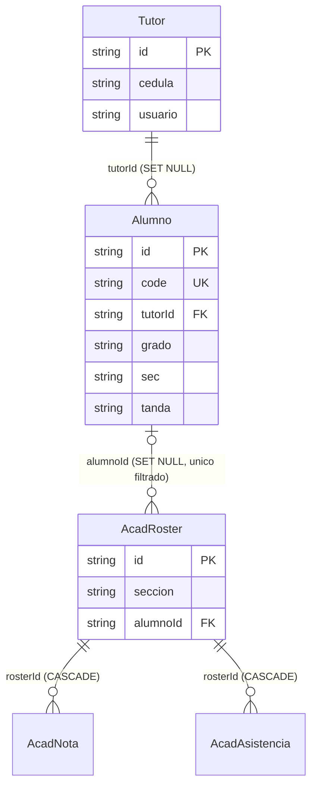
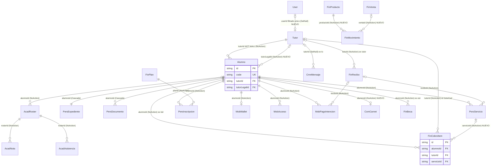

# STODIA - Relaciones de la base de datos: inventario, auditoría y diseño objetivo

> Documento de análisis y diseño (secciones 1-6, estado al 2026-10-08) con el ESTADO DE EJECUCION en 0.1 (Fases 1, 2A, 2B y 2C HECHAS: base completa con todas sus llaves). Las secciones 1-3 describen la base ANTES de las fases. La auditoría (`docs/db-auditoria.sql`) es de solo lectura (únicamente tablas temporales `#...`).
> Base auditada: `stodia` en SQL Server 2025 Express, collation `Modern_Spanish_CI_AI`, fecha de la auditoría: 2026-10-08.
> Reproducir: `sqlcmd -S tcp:localhost,1433 -E -C -d stodia -f 65001 -i docs\db-auditoria.sql -W -s"|" -w 700`

## 0. Resumen ejecutivo

| Hecho | Valor |
|---|---|
| Models Prisma | 37 (la BD tiene 38 tablas: la extra es `sysdiagrams` de SSMS) |
| FK reales | 4: `Alumno.tutorId`, `AcadRoster.alumnoId` (ambas `SET NULL`), `AcadNota.rosterId`, `AcadAsistencia.rosterId` (ambas `CASCADE`). Huérfanos: 0 |
| Referencias lógicas identificadas | 79 (R01-R79, sección 1.8). 73 se comprobaron con SQL (78 comprobaciones en total, contando las 4 FK reales y 2 variantes) |
| Comprobaciones con huérfanos | 19 de 78 |
| Valores huérfanos totales | 4,469, de los cuales 4,196 son de convención/representación (nombre en vez de id, centinelas, claves heredadas) y 273 son datos realmente rotos |
| Vacíos usados como "sin valor" (NULL o `''`) | 1,167 valores (ver 3.3) |
| Diferencias solo por mayúscula/acento | 59 (2 en `Alumno.alg`, 57 en `ComCarnet.allergies`) |
| Catálogos dentro de `Catalogo` (OTLT) | 16 tipos, 336 filas: grados 13, secciones 103, tandas 7, materias 42, rubricas 8, docentes 33, staff 13, aulas 50, cajas 8, rutas 8, becas 11, conceptosBeca 8, metodosPago 8, comidas 4, dietas 8, alergias 12 |
| Campos JSON/CSV/texto con ids o nombres embebidos | ≈25 (relaciones N:M o 1:N escondidas) |
| Esfuerzo estimado | Fase 0 (preparación) 2 días, Fase 1 (FK) 5-6 días, Fase 2 (tablas tipadas) 23-26 días incluidas pruebas, total 30-34 días-persona |

Hallazgos que cambian el diseño (todos verificados en código y datos):

1. `ComCarnet.code` es `EST-<Alumno.id>` (p. ej. `EST-0412`) y NO `Alumno.code` (`EST-2026-0412`). El código `comedor/index.ts:alumnoIdDe()` quita `EST-`; si el lector escanea `EST-2026-0412`, `provisionar()` crea un carnet con `alumnoId = "2026-0412"` (no existe) y el monedero queda desconectado. Es un defecto latente que la FK corregirá.
2. `FinCobroItem.kid` guarda `juan`/`sofia` en 9 filas (alias del prototipo, `lib/personas.ts:kidOf`); el resto guarda `Alumno.id`.
3. `PersExpediente.data` (JSON) contiene el tutor legal (`tutorLegalId`, 797 de 797 fichas), el plan de pago (`contrato.plan` -> `FinPlan.id`), la beca (`contrato.beca`) y el plan de alimentación (`medico.planAlim`, texto libre). Son relaciones reales sin FK.
4. `AcadHorario.materia` está sobrecargada: en filas con `slot = '_aula:<materiaId>'` guarda el id de un AULA, no de una materia.
5. `FinRecibo.items` y `pays` (JSON) no guardan el id del cargo cobrado: 1,382 líneas históricas no se pueden enlazar a `FinCobroItem`.
6. Tres contadores desnormalizados ya divergen de la realidad: `FinPlan.alumnos` (413/58/96 guardado vs 608/77/112 real), `AliPlan.inscritos` (286/94/41/352 vs 0 enlazables), `secciones.insc` (en `sg*`/`s*` varias difieren).
7. `Alumno.grado` es ambiguo: 6 textos de grado (`1ro`..`6to`) existen en dos niveles (Primaria y Secundaria). La sección real se identifica con (grado, sec, tanda) como TEXTO, y 3 alumnos apuntan a secciones que no existen (`3ro|B|Matutina` x2, `4to|C|Matutina` x1).
8. `FinBeca.est` enlaza al alumno por nombre completo, y hay un nombre duplicado en `Alumno` (Estefany Zapata Tavárez): el enlace por nombre ya es potencialmente ambiguo.
9. Prisma + SQL Server NO soporta `onDelete: Restrict`; el equivalente es `NoAction` (en SQL Server `NO ACTION`). Aplica a todo este diseño.
10. El proyecto usa `prisma db push` (sin migraciones). Agregar FK/NOT NULL con filas que no cumplen hace fallar el push; hace falta un procedimiento "expandir -> rellenar -> contraer" (sección 5).

## 0.1 ESTADO DE EJECUCION (actualizado tras la Fase 2C: base completa)

| Fase | Estado | FK reales |
|---|---|---|
| Fase 1 (FK sobre tablas existentes) | **HECHA** | 4 -> 35 |
| **Fase 2A (nucleo academico tipado)** | **HECHA** (esta seccion) | 35 -> **67** (0 no confiables) |
| **Fase 2B (resto de catalogos tipados: cajas, rutas, tipos y conceptos de beca, metodos de pago, comidas, dietas, alergias + puentes)** | **HECHA** (ver «Fase 2B» abajo) | 67 -> **85** (0 no confiables) |
| **Fase 2C (cierre: `Ciclo`/`PeriodoAcademico`/`Matricula`, `TutorAlumno`, `FinReciboItem/Pago`, `ServicioAlumno`, `Monedero`, `FinPlanTanda`, `TipoDocumento`; retiro de `Catalogo`; base del selector de ciclo lectivo)** | **HECHA** (ver «Fase 2C» abajo) | 85 -> **116** (0 no confiables; 76 tablas) |

### Fase 2A: que se hizo (decisiones y desviaciones del diseno 4.2)

- **Tipos de Catalogo que pasan en 2A** (los academicos, y se **quitan de Catalogo**): `grados`, `tandas`, `secciones`, `materias`, `rubricas`, `aulas`, `docentes`, `staff`. **Quedan para 2B**: `cajas`, `rutas`, `becas`, `conceptosBeca`, `metodosPago`, `comidas`, `dietas`, `alergias`.
- **Tablas nuevas (16)** con los MISMOS ids de texto: `Nivel` (Inicial/Primaria/Secundaria, tabla de referencia fija sembrada siempre), `Grado` (UNIQUE nivel+nombre y orden), `Tanda`, `Aula`, `Seccion` (UNIQUE grado+letra+tanda; `cap`; los inscritos se calculan), `Materia` (`rubricaId` opcional), `Rubrica`, `RubricaCriterio` (orden, nombre, peso, `clave` C1-C4/EX), `Docente`, `Empleado`, y los puentes `MateriaGrado`, `SeccionMateria` (plan de estudios con horas), `DocenteMateria`, `DocenteSeccion`, `AsignacionAula`, `AcadExtraGrado`.
- **Relacion con User (una, limpia)**: `Docente.userId` y `Empleado.userId` (FK opcional a `User`, indice unico filtrado cada una) mas `usuario` = usuario PROPUESTO mientras aun no hay cuenta. La API impide que una cuenta sea de un docente y de un empleado a la vez (y de un tutor). Reemplaza el campo de texto `usuario` del JSON. `Empleado.cajaId` sigue siendo referencia logica hasta 2B.
- **Desviacion respecto de 4.2**: `RubricaMateria` no existe; la relacion es `Materia.rubricaId` (una materia tiene UNA rubrica; antes `rubricaDe()` tomaba la primera que la cubria y la API ahora rechaza solaparlas). El aula elegida entre varias posibles vive en `AcadAsignacion.aulaElegidaId` (mismo grano: una asignacion por seccion+materia) en vez de una columna de `AcadHorario`; `AcadHorario` queda limpio (`seccionId`, `materiaId`, `slot`) y desaparecen las filas `_aula:*`.
- **Asignaciones**: `AcadAsignacion(docenteId, seccionId, materiaId)` con FK, UNIQUE(seccion, materia) (que implica UNIQUE(docente, seccion, materia), tambien declarado) y `heredada`: las asignaciones implicitas (`docentes.materias[] x secciones[]`) ya no se calculan al leer: se MATERIALIZAN como filas `heredada = true` al guardar el perfil del docente (`sincronizarAsignaciones`). Rafael Almonte conserva exactamente 3 (5to A, 5to B, 6to A de Matematicas).
- **Alumno**: `Alumno.seccionId` (FK NOT NULL, NoAction) reemplaza `grado/sec/tanda`; el DTO los calcula. `AcadRoster.seccionId`, `AcadNota.materiaId`, `MobNota.materiaId`, `AcadExtra.docenteId/aulaId` (opcionales; el texto `instructor`/`lugar` se conserva para personas/espacios externos) y `AcadExtraGrado` (el texto "4to - 6to" se reconstruye de los grados). El cierre de ciclo (EOY) promueve por seccion (misma letra y tanda del grado siguiente).
- **onDelete**: NoAction para lo academico/historico; Cascade solo hacia el padre "dueño" de un puente puro (`RubricaCriterio`<-Rubrica, `MateriaGrado`<-Materia, `SeccionMateria`<-Seccion, `DocenteMateria/DocenteSeccion`<-Docente, `AsignacionAula`<-AcadAsignacion, `AcadExtraGrado`<-AcadExtra); hacia el catalogo referenciado siempre NoAction. Resultado de las 67 FK: 11 CASCADE, 3 SET NULL, 53 NO ACTION; sin "multiple cascade paths".

### Estado por relacion (inventario R01-R79)

| R | Estado Fase 2A |
|---|---|
| R19 `Tutor.usuario`, R20 `docentes.usuario`, R21 `staff.usuario` | R19 hecha (Fase 1); **R20, R21 hechas** (`Docente.userId`, `Empleado.userId`) |
| R26 secciones.grado, R27 secciones.tanda, R28 secciones.aula | **hechas** (`Seccion.gradoId/tandaId/aulaBaseId`) |
| R29 materias.grados[], R30 rubricas.materias[], R31 docentes.materias[], R32 docentes.secciones[] | **hechas** (`MateriaGrado`, `Materia.rubricaId`, `DocenteMateria`, `DocenteSeccion`) |
| R33 staff.caja | pendiente 2B (`Empleado.cajaId` logica hasta `Caja`) |
| R34 AcadRoster.seccion, R35 AcadNota.materia | **hechas** |
| R36-R38 AcadAsignacion docente/seccion/materia, R39 aulas[] | **hechas** (`AcadAsignacion`, `AsignacionAula`) |
| R40-R42 AcadHorario seccion/materia/aula | **hechas** (la columna sobrecargada desaparece; aula elegida en la asignacion) |
| R43 PersCupo, R44 MobAsistencia | tablas eliminadas en la Fase 1 |
| R45 MobNota.materia (nombre) | **hecha** (`MobNota.materiaId`) |
| R46 Alumno.grado, R47 Alumno.tanda, R48 Alumno (grado,sec,tanda) | **hechas** (`Alumno.seccionId`) |
| R73 AcadExtra.instructor, R74 AcadExtra.grados | **hechas** (`docenteId` opcional, `AcadExtraGrado`) |
| R77 secciones.insc | **hecha** (se calcula con `COUNT(Alumno.seccionId)`) |
| R49-R72, R75, R76, R78, R79 | pendientes (2B/2C) o por diseno sin FK |

### Fase 2B: que se hizo (decisiones)

- **Tipos que migraron y SE QUITAN de Catalogo** (la tabla queda vacia; se elimina en la 2C): `cajas`, `rutas`, `becas`, `conceptosBeca`, `metodosPago`, `comidas`, `dietas`, `alergias`. Con la 2A, `Catalogo` ya no guarda ningun tipo.
- **Tablas nuevas (14)**, con los MISMOS ids de texto: `Caja`, `RutaTransporte`, `TipoBeca` (`pct` en %, `requiereAprobacion`), `ConceptoBeca`, `MetodoPago` (`ref` = etiqueta de la referencia, NULL = no la pide), `Comida`, `Dieta`, `Alergia`, `CategoriaProducto` y los puentes `FinBecaConcepto` (orden de los conceptos), `AliPlanComida`, `AliPlanDieta`, `AlumnoAlergia`, `AliMenuAlergia`. Todas con UNIQUE sobre el nombre/codigo (claves <= 900 bytes) y borrado logico (`estado`); la API `/catalogos` conserva la forma `{id, estado, ...campos}` y ahora tambien sirve `becas`, `metodosPago`, `comidas`, `dietas`, `alergias` (sin pantalla propia en Catalogos: los usan Becas, Cobros y Alimentacion). Eliminar con historial = 409 amistoso con el conteo; el ultimo medio de pago activo no se puede quitar.
- **Columnas nuevas / convertidas**: `Empleado.cajaId` y `FinRecibo.cajaId` -> `Caja`; `FinRecibo.metodoPagoId` -> `MetodoPago` (el medio cuando se cobro con UN solo medio; NULL si el pago es mixto o historico; el detalle por medio sigue en `pays` hasta que la 2C cree `FinReciboPago` con FK a `MetodoPago`); `FinVenta.metodoPagoId` (NOT NULL; `metodo` queda como instantanea); `FinBeca.tipoBecaId` (NOT NULL), `modo` (pct|monto) + `valor` (reemplazan `regla` en texto) y `FinBecaConcepto` (reemplaza `conceptos` en texto); `Contrato.beca` -> `Contrato.tipoBecaId` (FK, NULL = sin beca); `PersServicio.rutaId` -> `RutaTransporte` (cuando `catKey = 'rt:<id>'`; el resto de `catKey` es de la 2C); `FinProducto.cat` -> `FinProducto.categoriaId` -> `CategoriaProducto` (la API sigue devolviendo `cat` como texto).
- **Textos / banderas que desaparecen**: `Alumno.alg` -> `AlumnoAlergia` (el DTO sigue mostrando «Maní, Lactosa»); `ComCarnet.allergies` -> se DERIVA de las alergias del alumno (si un carnet tenia una alergia que el alumno no, se agrego al alumno: no se pierde dato clinico); `AliMenu.algs` -> `AliMenuAlergia`; `AliPlan.meals/diets` (banderas POSICIONALES) -> `AliPlanComida`/`AliPlanDieta` (la API conserva `meals[]`/`diets[]` por posicion del catalogo ACTIVO ordenado por id; las posiciones que faltaban eran `false`: `ALI-002/003` quedaron con las dietas que marcaban explicitamente). No existe dato de «dieta del alumno» en el modelo anterior: no se invento (queda para 2C si se requiere).
- **onDelete**: NoAction hacia todo catalogo; Cascade solo en puentes puros hacia su dueño (`FinBecaConcepto`<-FinBeca, `AliPlanComida/Dieta`<-AliPlan, `AlumnoAlergia`<-Alumno, `AliMenuAlergia`<-AliMenu). Resultado de las 85 FK: 16 CASCADE, 3 SET NULL, 66 NO ACTION; sin «multiple cascade paths».
- **Casos del analisis resueltos**: `Tarjeta` vs `Tarjeta de Credito` (`pays[].m` = nombre exacto de `MetodoPago`; la API traduce `Tarjeta`), nombres de beca (`FinBeca.tipoBecaId` FK), `Solo colegiatura` -> `Colegiatura`, 29+17 alergias sin catalogo (dadas de alta), banderas posicionales de `AliPlan`, `FinMovimiento`/`FinVenta` ya con FK. `ComCarnet.plan` y `PersExpediente.medico.planAlim` (R69, R70) son ETIQUETAS de presentacion («Suscripción completa · Almuerzo»): la relacion real es `ComCarnet.aliPlanId` (FK); no son referencia.
- **Cosas dejadas a la 2C a proposito** (para no estorbar el selector global de **ciclo lectivo**): `FinBeca.periodo` y `Contrato.ciclo` siguen siendo el texto `2026–2027` heredado; NO se agrego ninguna columna de ciclo nueva. La 2C crea `Ciclo` y convierte esos textos en FK (`cicloId`) junto con `FinCobroItem`/`FinRecibo`/`PersInscripcion`, para poder consultar anos anteriores.

### Estado por relacion tras la Fase 2B

| R | Estado Fase 2B |
|---|---|
| R33 `staff.caja` | **hecha** (`Empleado.cajaId` FK) |
| R49 `Alumno.alg`, R50 `ComCarnet.allergies`, R51 `AliMenu.algs` | **hechas** (`AlumnoAlergia`, derivada del alumno, `AliMenuAlergia`) |
| R52 `pays[].m`, R53 `FinRecibo.metodo` | **parcial**: `FinRecibo.metodoPagoId` FK (un solo medio) y nombre exacto en `pays`; el detalle por medio es `FinReciboPago` (2C) |
| R54 `FinVenta.metodo` | **hecha** (`FinVenta.metodoPagoId` FK) |
| R56 `FinBeca.tipo`, R57 `FinBeca.conceptos` | **hechas** (`tipoBecaId`, `modo`/`valor`, `FinBecaConcepto`) |
| R61 `contrato.beca` | **hecha** (`Contrato.tipoBecaId` FK) |
| R68 `PersServicio.catKey` | **parcial**: `rutaId` FK para transporte; las 289 claves heredadas (`com`, `fut`, `lib`...) y `ali:`/`ext:`/`prd:` son 2C (`ServicioAlumno`) |
| R69, R70 | etiquetas de presentacion; la FK real ya existia (`ComCarnet.aliPlanId`) |
| R71 `AliPlan.meals`, R72 `AliPlan.diets` | **hechas** (`AliPlanComida`, `AliPlanDieta`) |
| R76 `AliPlan.inscritos` | hecha en 2A/2B (se calcula con `COUNT(ComCarnet.aliPlanId)`) |
| Pendientes (2C) | R55 `FinRecibo.items` (1,382 lineas historicas), R58 `FinPlan.tm`, R59/R60 `ciclo` como texto, R64 `MobPagoIntencion.detalle`, R65, R23 `CmnMensaje.by` (instantanea), R78 `ComLectura.n`, R79 (polimorfica por diseno) |

### Fase 2C: que se hizo (cierre de la base) — HECHA

Resultado verificado sobre `stodia` (SQL Server): **76 tablas, 116 FK reales** (22 CASCADE, 3 SET NULL, 91 NO ACTION; 0 no confiables; 0 huerfanos), **9 indices unicos filtrados**, **8 CHECK**; `Catalogo`, `PersServicio` y `MobWallet` ya no existen. `docs/db-auditoria.sql` da 0 problemas.

**A. El ciclo lectivo es una ENTIDAD.** `Ciclo` (id estable `cic-2026-2027`, nombre `2026–2027`, `fechaInicio`/`fechaFin` ISO, estado Planificado/Activo/Cerrado; **un solo Activo**: indice unico filtrado `UX_Ciclo_activo`) y `PeriodoAcademico` (hijo de Ciclo: 4 periodos Ago–Oct, Nov–Ene, Feb–Abr, May–Jul con su rango; `orden` 1..4 es la clave `'1'..'4'` de la API). `SisConfig 'ciclos'` desaparece: `/config` sigue devolviendo `ciclos: [{n, estado}]` pero desde la tabla; crear un ciclo crea tambien sus periodos; el **cierre (EOY)** actualiza la tabla (`lib/ciclo-cierre.ts`). Toda base tiene un ciclo activo (`asegurarCicloActivo`: la instalacion crea el del ano en curso, o el de `CICLO_INICIO`/`CICLO_FIN`). Un ciclo Cerrado es de solo lectura para la app (recibos y becas lo rechazan con 409).

| Dato | Pasa a | Por que / criterio |
|---|---|---|
| `Contrato.ciclo` (texto) | `Contrato.cicloId` -> Ciclo (UNIQUE alumno+ciclo) | por ciclo |
| `FinBeca.periodo` (texto) | `FinBeca.cicloId` -> Ciclo | por ciclo |
| `PersInscripcion` | `cicloId` -> Ciclo (UNIQUE alumno+ciclo) | una inscripcion por ciclo |
| `FinCobroItem` | `cicloId` -> Ciclo (derivado de la fecha de vencimiento) | la cartera pendiente exigible es la del ciclo ACTIVO; la deuda de un ciclo cerrado NO entra en morosidad, recaudo del mes ni proyeccion |
| `FinRecibo` | `cicloId` -> Ciclo (ciclo activo al emitir; en migracion, el que contiene `createdAt`) | por ciclo (el recaudo por mes del Centro de Control es por FECHA) |
| `AcadAsignacion`, `AcadHorario` | `cicloId` + UNIQUE por ciclo | asignaciones y horarios cambian cada ano |
| `AcadNota.periodo` ('1'..'4') | `AcadNota.periodoId` -> PeriodoAcademico | el ciclo de la nota sale de su periodo |
| `AcadAsistencia` | **sin FK**: es por fecha (`fecha` ISO); se filtra por el rango del ciclo. Para los ciclos cerrados existe `AsistenciaResumen(matriculaId, periodoId, dias, presentes, tardanzas, ausencias)` | 145 k filas diarias por ano por alumno no se conservan; el resumen es suficiente |
| `AcadRoster`, `PersExpediente` | **sin cicloId**: la nomina es del alumno (se enlaza a la seccion por su Matricula) y la ficha del expediente es una por alumno | el historial por ciclo sale de `Matricula` + `AcadNota` |
| **NO son por ciclo** | catalogos (grados, materias, aulas, tandas, rubricas, cajas, rutas, becas, medios de pago, alergias...), usuarios, licencia, configuracion, auditoria, `FinPlan` (plantilla reutilizable; el ciclo lo fija `Contrato`), `AliPlan`/`AliMenu`/`ComCarnet`/`ComLectura` (comedor vigente), `Monedero` y sus movimientos (por fecha), `ServicioAlumno` (servicio vigente; sus cargos si llevan ciclo), `MobAcceso` | |

**B. Matricula por ciclo.** `Matricula(alumnoId, cicloId, seccionId, estado, fechaIngreso, fechaRetiro)`, UNIQUE(alumno, ciclo), estado Activo / Retirado / Promovido / Repitente / Graduado (CHECK). **Regla**: `Matricula` es la FUENTE de verdad del historial; `Alumno.seccionId` es la copia de la matricula del ciclo ACTIVO y se mantiene con `lib/matricula.sincronizarMatricula` (inscripcion, Directorio, cierre de ciclo, seeds); la auditoria verifica 0 divergencias. **Cierre / promocion**: 6to egresa (`Alumno.estado = Egresado`, matricula Graduado); el resto pasa al grado de `orden` siguiente, misma letra y tanda (matricula anterior Promovido + matricula nueva); sin seccion destino, o alumno Inactivo, repite (anterior Repitente + nueva en la misma seccion); los Retirados conservan su matricula Retirado y no pasan al ciclo siguiente. El historial nunca se pierde. El Expediente 360 (`ficha.hist`) sale de `Matricula` + `AcadNota` (promedio = media de las medias de cada nota; el ciclo activo se muestra parcial con `*`).

**C. Tablas hijas / puente.**

| Tabla (FK) | Reemplaza | Regla |
|---|---|---|
| `TutorAlumno` (alumnoId CASCADE, tutorId NO ACTION; rol Financiero/Legal/Academico; desde, hasta NULL = vigente) | `Alumno.tutorId` / `tutorLegalId` como unica fuente | indices unicos filtrados: UN Financiero y UN Legal vigentes por alumno. FUENTE = TutorAlumno; `Alumno.tutorId`/`tutorLegalId` son su copia vigente (`lib/tutor-alumno.sincronizarTutores`); Academico lo da `Tutor.tipo` |
| `FinReciboItem` (reciboId CASCADE, cobroItemId -> FinCobroItem NULLable, orden, concepto, monto) | `FinRecibo.items` JSON | la API y los PDF devuelven la misma forma `{con, monto, cobroItemId?}`. Las lineas historicas sin cargo (reinscripciones, libros, meses anteriores al vinculo) quedan con `cobroItemId` NULL: **696** en la base migrada del 2B; 510 en la demo regenerada |
| `FinReciboPago` (reciboId CASCADE, metodoPagoId -> MetodoPago, monto, referencia) | `FinRecibo.pays` JSON | forma `{m, r, amt}`; `FinRecibo.metodoPagoId` queda como copia del pago unico (NULL si es mixto) |
| `ServicioAlumno` (= PersServicio): `rutaId`/`aliPlanId`/`extraId`/`productoId` + **CHECK exactamente una no nula** | `PersServicio.catKey` | la API conserva `catKey` (`rt:`/`ali:`/`ext:`/`prd:`), derivado. Claves heredadas (`com`, `fut`, `lib`, `uni0`, `seg`, `sal`): por NOMBRE contra el catalogo; si no existe, el servicio pasa a ser un `FinProducto` de la categoria Servicios (decision registrada en el informe de `fk-fase2c`) |
| `Monedero` (alumnoId PK) + `MonederoMovimiento` (Recarga/Consumo/Ajuste, monto con signo, saldoDespues, intencionId) | `MobWallet` + `ComCarnet.wallet/limit/spent` (doble fuente de saldo) | una sola cuenta por alumno; el consumo de HOY (`spent`) se calcula con los movimientos; todo carnet tiene su monedero |
| `FinPlanTanda` (planId CASCADE, tandaId) | `FinPlan.data.tm` (importe por NOMBRE de tanda) | `tm` = importe anual por tanda del plan; la API lo sigue devolviendo en `tm` |
| `TipoDocumento` (`requerido`, `orden`) + `PersDocumento.tipoId` UNIQUE(alumno, tipo) | `PersDocumento.n` y `SisConfig docsRequeridos` | catalogo de documentos del expediente |
| `MobPagoIntencionCargo` + `MobPagoIntencion.resueltoPorId` -> User | `detalle` JSON y `resueltoPor` texto | R64, R25 |
| `AsistenciaResumen`, `PeriodoAcademico`, `Matricula`, `Ciclo` | — | ver A y B |

**D. `Catalogo` eliminada** del schema, del codigo y de los seeds (las migraciones de 2A/2B solo la LEEN con SQL crudo en bases heredadas: `scripts/fk-comun.catalogo()`); `db push` la elimina de una instancia existente una vez vaciada.

**E. Ciclos de la demo.** `seed-ciclos.ts`: 3 ciclos cerrados (2023–2024, 2024–2025, 2025–2026) + el activo, cada uno con sus periodos. Cada alumno con grado inferior tiene Matricula en los 3 ciclos anteriores (grado inmediato inferior; ~3 % repitentes); los de nuevo ingreso (14 del mes y el grado inicial) no tienen previa. Ciclo 2025–2026 con detalle: contrato, reinscripcion + cuotas del plan (pagadas salvo unos pocos saldos), recibos con lineas y pagos (algunos mixtos), becas, notas finales de los 4 periodos (alumnos con nomina), asistencia resumida y copia de las asignaciones y horarios. Juan Mendoza (0412): 4to A 89.4 / 3ro A 91.2 / 2do A 87.8 exactos desde `AcadNota` + el parcial 83.5 del ciclo activo.

**F. Capa de lectura por ciclo** (`apps/api/src/lib/ciclo.ts`): `cicloDeRequest(req)` (cabecera `X-Ciclo` o `?ciclo=`, id o nombre; por defecto el Activo; 404 si no existe), `cicloIdActivo()`, `periodoId(cicloId, k)`, `cicloPorFecha()`, `cicloEditable()`. **Fase 2D HECHA**: se aplica a los modulos por ciclo (dashboard, directorio, expediente, notas, asistencia, horarios, cobros, planes, becas, tutores, comunica), el selector de la web envia `X-Ciclo` y un hook global rechaza (409 `CICLO_CERRADO`) las escrituras por ciclo sobre un ciclo Cerrado. Detalle, tabla pantalla -> por ciclo y regla de la deuda anterior en `docs/ciclo-lectivo.md`.

### Estado por relacion tras la Fase 2C (cierre)

| R | Estado final |
|---|---|
| R55 `FinRecibo.items` | **hecha** (`FinReciboItem`; 696/510 lineas historicas sin cargo = NULL permitido) |
| R52, R53 `pays[].m`, `metodo` | **hechas** (`FinReciboPago.metodoPagoId` FK; `metodoPagoId` del recibo = copia del pago unico) |
| R58 `FinPlan.tm` | **hecha** (`FinPlanTanda`) |
| R59, R60 ciclo como texto (`Contrato.ciclo`, `PersInscripcion`) y `FinBeca.periodo` | **hechas** (`cicloId` FK; tambien `FinCobroItem`, `FinRecibo`, `AcadAsignacion`, `AcadHorario`, `AcadNota.periodoId`) |
| R62 `PersServicio.recibo`, R67 prefijo `psv-` | FK reales (`ServicioAlumno.reciboId`, `FinCobroItem.servicioId`) |
| R64 `MobPagoIntencion.detalle[]`, R25 `resueltoPor` | **hechas** (`MobPagoIntencionCargo`, `resueltoPorId`) |
| R65 `FinMovimiento.ref` | `ventaId` FK (Fase 1); `ref` = etiqueta visible |
| R68 `PersServicio.catKey` | **hecha** (`ServicioAlumno`: 4 FK + CHECK) |
| R12/R78 `ComCarnet.code`, `ComLectura.n` | `alumnoId` FK; `n`/`name` = instantaneas |
| R03 `MobWallet`, duplicado `ComCarnet.wallet` | **hechas** (`Monedero` + movimientos) |
| R08 `PersDocumento.n`, `docsRequeridos` | **hechas** (`TipoDocumento`) |
| R61 contratos / R18 tutor legal / `Tutor.tipo` | `Contrato.tipoBecaId` FK; `TutorAlumno` (Financiero/Legal/Academico con vigencia) |
| R69, R70 `ComCarnet.plan`, `medico.planAlim` | etiquetas de presentacion (la FK real es `ComCarnet.aliPlanId`) |
| R22 `SisAudit.usr`, R79 `SisAudit.tabla/registro`, R24 `DocFolio.emitidoPor`, R23 `CmnMensaje.by` | **deliberadas** (sin FK): bitacora/folios deben sobrevivir al borrado del usuario o del registro; `CmnMensaje` tiene `userId`/`tutorId` FK y `by`/`to` como instantanea |
| `SisConfig`, `FinCounter` | clave/valor y secuencias sin relaciones |
| `AcadExtra.inscritos`, `Alumno.cuenta`, `AcadExtra.instructor/lugar` | contadores operativos / texto de personas o espacios externos (FK opcionales `docenteId`/`aulaId`); la lista nominal de una actividad esta en `ServicioAlumno.extraId` |

**Referencias logicas que quedan, todas DELIBERADAS**: `SisAudit.usr/tabla/registro`, `DocFolio.emitidoPor`, `CmnMensaje.by/to`, `ComLectura.n`, instantaneas de nombre en recibos/becas/movimientos/cargos/carnets, `SisConfig`, `FinCounter`, `PersExpediente.data` (ficha medica/conducta) y los contadores `AcadExtra.inscritos` y `Alumno.cuenta`. `docs/db-auditoria.sql` seccion D las lista con su motivo; no hay ninguna otra referencia por texto, nombre, posicion o JSON.

### Scripts (Fase 2C)

`scripts/fk-fase2c.ts` (invocado por `fk-reparar --fase2c` o `--auto`): **expandir** (13 tablas con el DDL del schema + 10 columnas NULLables; crea los `Ciclo` desde `SisConfig ciclos` y los nombres usados por `Contrato.ciclo`/`FinBeca.periodo`), **rellenar** (cicloId por texto / fecha de emision / fecha de vencimiento / ciclo activo, `AcadNota.periodoId`, `Matricula`, `TutorAlumno`, lineas y pagos del recibo, `FinPlanTanda`, `TipoDocumento`, `ServicioAlumno`, `Monedero` + consumo del dia, `MobPagoIntencionCargo`), **contraer** (`prisma db push --accept-data-loss`: NOT NULL, FK, UNIQUE; elimina `PersServicio`, `MobWallet`, `Catalogo` y las columnas heredadas) y **verificar**. BLOQUEANTE (exit 3 en `--auto`): ciclo con nombre invalido o mas de un Activo, medio de pago de un recibo inexistente, `tm` con tandas inexistentes, `catKey` hacia un elemento inexistente, documento repetido por alumno, `Catalogo` con filas. Probado: (a) restore de `stodia_fase2b_ok.bak` en una base temporal (SQL Server): 48 pasos, `db push`, 2.ª pasada rc 0, auditoria 0 y las mismas cifras del Centro de Control; (b) SQLite heredado `preview.sqlite.pre-fk.bak` (Fase 0 -> 2C con `--auto`).

### Diagrama ER FINAL (base completa tras la Fase 2C)

Lineas solidas = FK reales (116). Las cardinalidades y reglas ON DELETE estan en el schema (`apps/api/prisma/schema.prisma`) y en la seccion A de `docs/db-auditoria.sql`.

```mermaid
erDiagram
    Ciclo ||--o{ PeriodoAcademico : "CASCADE"
    Ciclo ||--o{ Matricula : ""
    Ciclo ||--o{ Contrato : ""
    Ciclo ||--o{ PersInscripcion : ""
    Ciclo ||--o{ FinBeca : ""
    Ciclo ||--o{ FinCobroItem : ""
    Ciclo ||--o{ FinRecibo : ""
    Ciclo ||--o{ AcadAsignacion : ""
    Ciclo ||--o{ AcadHorario : ""
    PeriodoAcademico ||--o{ AcadNota : ""
    PeriodoAcademico ||--o{ AsistenciaResumen : ""
    Matricula ||--o{ AsistenciaResumen : ""
    Alumno ||--o{ Matricula : "historial por ciclo"
    Seccion ||--o{ Matricula : ""
    Seccion ||--o{ Alumno : "ciclo activo"
    Grado ||--o{ Seccion : ""
    Nivel ||--o{ Grado : ""
    Tanda ||--o{ Seccion : ""
    Aula |o--o{ Seccion : "aula base"
    Tutor ||--o{ TutorAlumno : ""
    Alumno ||--o{ TutorAlumno : "CASCADE"
    Tutor ||--o{ Alumno : "financiero / legal (copia vigente)"
    User |o--o{ Tutor : "portal"
    Alumno ||--o{ FinCobroItem : ""
    Tutor |o--o{ FinCobroItem : ""
    ServicioAlumno |o--o{ FinCobroItem : ""
    Alumno ||--o{ ServicioAlumno : ""
    RutaTransporte |o--o{ ServicioAlumno : "una sola FK (CHECK)"
    AliPlan |o--o{ ServicioAlumno : ""
    AcadExtra |o--o{ ServicioAlumno : ""
    FinProducto |o--o{ ServicioAlumno : ""
    FinRecibo |o--o{ ServicioAlumno : ""
    FinRecibo ||--o{ FinReciboItem : "CASCADE"
    FinCobroItem |o--o{ FinReciboItem : "cargo cobrado (NULL historico)"
    FinRecibo ||--o{ FinReciboPago : "CASCADE"
    MetodoPago ||--o{ FinReciboPago : ""
    MetodoPago |o--o{ FinRecibo : "pago unico"
    Caja |o--o{ FinRecibo : ""
    Tutor |o--o{ FinRecibo : ""
    User |o--o{ FinRecibo : "cajero"
    FinPlan ||--o{ Contrato : ""
    FinPlan ||--o{ PersInscripcion : ""
    FinPlan ||--o{ FinPlanTanda : "CASCADE"
    Tanda ||--o{ FinPlanTanda : ""
    TipoBeca |o--o{ Contrato : ""
    TipoBeca ||--o{ FinBeca : ""
    FinBeca ||--o{ FinBecaConcepto : "CASCADE"
    ConceptoBeca ||--o{ FinBecaConcepto : ""
    Alumno ||--o{ Contrato : ""
    Alumno ||--o{ FinBeca : ""
    Alumno ||--o{ PersInscripcion : ""
    Alumno ||--o| PersExpediente : "CASCADE"
    Alumno ||--o{ PersDocumento : "CASCADE"
    TipoDocumento ||--o{ PersDocumento : ""
    Alumno ||--o| Monedero : ""
    Monedero ||--o{ MonederoMovimiento : ""
    MobPagoIntencion |o--o{ MonederoMovimiento : "recarga"
    Alumno ||--o| ComCarnet : ""
    AliPlan |o--o{ ComCarnet : ""
    AliPlan ||--o{ AliPlanComida : "CASCADE"
    AliPlan ||--o{ AliPlanDieta : "CASCADE"
    Comida ||--o{ AliPlanComida : ""
    Dieta ||--o{ AliPlanDieta : ""
    AliMenu ||--o{ AliMenuAlergia : "CASCADE"
    Alumno ||--o{ AlumnoAlergia : "CASCADE"
    Alergia ||--o{ AlumnoAlergia : ""
    Alergia ||--o{ AliMenuAlergia : ""
    Alumno ||--o{ MobPagoIntencion : ""
    Tutor ||--o{ MobPagoIntencion : ""
    FinRecibo |o--o{ MobPagoIntencion : ""
    User |o--o{ MobPagoIntencion : "resuelto por"
    MobPagoIntencion ||--o{ MobPagoIntencionCargo : "CASCADE"
    FinCobroItem ||--o{ MobPagoIntencionCargo : ""
    Alumno ||--o{ AcadRoster : "SET NULL"
    Seccion ||--o{ AcadRoster : ""
    AcadRoster ||--o{ AcadNota : ""
    AcadRoster ||--o{ AcadAsistencia : ""
    Materia ||--o{ AcadNota : ""
    Materia |o--o{ MobNota : ""
    Alumno ||--o{ MobNota : "CASCADE"
    Docente ||--o{ AcadAsignacion : ""
    Seccion ||--o{ AcadAsignacion : ""
    Materia ||--o{ AcadAsignacion : ""
    AcadAsignacion ||--o{ AsignacionAula : "CASCADE"
    Seccion ||--o{ AcadHorario : ""
    Materia ||--o{ AcadHorario : ""
    Materia ||--o{ MateriaGrado : "CASCADE"
    Grado ||--o{ MateriaGrado : ""
    Seccion ||--o{ SeccionMateria : "CASCADE"
    Docente ||--o{ DocenteMateria : "CASCADE"
    Docente ||--o{ DocenteSeccion : "CASCADE"
    Rubrica ||--o{ RubricaCriterio : "CASCADE"
    Rubrica |o--o{ Materia : ""
    AcadExtra ||--o{ AcadExtraGrado : "CASCADE"
    User |o--o{ Docente : ""
    User |o--o{ Empleado : ""
    Caja |o--o{ Empleado : ""
    CategoriaProducto ||--o{ FinProducto : ""
    FinProducto ||--o{ FinMovimiento : ""
    FinVenta |o--o{ FinMovimiento : ""
    FinVenta ||--o{ FinVentaItem : "CASCADE"
    FinProducto ||--o{ FinVentaItem : ""
    MetodoPago ||--o{ FinVenta : ""
    Tutor |o--o{ CmnMensaje : "SET NULL"
    User |o--o{ CmnMensaje : ""
    Alumno |o--o{ ComLectura : "SET NULL"
    Alumno ||--o{ MobAcceso : ""
```



Tablas sin FK de entrada ni de salida (deliberado): `SisConfig`, `FinCounter`, `SisAudit`, `DocFolio`.

**Modulo fiscal (NCF / e-NCF; `docs/fiscal-ncf.md`)**: `TipoComprobante` (catalogo fijo, id = codigo B01…E47) -> `SecuenciaFiscal` (N:1, NoAction; UNIQUE tipo+modalidad+historica+desde) y `FinRecibo.tipoComprobanteId` / `FinRecibo.secuenciaFiscalId` (FK NoAction, NOT NULL con DEFAULT B02 / secuencia historica B02 para filas creadas fuera de la API). `FinRecibo.ncf` sigue UNIQUE. `FinCounter` ya no numera NCF (solo REC/VTA/ENT/PLN) y `SisConfig 'ncf'` es legado de la migracion. `Tutor.comprobanteHabitual` es un tipo logico en texto (deliberado: es una preferencia, no una referencia).

### Datos corregidos / lineas base

- Linea base verificada antes de empezar (la base ya traia la limpieza de la Fase 1): 810 alumnos (786 Activo / 9 Inactivo / 15 Retirado), 13 grados, 7 tandas, **105 secciones** (el plan decia 103: son 103 + las dos creadas en la Fase 1, `3ro B` y `4to C` Matutina), 42 materias, 8 rubricas, 32 docentes, 13 empleados, 50 aulas, 21 asignaciones explicitas, 788 rosters, 12 notas, 17 actividades.
- Tras la Fase 2A: **106 secciones**. La alumna 0501 (6 años, `1ro A Extendida`) estaba enlazada por TEXTO a la seccion de SECUNDARIA `s5` (`1ro` existe en dos niveles); se crea `s13` (1ro de Primaria, A, Extendida) y se resiembra con ella. En una instancia ya existente `fk-reparar --fase2a` NO la mueve (solo informa): el texto resolvia a un unico candidato.
- Cifras de la demo recalculadas desde las tablas: matricula 786, recaudo del mes 2,015,700 (efectivo 818,650 + banco 1,197,050), morosidad 3,220,455, 14 inscripciones del mes, 2 becas pendientes, 3 asignaciones de Rafael Almonte.
- El docente `d1` Rafael Almonte quedaba con rol `Director Académico` en el catalogo del prototipo mientras su cuenta `usr_ralmonte` es `Docente`: ahora se enlaza por nombre a esa cuenta y el rol visible es el de la cuenta.

### Datos de la demo tras la Fase 2B

Linea base (re-sembrada con los generadores corregidos): 810 alumnos (786 Activo), 560 tutores, **8,780 cargos y 760 recibos** (la linea de la Fase 1 era 8,738 / 737: los generadores de la 2A ya sembraban 8,780 cargos; el SQLite heredado actualizado con `--auto` conserva 8,738 / 737 y su conteo exacto). Cifras exactas: matricula 786; recaudo del mes 2,015,700; morosidad 3,220,455; proyeccion 62,399,666.67; 14 inscripciones del mes; 2 becas pendientes; Rafael Almonte con 3 asignaciones; 120 filas `AlumnoAlergia` (96 alumnos); 85 FK. El reparto efectivo/banco del recaudo es aleatorio por semilla (la suma es la meta).

### Scripts

`scripts/fk-fase2b.ts` (invocado por `fk-reparar --fase2b`/`--auto`): expandir (14 tablas con el DDL de `prisma/schema.prisma` + 8 columnas NULLables), rellenar (Catalogo -> tablas con los mismos ids; alergias faltantes dadas de alta; puentes desde CSV/JSON/banderas; `FinBeca` regla/conceptos; `FinRecibo.metodoPagoId`; rutas; categorias), contraer (`prisma db push --accept-data-loss`) y retirar los 8 tipos de Catalogo. Lo ambiguo (tipo/regla/concepto de beca inexistente, medio de pago desconocido, caja inexistente) = BLOQUEANTE (exit 3 en `--auto`). Probado sobre la base real en SQL Server (restore del respaldo de la 2A), sobre el SQLite heredado `prisma/preview.db` (Fase 0 -> 2B con `--auto`, `foreign_key_check` = 0, 85 FK) y con `db:migrar` a SQL Server (66 tablas verificadas; se corrigio un `INSERT` multifila con IDENTITY que fallaba al mezclar NULL y texto).

`scripts/fk-fase2a.ts` (invocado por `fk-reparar --fase2a`/`--auto`): expandir (crea las tablas con el DDL leido de `prisma/schema.prisma`), rellenar (Catalogo -> tablas con los mismos ids; secciones faltantes; alumnos por nombre; `_aula:*` -> `aulaElegidaId`; asignaciones del perfil; extras; MobNota), contraer (`prisma db push --accept-data-loss`) y retirar los tipos de Catalogo. Probado sobre la base real (restore del respaldo de la Fase 1, SQL Server) y sobre el SQLite anterior a la Fase 1 (camino Docker). `fk-auditar` y `db-auditoria.sql` cubren las 67 FK y las nuevas comprobaciones academicas.

---

## 1. Inventario completo (37 models)

Leyenda de "Enlace HOY": **id** = id interno, **código** = clave natural, **ced** = cédula del tutor, **nombre** = texto con el nombre, **pos** = posición en arreglo, **JSON/CSV** = valor embebido, **prefijo** = prefijo de id, **texto** = texto libre/descriptivo, **FK** = clave foránea real.
Cardinalidad se expresa del lado hijo hacia el padre (1:N significa que un padre tiene muchos hijos).

### 1.1 Núcleo de personas

**User** (51 filas)
| Columna | Referencia destino | Card. | Oblig. | Enlace HOY | Obs. |
|---|---|---|---|---|---|
| `usuario` | es la llave natural que usan Tutor.usuario, docentes.usuario, staff.usuario, SisAudit.usr | 1:1 con Tutor/Docente/Empleado | - | nombre de usuario (texto) | `@unique`. 4 usuarios sin docente/staff/tutor asociado |
| `rol` | catálogo fijo `Rol` (shared) | N:1 | sí | texto | no necesita tabla; usar enum/CHECK |

**Tutor** (561 filas)
| Columna | Referencia destino | Card. | Oblig. | Enlace HOY | Obs. |
|---|---|---|---|---|---|
| `id` (`u1`.., `tg1`..) | referenciada por Alumno.tutorId (FK), PersExpediente.data.tutorLegalId (JSON) | 1:N | - | id | |
| `cedula` | FinCobroItem.tutorCed | 1:N | sí | ced (con guiones en Tutor, solo dígitos en FinCobroItem) | sin UNIQUE; 0 duplicados reales (561 únicos) |
| `nombre` | FinRecibo.tutor, MobPagoIntencion.tutor, CmnMensaje.to | 1:N | sí | nombre | 0 duplicados hoy, pero es texto editable |
| `usuario` | User.usuario | 1:1 | no | nombre de usuario | 557 NULL, 3 apuntan a usuarios que no existen (`a.brito`, `p.mejia`, `r.pena`), 1 válido (`c.mendoza`) |
| `tipo` | "Financiero y académico" / "Financiero" / "Académico" | - | sí | texto | codifica una relación con Alumno dentro del tutor (debería vivir en la relación) |
| `alumnos` (relación) | Alumno.tutorId | 1:N | - | FK | |

**Alumno** (811 filas; 787 Activo, 9 Inactivo, 15 Retirado)
| Columna | Referencia destino | Card. | Oblig. | Enlace HOY | Obs. |
|---|---|---|---|---|---|
| `tutorId` | Tutor.id | N:1 | opcional en schema, 0 NULL | **FK** (SET NULL) | borrar un tutor deja al alumno sin responsable |
| `grado`, `sec`, `tanda` | Catalogo grados/secciones/tandas | N:1 (seccion) | sí | texto (grado.grado, seccion.seccion, tanda.nombre) | 3 alumnos sin sección existente; `grado` ambiguo entre niveles |
| `alg` | Catalogo alergias | N:M | no | CSV de nombres | 120 elementos, 29 sin catálogo (`Penicilina`, `Polen`...) |
| `code` | ComCarnet.code (NO coincide literal) | 1:1 | sí | `@unique`, `EST-2026-0412` | 811 únicos |
| `id` | casi todas las tablas de alumno | 1:N | - | id (`0412`, `1019`) | ver 1.2 |

**Catalogo** (336 filas) - ver 1.3 para las relaciones internas de cada tipo.
| Columna | Obs. |
|---|---|
| `id` | `'<tipo>:<id>'`, p. ej. `secciones:s1`. Los ids internos (`s1`, `g6`, `m1`, `d1`, `a1`) se repiten entre tipos (`metodosPago:m1` vs `materias:m1`): por eso los consumidores filtran siempre por `tipo` |
| `tipo` | discriminador OTLT; `@@index([tipo])` |
| `data` | JSON con todos los campos y las referencias |
| `estado` | duplica `data.estado` |

### 1.2 Tablas que cuelgan de Alumno / Tutor

**MobCargo** (0 filas, DEPRECADA): `alumnoId` -> Alumno.id (N:1, obligatoria, id, sin FK). No se lee ni se siembra. Candidata a eliminar.

**MobNota** (9): `alumnoId` -> Alumno.id (N:1, id, 0 huérfanos); `materia` -> Catalogo materias.nombre (NOMBRE, 2 huérfanos: `Ciencias`, `Lectoescritura`). Fallback del portal cuando no hay `AcadNota`.

**MobWallet** (283): `alumnoId` PK -> Alumno.id (1:1, id, 0 huérfanos). 528 alumnos sin monedero. DUPLICA a `ComCarnet.wallet/limit` (el código intenta mantenerlos sincronizados a mano).

**MobAcceso** (4): `alumnoId` -> Alumno.id (N:1, id). Log de accesos del portal.

**MobAsistencia** (0): `alumnoId` -> Alumno.id y `seccion` -> Catalogo secciones.id (texto de id). Tabla paralela a `AcadAsistencia` (que es la que escribe el pase de lista). `@@unique([fecha, seccion, alumnoId])`. Sin filas.

**MobPagoIntencion** (0): `alumnoId` -> Alumno.id (N:1); `tutor` -> Tutor.nombre (nombre); `detalle` -> JSON de ids de `FinCobroItem` (N:M embebida); `reciboId` -> FinRecibo.id (`''` = sin recibo); `resueltoPor` -> User.usuario (`''` = sin resolver).

**PersExpediente** (797): `alumnoId` PK -> Alumno.id (1:1, id; 14 alumnos sin expediente). `data` (JSON) contiene: `tutorLegalId` -> Tutor.id (N:1, 797 informados, 2 distintos del financiero), `contrato.plan` -> FinPlan.id (N:1, 797), `contrato.beca` -> Catalogo becas.id (`none` en 795, `hermano` en 2), `medico.planAlim`/`planAlimExtra` -> AliPlan.name (texto, 501 sin coincidencia, 296 vacíos), `hist[]`, `conducta.obs[]` (listas propias del alumno), `carnet`, `geo`, `ingreso`, datos médicos.

**PersDocumento** (3,184): `alumnoId` -> Alumno.id (N:1, id, 0 huérfanos). `n` = nombre del documento requerido (lista en `SisConfig.docsRequeridos`, texto).

**PersServicio** (289): `alumnoId` -> Alumno.id (N:1, id). `catKey` -> servicio del catálogo (`rt:<rutaId>` / `ali:<AliPlan.id>` / `ext:<AcadExtra.id>` / `prd:<FinProducto.id>`): relación polimórfica; en los datos hay claves heredadas (`com`, `fut`, `lib`, `sal`, `seg`, `uni0`) que no coinciden con ninguna (289 de 289). `recibo` -> FinRecibo.id (`''` en 287, 2 huérfanos `REC-0389`...). Cargos generados: `FinCobroItem.id = PersServicio.id + '-' + mes` (relación por PREFIJO de id; ningún `psv-*` actual coincide).

**PersInscripcion** (15): `alumnoId` -> Alumno.id (N:1 declarado, debería ser 1:1 por ciclo, id); `plan` -> FinPlan.id (N:1, id, 0 huérfanos); `ncf` (evidencia fiscal, único hoy); `cuotas` derivable.

**PersCupo** (0 filas, SIN USO: el código lo marca "ya no se lee"): `seccion` -> Catalogo secciones.id. Candidata a eliminar.

### 1.3 Referencias internas de `Catalogo` (por tipo)

| Tipo | Campos de `data` | Referencia destino | Card. | Oblig. | Enlace HOY | Huérfanos |
|---|---|---|---|---|---|---|
| grados | nivel, grado, orden | - | - | - | UNIQUE lógico (nivel,grado) y (orden) validado en API | - |
| tandas | nombre, ini, fin | - | - | - | UNIQUE lógico nombre | - |
| aulas | nombre, tipo, edif, pupitres | - | - | - | UNIQUE lógico nombre | - |
| secciones | `grado` | grados.id | N:1 | sí | id | 0 |
| secciones | `tanda` | tandas.id | N:1 | sí | id | 0 |
| secciones | `aula` | aulas.id | N:1 | no | id | 0 |
| secciones | `insc` (contador) | cuenta de Alumno | derivado | - | contador desnormalizado | diverge |
| materias | `grados[]` | grados.id | N:M | sí | **JSON array** de ids | 0 (167 elementos) |
| rubricas | `materias[]` | materias.id | N:M | sí | **JSON array** | 0 (42) |
| rubricas | `crit` ("Tareas 20%, Examen 70%") | criterios y pesos | 1:N | sí | **texto parseado con regex** | - |
| docentes | `materias[]` | materias.id | N:M | no | **JSON array** | 0 (45) |
| docentes | `secciones[]` | secciones.id | N:M | no | **JSON array** (670 elementos) | 0 |
| docentes | `usuario` | User.usuario | 1:1 | sí | nombre de usuario | 0 |
| docentes | `cedula` | - | UNIQUE | sí | UNIQUE lógico | 0 dup |
| staff | `usuario` | User.usuario | 1:1 | sí | nombre de usuario | 0 |
| staff | `caja` | cajas.id | N:1 | no | id (`''` = sin caja en 8 de 13) | 0 |
| cajas | codigo, ubic, ncf | - | - | - | UNIQUE lógico codigo | - |
| rutas | nombre, sectores, chofer, ficha, asientos, tarifa | - | - | - | UNIQUE lógico nombre y ficha; el chofer es texto | - |
| becas | nombre, pct, aprobacion | - | - | - | FinBeca.tipo la referencia por NOMBRE; PersExpediente por id | - |
| conceptosBeca | nombre | - | - | - | FinBeca.conceptos la referencia por NOMBRE concatenado | - |
| metodosPago | nombre, ref | - | - | - | FinRecibo.pays[].m por NOMBRE | - |
| comidas / dietas / alergias | nombre | - | - | - | AliPlan.meals/diets por **POSICIÓN** (orden por id); Alumno.alg y ComCarnet.allergies por NOMBRE | - |

### 1.4 Académico

**AcadRoster** (788: 778 con alumno + 10 heredadas sin alumno): `seccion` -> Catalogo secciones.id (N:1, obligatoria, id, 0 huérfanos); `alumnoId` -> Alumno.id (**FK**, opcional, índice único filtrado `UX_AcadRoster_alumnoId`); `nombre` (copia del nombre del alumno, desnormalizada). 33 alumnos no tienen roster (se crea al primer uso con `materializar`, id `ra-<alumnoId>`).

**AcadNota** (12): `rosterId` -> AcadRoster.id (**FK** CASCADE); `materia` -> Catalogo materias.id (N:1, id, 0 huérfanos); `periodo` ('1'..'4', texto fijo en código `PERIODOS`); `c1..c4, ex` = competencias POSICIONALES que dependen de la rúbrica (`rubricaDe`).

**AcadAsistencia** (3,831): `rosterId` -> AcadRoster.id (**FK** CASCADE); `fecha` texto `YYYY-MM-DD`; `estado` P/T/AJ/AI.

**AcadAsignacion** (21): `docenteId` -> Catalogo docentes.id, `seccionId` -> secciones.id, `materiaId` -> materias.id (todas N:1, obligatorias, id, 0 huérfanos); `aulas` -> JSON de ids de aula (N:M, 13 elementos, 0 huérfanos); `@@unique([seccionId, materiaId])`. Además `todasAsig()` construye asignaciones IMPLÍCITAS multiplicando `docentes.materias[] x docentes.secciones[]` (filtrando por grados de la materia): relación N:M escondida.

**AcadHorario** (28): `seccion` -> secciones.id; `materia` -> materias.id (slot normal) **o aulas.id** (slot `_aula:<materiaId>`, 1 fila); `slot` = `'dia-bloque'` (texto compuesto, p. ej. `0-1`) o `_aula:<materiaId>` (id embebido). `@@unique([seccion, slot])`.

**AcadExtra** (17): `instructor` ("Prof. José Cruz") texto sin relación con `docentes`; `grados` ("4to - 6to") texto de rango; `inscritos` contador sin tabla de inscripciones (no se sabe QUÉ alumno está inscrito).

### 1.5 Finanzas

**FinCobroItem** (8,748; 49.6 M pendientes de 68.4 M): `kid` -> Alumno.id (N:1, obligatoria; 8,739 = id, 9 = alias `juan`/`sofia`); `tutorCed` -> Tutor.cedula solo dígitos (N:1, opcional: 9 NULL, 0 huérfanos); `id` con prefijo `psv-...-<mes>` -> PersServicio.id (N:1 por prefijo, 0 coincidencias hoy); `tipo` (`col`/`com`/`mora`/`srv`/`mat`/`tra`); `al` = texto "Juan · 5to A" (copia); `vence` = `dd/mm/aaaa` texto; `est` derivado en código (no se usa el guardado).

**FinRecibo** (737; 12.2 M activos): `tutor` -> Tutor.nombre (nombre, 0 huérfanos; "Consumidor final" cuando no hay cédula); `items` JSON `[{con, monto}]` (N:M con FinCobroItem SIN id: 1,382 líneas, 0 enlazables; 3 recibos con `[]`); `pays` JSON `[{m, r, amt}]` (`m` -> metodosPago.nombre, 737 líneas, 208 `Tarjeta` vs catálogo `Tarjeta de Crédito`); `metodo` texto derivado (`Mixto` si hay varios); `nc` (nota de crédito) texto; `ncf` UNIQUE de hecho (0 duplicados).

**FinCounter** (7): clave/valor de secuencias (`rec`, `ncf`, `nc`, `b01`, `pln`, `vta`, `ent`). Sin relaciones.

**FinPlan** (4): `data` JSON con `n, freq, anual, desc, start, dia, gracia, moraTipo, moraVal, pronto, porTanda, tm{<nombreTanda>:monto}`: `tm` usa el NOMBRE de la tanda como llave (N:M plan x tanda, 7 elementos, 0 huérfanos); `alumnos` = contador (diverge de la realidad). Es referenciado por `PersExpediente.data.contrato.plan` y `PersInscripcion.plan`.

**FinBeca** (5): `est` -> Alumno por NOMBRE COMPLETO (`nombres + ' ' + apellidos`, 0 huérfanos pero hay un nombre duplicado en Alumno); `grado` copia "5to A"; `tipo` -> becas.nombre (3 de 5 sin coincidencia: `Académica`, `Plan Hermano`); `conceptos` -> conceptosBeca.nombre concatenados con ` · ` (N:M embebida; `Solo colegiatura` no existe como concepto); `regla` = "50%" o "RD$ 2,000.00" (texto: valor y modo mezclados); `periodo` -> ciclo (texto; ciclos viven en `SisConfig.ciclos` JSON); `aprob` texto libre.

**FinProducto** (34): `code` UNIQUE. Sin FK de salida. Referenciado por `FinMovimiento.name` (nombre) y `PersServicio.catKey = 'prd:<id>'`.

**FinMovimiento** (2): `name` -> FinProducto.name (nombre); `ref` -> `FinVenta.id` (Salida) o `ENT-nnnn` (Entrada, sin tabla de entradas): 2 de 2 sin coincidencia (venta `VTA-0088` no existe en `FinVenta`, que tiene 0 filas); `q` cantidad como texto con signo ("−3").

**FinVenta** (0): `metodo` -> metodosPago.nombre (texto); NO guarda las líneas vendidas (productos, cantidades, precios): la venta no se puede reconstruir.

### 1.6 Alimentación, comedor y comunicaciones

**AliPlan** (4): `meals` JSON boolean[4] y `diets` JSON boolean[8] POSICIONALES respecto a los catálogos `comidas` (4) y `dietas` (8) ordenados por id; `diets` de ALI-002/003/004 tiene 4 posiciones, el catálogo 8: **mal alineado hoy**. `inscritos` contador (286/94/41/352) sin tabla de inscripciones. `name` UNIQUE lógico (4).

**AliMenu** (5): `algs` JSON de nombres de alergias (N:M día x alergia, 5 elementos, 0 huérfanos). PK es `orden` (0-4) = día de semana.

**ComCarnet** (504): `code` PK = `EST-<Alumno.id>` (504 de 504 NO coinciden literal con `Alumno.code`; todos resuelven vía regla `alumnoIdDe`); `plan` -> AliPlan.name (texto descriptivo `Suscripción completa · Almuerzo`, `Monedero virtual`, `Sin plan activo`: 504 de 504 sin coincidencia con `AliPlan.name`); `allergies` JSON de nombres en MAYÚSCULAS (74 elementos, 17 sin catálogo, 57 solo por mayúsculas); `name` y `grado` copias de Alumno; `wallet`/`limit` duplican `MobWallet`. 307 alumnos sin carnet.

**ComLectura** (3): `n` = nombre del alumno leído (texto, sin id); log de lecturas.

**CmnMensaje** (7): `to` -> Tutor.nombre (nombre, 0 huérfanos); `by` -> User.usuario (4 de 7 = `usr_sistema`, usuario que no existe); `batch` agrupa envíos (`B<ts>` y sufijo `~r`); `destino` correo resuelto al encolar.

### 1.7 Sistema

**SisAudit** (448): `usr` -> User.usuario (0 huérfanos hoy, pero es un registro histórico: debe sobrevivir al borrado del usuario); `tabla`/`registro` = referencia POLIMÓRFICA por texto (`Alumnos`, `EST-2026-1543/tel`, `REC-G00438`...): no es candidata a FK.
**DocFolio** (0): `emitidoPor` -> User.usuario (`''` por defecto). Folio público de verificación; sin relación con el documento emitido (`detalle` es texto).
**SisConfig** (11): clave/valor JSON (`perfil`, `ciclos`, `ncf`, `ecf`, `finanzas`, `docsRequeridos`, `comedor`, `access`...). `ciclos` (lista con `n`, `estado`) es la referencia que usan `FinBeca.periodo` y `PersExpediente.contrato.ciclo`.

### 1.8 Registro consolidado de referencias lógicas (R01-R79)

Estado: ✔ 0 huérfanos, ⚠ huérfanos de convención/representación, ✖ datos rotos. "Compr." = número de la comprobación en `db-auditoria.sql` (columna `n`).

| R | Hijo.columna | Padre | Card. | Oblig. | Enlace hoy | Compr. | Estado |
|---|---|---|---|---|---|---|---|
| R01 | MobCargo.alumnoId | Alumno.id | N:1 | sí | id | 5 | ✔ (0 filas) |
| R02 | MobNota.alumnoId | Alumno.id | N:1 | sí | id | 6 | ✔ |
| R03 | MobWallet.alumnoId (PK) | Alumno.id | 1:1 | sí | id | 7 | ✔ |
| R04 | MobAcceso.alumnoId | Alumno.id | N:1 | sí | id | 8 | ✔ |
| R05 | MobAsistencia.alumnoId | Alumno.id | N:1 | sí | id | 9 | ✔ (0 filas) |
| R06 | MobPagoIntencion.alumnoId | Alumno.id | N:1 | sí | id | 10 | ✔ (0 filas) |
| R07 | PersExpediente.alumnoId (PK) | Alumno.id | 1:1 | sí | id | 11 | ✔ |
| R08 | PersDocumento.alumnoId | Alumno.id | N:1 | sí | id | 12 | ✔ |
| R09 | PersServicio.alumnoId | Alumno.id | N:1 | sí | id | 13 | ✔ |
| R10 | PersInscripcion.alumnoId | Alumno.id | N:1 (debe ser 1:1/ciclo) | sí | id | 14 | ✔ |
| R11 | FinCobroItem.kid | Alumno.id | N:1 | sí | id + alias `juan`/`sofia` | 15-16 | ⚠ 9 (alias) |
| R12 | ComCarnet.code | Alumno.id (vía `EST-`) | 1:1 | sí | código derivado | 17-18 | ⚠ 504 (literal) |
| R13 | FinBeca.est | Alumno (nombre completo) | N:1 | sí | nombre | 19 | ✔ pero ambiguo (1 duplicado) |
| R14 | FinCobroItem.tutorCed | Tutor.cedula | N:1 | no | ced | 20 | ✔ (9 NULL) |
| R15 | FinRecibo.tutor | Tutor.nombre | N:1 | no | nombre | 21 | ✔ |
| R16 | MobPagoIntencion.tutor | Tutor.nombre | N:1 | sí | nombre | 22 | ✔ (0 filas) |
| R17 | CmnMensaje.to | Tutor.nombre | N:1 | sí | nombre | 23 | ✔ |
| R18 | PersExpediente.data.tutorLegalId | Tutor.id | N:1 | no | JSON | 24 | ✔ |
| R19 | Tutor.usuario | User.usuario | 1:1 | no | usuario | 25 | ✖ 3 |
| R20 | Catalogo docentes.usuario | User.usuario | 1:1 | sí | usuario | 26 | ✔ |
| R21 | Catalogo staff.usuario | User.usuario | 1:1 | sí | usuario | 27 | ✔ |
| R22 | SisAudit.usr | User.usuario | N:1 | sí | usuario | 28 | ✔ |
| R23 | CmnMensaje.by | User.usuario | N:1 | sí | usuario | 29 | ⚠ 4 (`usr_sistema`) |
| R24 | DocFolio.emitidoPor | User.usuario | N:1 | sí | usuario | 30 | ✔ (0 filas) |
| R25 | MobPagoIntencion.resueltoPor | User.usuario | N:1 | no | usuario/`''` | 31 | ✔ (0 filas) |
| R26 | secciones.grado | grados.id | N:1 | sí | id en JSON | 32 | ✔ |
| R27 | secciones.tanda | tandas.id | N:1 | sí | id en JSON | 33 | ✔ |
| R28 | secciones.aula | aulas.id | N:1 | no | id en JSON | 34 | ✔ |
| R29 | materias.grados[] | grados.id | N:M | sí | JSON array | 35 | ✔ |
| R30 | rubricas.materias[] | materias.id | N:M | sí | JSON array | 36 | ✔ |
| R31 | docentes.materias[] | materias.id | N:M | no | JSON array | 37 | ✔ |
| R32 | docentes.secciones[] | secciones.id | N:M | no | JSON array | 38 | ✔ |
| R33 | staff.caja | cajas.id | N:1 | no | id en JSON | 39 | ✔ (8 `''`) |
| R34 | AcadRoster.seccion | secciones.id | N:1 | sí | id | 40 | ✔ |
| R35 | AcadNota.materia | materias.id | N:1 | sí | id | 41 | ✔ |
| R36 | AcadAsignacion.docenteId | docentes.id | N:1 | sí | id | 42 | ✔ |
| R37 | AcadAsignacion.seccionId | secciones.id | N:1 | sí | id | 43 | ✔ |
| R38 | AcadAsignacion.materiaId | materias.id | N:1 | sí | id | 44 | ✔ |
| R39 | AcadAsignacion.aulas[] | aulas.id | N:M | no | JSON array | 45 | ✔ |
| R40 | AcadHorario.seccion | secciones.id | N:1 | sí | id | 46 | ✔ |
| R41 | AcadHorario.materia | materias.id | N:1 | sí | id | 47 | ✔ |
| R42 | AcadHorario.materia (slot `_aula:`) y slot | aulas.id / materias.id | N:1 | - | columna sobrecargada + id en el slot | 48-49 | ✔ (1 fila) |
| R43 | PersCupo.seccion | secciones.id | N:1 | sí | id | 50 | ✔ (0 filas) |
| R44 | MobAsistencia.seccion | secciones.id | N:1 | sí | id | 51 | ✔ (0 filas) |
| R45 | MobNota.materia | materias.nombre | N:1 | sí | nombre | 52 | ✖ 2 |
| R46 | Alumno.grado | grados.grado | N:1 | sí | texto | 53 | ✔ pero ambiguo (6 textos repetidos) |
| R47 | Alumno.tanda | tandas.nombre | N:1 | sí | texto | 54 | ✔ |
| R48 | Alumno (grado,sec,tanda) | secciones | N:1 | sí | texto compuesto | 55 | ✖ 3 |
| R49 | Alumno.alg | alergias.nombre | N:M | no | CSV | 56 | ✖ 29 (+2 por mayúscula) |
| R50 | ComCarnet.allergies[] | alergias.nombre | N:M | no | JSON de nombres | 57 | ✖ 17 (+57 por mayúscula) |
| R51 | AliMenu.algs[] | alergias.nombre | N:M | no | JSON de nombres | 58 | ✔ |
| R52 | FinRecibo.pays[].m | metodosPago.nombre | N:1 | sí | JSON/nombre | 59 | ✖ 208 (`Tarjeta`) |
| R53 | FinRecibo.metodo | metodosPago.nombre | N:1 | sí | texto derivado | 60 | ⚠ 208 (misma causa) |
| R54 | FinVenta.metodo | metodosPago.nombre | N:1 | sí | nombre | 61 | ✔ (0 filas) |
| R55 | FinRecibo.items[] | FinCobroItem.id | N:M | - | JSON sin id | 62 | ⚠ 1,382 (no enlazable) |
| R56 | FinBeca.tipo | becas.nombre | N:1 | sí | nombre | 63 | ✖ 3 |
| R57 | FinBeca.conceptos | conceptosBeca.nombre | N:M | sí | texto con ` · ` | 64 | ✖ 4 |
| R58 | FinPlan.data.tm | tandas.nombre | N:M | - | llaves JSON | 66 | ✔ |
| R59 | PersExpediente.data.contrato.plan | FinPlan.id | N:1 | no | JSON | 67 | ✔ |
| R60 | PersInscripcion.plan | FinPlan.id | N:1 | sí | id | 68 | ✔ |
| R61 | PersExpediente.data.contrato.beca | becas.id | N:1 | no | JSON + centinela `none` | 69 | ⚠ 795 (`none`) |
| R62 | PersServicio.recibo | FinRecibo.id | N:1 | no | id/`''` | 70 | ✖ 2 (287 `''`) |
| R63 | MobPagoIntencion.reciboId | FinRecibo.id | N:1 | no | id/`''` | 71 | ✔ (0 filas) |
| R64 | MobPagoIntencion.detalle[] | FinCobroItem.id | N:M | sí | JSON array | 72 | ✔ (0 filas) |
| R65 | FinMovimiento.ref | FinVenta.id / ENT | N:1 | sí | texto | 73 | ✖ 2 |
| R66 | FinMovimiento.name | FinProducto.name | N:1 | sí | nombre | 74 | ✔ |
| R67 | FinCobroItem.id (prefijo) | PersServicio.id | N:1 | no | prefijo de id | 75 | ✔ (0 coincidencias) |
| R68 | PersServicio.catKey | rutas/AliPlan/AcadExtra/FinProducto | N:1 polimórfica | sí | clave `rt:`/`ali:`/`ext:`/`prd:` | 76 | ⚠ 289 (claves heredadas) |
| R69 | ComCarnet.plan | AliPlan.name | N:1 | no | texto | 77 | ⚠ 504 |
| R70 | PersExpediente.data.medico.planAlim | AliPlan.name | N:1 | no | texto | 78 | ⚠ 501 (+296 vacíos) |
| R71 | AliPlan.meals[] | comidas | N:M | - | POSICIÓN | sección J | ⚠ largo 4 = 4 |
| R72 | AliPlan.diets[] | dietas | N:M | - | POSICIÓN | sección J | ✖ 3 de 4 planes con 4 posiciones frente a 8 |
| R73 | AcadExtra.instructor | docentes.nombre | N:1 | sí | texto "Prof. X" | - | no enlazable |
| R74 | AcadExtra.grados | grados | N:M | sí | texto de rango | - | no enlazable |
| R75 | FinPlan.alumnos | contratos con el plan | contador | - | desnormalizado | J | ✖ 3 de 3 divergen |
| R76 | AliPlan.inscritos | ComCarnet.plan | contador | - | desnormalizado | J | ✖ 4 de 4 divergen |
| R77 | secciones.insc | Alumno de la sección | contador | - | desnormalizado | J | ✖ ~12 de 103 divergen |
| R78 | ComLectura.n | ComCarnet.name / Alumno | N:1 | sí | nombre | - | no enlazable (texto) |
| R79 | SisAudit.tabla + registro | cualquier tabla | N:1 polimórfica | sí | texto | - | por diseño sin FK |

(Los números "Compr." 65 y 8 de la tabla corresponden al orden de ejecución del script; si se añaden comprobaciones el orden cambia, la columna `ref` del resultado es la referencia estable.)

---

## 2. Diagramas ER

### 2.1 Estado ACTUAL - FK reales (líneas sólidas)



### 2.2 Estado ACTUAL - referencias lógicas (líneas punteadas, sin FK)

```mermaid
erDiagram
    Alumno ||..o{ MobWallet : "alumnoId"
    Alumno ||..o{ MobNota : "alumnoId"
    Alumno ||..o{ MobAcceso : "alumnoId"
    Alumno ||..o{ MobPagoIntencion : "alumnoId"
    Alumno ||..|| PersExpediente : "alumnoId (PK)"
    Alumno ||..o{ PersDocumento : "alumnoId"
    Alumno ||..o{ PersServicio : "alumnoId"
    Alumno ||..o{ PersInscripcion : "alumnoId"
    Alumno ||..o{ FinCobroItem : "kid (id o alias juan/sofia)"
    Alumno ||..o| ComCarnet : "code = EST-id"
    Alumno ||..o{ FinBeca : "est (nombre completo)"
    Tutor ||..o{ FinCobroItem : "tutorCed"
    Tutor ||..o{ FinRecibo : "tutor (nombre)"
    Tutor ||..o{ CmnMensaje : "to (nombre)"
    Tutor ||..o{ PersExpediente : "data.tutorLegalId (JSON)"
    User ||..o| Tutor : "usuario"
    User ||..o{ SisAudit : "usr"
    User ||..o| Cat_docentes : "usuario"
    User ||..o| Cat_staff : "usuario"
    PersServicio ||..o{ FinCobroItem : "prefijo de id"
    FinRecibo ||..o{ PersServicio : "recibo"
    FinRecibo ||..o{ MobPagoIntencion : "reciboId"
    FinPlan ||..o{ PersInscripcion : "plan"
    FinPlan ||..o{ PersExpediente : "data.contrato.plan (JSON)"
    FinCobroItem }o..o{ FinRecibo : "items JSON sin id"
    FinCobroItem }o..o{ MobPagoIntencion : "detalle JSON"
    Cat_grados ||..o{ Cat_secciones : "grado"
    Cat_tandas ||..o{ Cat_secciones : "tanda"
    Cat_aulas |o..o{ Cat_secciones : "aula"
    Cat_grados }o..o{ Cat_materias : "grados[] JSON"
    Cat_materias }o..o{ Cat_rubricas : "materias[] JSON"
    Cat_docentes }o..o{ Cat_materias : "materias[] JSON"
    Cat_docentes }o..o{ Cat_secciones : "secciones[] JSON"
    Cat_cajas |o..o{ Cat_staff : "caja"
    Cat_secciones ||..o{ AcadRoster : "seccion"
    Cat_secciones ||..o{ AcadAsignacion : "seccionId"
    Cat_materias ||..o{ AcadAsignacion : "materiaId"
    Cat_docentes ||..o{ AcadAsignacion : "docenteId"
    Cat_aulas }o..o{ AcadAsignacion : "aulas JSON"
    Cat_secciones ||..o{ AcadHorario : "seccion"
    Cat_materias ||..o{ AcadHorario : "materia (o aula si slot _aula:)"
    Cat_materias ||..o{ AcadNota : "materia"
    Cat_secciones ||..o{ Alumno : "grado+sec+tanda (TEXTO)"
    Cat_alergias }o..o{ Alumno : "alg CSV"
    Cat_alergias }o..o{ ComCarnet : "allergies JSON"
    Cat_alergias }o..o{ AliMenu : "algs JSON"
    Cat_comidas }o..o{ AliPlan : "meals POSICION"
    Cat_dietas }o..o{ AliPlan : "diets POSICION"
    AliPlan ||..o{ ComCarnet : "plan (texto)"
    Cat_metodosPago ||..o{ FinRecibo : "pays m (nombre)"
    Cat_becas ||..o{ FinBeca : "tipo (nombre)"
    Cat_conceptosBeca }o..o{ FinBeca : "conceptos (texto)"
    Cat_becas ||..o{ PersExpediente : "contrato.beca (JSON)"
    FinProducto ||..o{ FinMovimiento : "name"
    Cat_rutas ||..o{ PersServicio : "catKey rt:"
```



### 2.3 Estado OBJETIVO - Fase 1 (FK sobre las tablas que ya existen)

Las líneas sólidas son FK nuevas o modificadas. Las referencias a catálogos siguen punteadas hasta la Fase 2.



### 2.4 Estado OBJETIVO - Fase 2 (catálogos tipados y tablas puente)

```mermaid
erDiagram
    Grado ||--o{ Seccion : "gradoId"
    Tanda ||--o{ Seccion : "tandaId"
    Aula |o--o{ Seccion : "aulaBaseId"
    Seccion ||--o{ Alumno : "seccionId (NoAction)"
    Grado ||--o{ MateriaGrado : ""
    Materia ||--o{ MateriaGrado : ""
    Rubrica ||--o{ RubricaMateria : ""
    Materia ||--o{ RubricaMateria : ""
    Rubrica ||--o{ RubricaCriterio : "orden, nombre, peso"
    Docente ||--o{ DocenteMateria : ""
    Materia ||--o{ DocenteMateria : ""
    Docente ||--o{ AcadAsignacion : "docenteId"
    Seccion ||--o{ AcadAsignacion : "seccionId"
    Materia ||--o{ AcadAsignacion : "materiaId"
    AcadAsignacion ||--o{ AsignacionAula : ""
    Aula ||--o{ AsignacionAula : ""
    AcadAsignacion |o--o| Aula : "aulaElegidaId"
    Seccion ||--o{ AcadHorario : "seccionId"
    Materia ||--o{ AcadHorario : "materiaId"
    Seccion ||--o{ AcadRoster : "seccionId"
    Materia ||--o{ AcadNota : "materiaId"
    User |o--o| Docente : "userId filtrado unico"
    User |o--o| Empleado : "userId filtrado unico"
    User |o--o| Tutor : "userId filtrado unico"
    Caja |o--o{ Empleado : "cajaId"
    Caja |o--o{ FinRecibo : "cajaId NUEVO"
    Tutor ||--o{ TutorAlumno : ""
    Alumno ||--o{ TutorAlumno : "rol FINANCIERO o LEGAL o ACADEMICO"
    Alumno ||--o{ AlumnoAlergia : ""
    Alergia ||--o{ AlumnoAlergia : ""
    Alergia ||--o{ AliMenuAlergia : ""
    AliMenu ||--o{ AliMenuAlergia : ""
    AliPlan ||--o{ AliPlanComida : ""
    Comida ||--o{ AliPlanComida : ""
    AliPlan ||--o{ AliPlanDieta : ""
    Dieta ||--o{ AliPlanDieta : ""
    AliPlan |o--o{ ComCarnet : "aliPlanId"
    Alumno ||--o| Monedero : "alumnoId"
    Alumno ||--o| ComCarnet : "alumnoId"
    FinRecibo ||--o{ FinReciboItem : "reciboId"
    FinCobroItem |o--o{ FinReciboItem : "cobroItemId (nulo si historico)"
    FinRecibo ||--o{ FinReciboPago : "reciboId"
    MetodoPago ||--o{ FinReciboPago : "metodoPagoId"
    Ciclo ||--o{ Contrato : "cicloId"
    Alumno ||--o{ Contrato : "alumnoId"
    FinPlan ||--o{ Contrato : "planId"
    TipoBeca |o--o{ Contrato : "becaTipoId"
    FinPlan ||--o{ FinPlanTandaMonto : ""
    Tanda ||--o{ FinPlanTandaMonto : ""
    Alumno ||--o{ FinBeca : "alumnoId"
    TipoBeca ||--o{ FinBeca : "tipoBecaId"
    FinBeca ||--o{ FinBecaConcepto : ""
    ConceptoBeca ||--o{ FinBecaConcepto : ""
    FinVenta ||--o{ FinVentaItem : ""
    FinProducto ||--o{ FinVentaItem : ""
    RutaTransporte |o--o{ PersServicio : "rutaId (una de 4 FK, CHECK)"
```



---

## 3. Auditoría de datos (SQL real sobre `stodia`)

Scripts: `docs/db-auditoria.sql` (78 comprobaciones de referencia, 36 de duplicados, 4 de contadores, 1 de cobertura). La definición de columnas está en el encabezado del script.

### 3.1 Resultado por referencia (solo las que tienen algún hallazgo; las demás: huérfanos 0, ver `Estado ✔` en 1.8)

| Referencia | Total | Huérfanos | Vacíos | Dif. mayús/acento | Ejemplos de huérfanos |
|---|---|---|---|---|---|
| **FK reales** (4) | 3831 / 12 / 788 / 811 | 0 | 0 / 0 / 10 / 0 | 0 | - |
| FinCobroItem.kid -> Alumno.id (crudo) | 8,748 | 9 | 0 | 0 | `juan`, `sofia` |
| FinCobroItem.kid con kidOf -> Alumno.id | 8,748 | 0 | 0 | 0 | - |
| ComCarnet.code -> Alumno.code (literal) | 504 | 504 | 0 | 0 | `EST-0398`, `EST-0412`, `EST-0455`, `EST-0501`, `EST-1001` |
| ComCarnet.code sin `EST-` -> Alumno.id | 504 | 0 | 0 | 0 | - |
| FinCobroItem.tutorCed -> Tutor.cedula | 8,748 | 0 | 9 NULL | 0 | - |
| Tutor.usuario -> User.usuario | 561 | 3 | 557 NULL | 0 | `a.brito`, `p.mejia`, `r.pena` |
| CmnMensaje.by -> User.usuario | 7 | 4 | 0 | 0 | `usr_sistema` |
| staff.caja -> cajas.id | 13 | 0 | 8 `''` | 0 | - |
| AcadRoster.alumnoId -> Alumno.id | 788 | 0 | 10 NULL | 0 | - |
| MobNota.materia -> materias.nombre | 9 | 2 | 0 | 0 | `Ciencias`, `Lectoescritura` |
| Alumno (grado\|sec\|tanda) -> secciones | 811 | 3 | 0 | 0 | `3ro\|B\|Matutina` (2), `4to\|C\|Matutina` (1) |
| Alumno.alg (CSV) -> alergias.nombre | 120 | 29 | 0 | 2 | `Penicilina`, `Polen` |
| ComCarnet.allergies -> alergias.nombre | 74 | 17 | 0 | 57 | `PENICILINA`, `POLEN` (y todas las demás en MAYÚSCULAS) |
| FinRecibo.pays[].m -> metodosPago.nombre | 737 | 208 | 0 | 0 | `Tarjeta` (catálogo: `Tarjeta de Crédito`) |
| FinRecibo.metodo -> metodosPago.nombre | 737 | 208 | 0 | 0 | `Tarjeta` (valor derivado en `cobros/index.ts`) |
| FinRecibo.items[].con -> FinCobroItem.con | 1,382 | 1,382 | 0 | 0 | texto formateado distinto; no hay id |
| FinBeca.tipo -> becas.nombre | 5 | 3 | 0 | 0 | `Académica`, `Plan Hermano` |
| FinBeca.conceptos -> conceptosBeca.nombre | 6 | 4 | 0 | 0 | `Solo colegiatura` |
| PersExpediente.contrato.beca -> becas.id | 797 | 795 | 0 | 0 | `none` (centinela legítimo) |
| PersServicio.recibo -> FinRecibo.id | 289 | 2 | 287 `''` | 0 | `REC-0389`... |
| FinMovimiento.ref -> FinVenta.id | 2 | 2 | 0 | 0 | `ENT-0031`, `VTA-0088` |
| PersServicio.catKey -> servicios | 289 | 289 | 0 | 0 | `com`, `fut`, `lib`, `sal`, `seg`, `uni0` |
| ComCarnet.plan -> AliPlan.name | 504 | 504 | 0 | 0 | `Monedero virtual`, `Sin plan activo`, `Suscripción completa · Almuerzo` |
| PersExpediente.medico.planAlim -> AliPlan.name | 797 | 501 | 296 | 0 | `Suscripción completa · Almuerzo`, `Monedero virtual` |
| FinPlan.data.tm -> tandas.nombre | 7 | 0 | 0 | 0 | - |
| FinBeca.est -> Alumno (nombre completo) | 5 | 0 | 0 | 0 | pero 1 nombre duplicado en Alumno |

Totales (consulta resumen del script): **78 comprobaciones, 19 con huérfanos, 4,469 huérfanos totales, 1,167 vacíos, 59 diferencias por mayúscula/acento**.

Clasificación de los 4,469:
- **Convención/representación (4,196)**: alias `juan/sofia` (9), `ComCarnet.code` literal (504), `usr_sistema` (4), `Tarjeta` duplicado en 2 comprobaciones (208 en `metodo`), `FinRecibo.items` sin id (1,382), centinela `none` (795), `catKey` heredadas (289), `ComCarnet.plan` descriptivo (504), `planAlim` descriptivo (501). No son datos corruptos: son formas distintas de decir lo mismo y se resuelven con una tabla de equivalencias.
- **Datos realmente rotos (273)**: 3 alumnos en secciones inexistentes, 2 `MobNota.materia`, 3 `Tutor.usuario`, 29 alergias de `Alumno.alg` sin catálogo, 17 alergias de `ComCarnet` sin catálogo, 208 `pays.m` = `Tarjeta`, 3 `FinBeca.tipo`, 4 `FinBeca.conceptos`, 2 `PersServicio.recibo`, 2 `FinMovimiento.ref`.

### 3.2 Duplicados que impedirían un UNIQUE (sección I del script)

| Clave candidata | Filas | Grupos duplicados | Veredicto |
|---|---|---|---|
| Alumno.code | 811 | 0 | UNIQUE ya existe |
| Tutor.cedula (solo dígitos) | 561 | 0 | se puede crear UNIQUE (índice sobre columna normalizada; guardar dígitos) |
| Tutor.nombre | 561 | 0 | único hoy pero NO debe usarse como llave |
| Tutor.usuario (no nulo) | 4 | 0 | índice filtrado `WHERE usuario IS NOT NULL` |
| Alumno nombres+apellidos | 811 | **1 grupo (2 filas): Estefany Zapata Tavárez** | NO se puede usar como llave (FinBeca.est) |
| Alumno nombres+apellidos+fnac | 811 | 0 | |
| FinRecibo.ncf / PersInscripcion.ncf | 737 / 15 | 0 | UNIQUE viable (NCF fiscal) |
| PersInscripcion.alumnoId | 15 | 0 | UNIQUE(alumnoId, ciclo) viable |
| AcadRoster.alumnoId (no nulo) | 778 | 0 | índice filtrado ya existe |
| Catálogos: grados(nivel,grado), grados.orden, secciones(grado,seccion,tanda), tandas.nombre, materias.codigo/nombre, rubricas.nombre, docentes.cedula/usuario, staff.usuario, docentes+staff.usuario, aulas.nombre, cajas.codigo, rutas.nombre/ficha, metodosPago.nombre, becas.nombre, conceptosBeca.nombre | todos | 0 | UNIQUE viables en las tablas tipadas |
| **grados.grado SOLO** | 13 | **6 grupos (12 filas)**: `1ro`..`4to`... | por eso `Alumno.grado` (texto) es ambiguo; en la tabla `Grado` la llave es id o (nivel, nombre) |

### 3.3 Vacíos usados como "sin valor" (1,167)

`Tutor.usuario` NULL (557), `PersServicio.recibo` `''` (287), `PersExpediente.medico.planAlim` `''` (296), `staff.caja` `''` (8), `AcadRoster.alumnoId` NULL (10), `FinCobroItem.tutorCed` NULL (9). Además hay defaults `''` en el schema: `MobPagoIntencion.reciboId/resueltoPor/nota`, `DocFolio.emitidoPor`, `PersServicio.recibo/fecha/mes/st`, `CmnMensaje.batch/destino/error`. En SQL Server un `''` en una FK obligaría a una fila padre `''`: al migrar a FK hay que convertir todos los `''` a NULL (y las columnas pasan a opcionales).

### 3.4 Contadores desnormalizados y cobertura

| Control | Guardado | Real |
|---|---|---|
| FinPlan.alumnos PLN-001 / 002 / 003 | 413 / 58 / 96 | 608 / 77 / 112 |
| AliPlan.inscritos ALI-001..004 | 286 / 94 / 41 / 352 | 0 enlazables por nombre |
| secciones.insc (ej.) s1 / s2 / sg13 / sg16 | 28 / 30 / 5 / 22 | 6 / 0 / 4 / 21 |
| AliPlan.diets (largo) vs catálogo dietas (8) | ALI-002/003/004 = 4 | 8 |

| Hueco de cobertura | Alumnos / filas |
|---|---|
| Alumno sin PersExpediente | 14 |
| Alumno sin AcadRoster | 33 |
| Alumno sin MobWallet | 528 |
| Alumno sin ComCarnet | 307 |
| Alumno sin PersInscripcion | 796 (solo 15 pasaron por el wizard) |
| Tutor sin ningún alumno financiero | 1 |
| Expedientes con tutor legal distinto del financiero | 2 |
| FinRecibo con `items = []` | 3 |
| Alumnos activos | 787 (la cifra de referencia del dashboard es 786: recapturar el dashboard ANTES de empezar para fijar la línea base) |

---

## 4. Diseño objetivo

### 4.0 Principios y reglas globales

1. **FK siempre al `id` interno** (cadena estable, nunca editable). Las claves naturales (`Alumno.code`, `Tutor.cedula`, `Materia.codigo`, `Docente.cedula`, `User.usuario`, NCF) llevan `UNIQUE` pero NO se usan como destino de FK: cambian (corrección de cédula, nuevo formato de carnet) y propagarlo en cascada rompe el historial financiero. Motivo: estabilidad. Riesgo: ninguno técnico; hay que cambiar las consultas que hoy buscan por texto.
2. **`onDelete`/`onUpdate` en SQL Server con Prisma**: `Restrict` no existe en SQL Server; usar `NoAction`. `onUpdate: NoAction` en todo (los ids no se editan; `Cascade` en `onUpdate` también produce "multiple cascade paths"). Prisma genera las mismas FK en SQLite (`gen-schema.mjs` solo quita `@db.*`): `NoAction` funciona en SQLite con `PRAGMA foreign_keys=ON` (Prisma lo activa).
3. **Cascada solo** donde la fila hija no tiene valor propio sin el padre: `PersExpediente`, `PersDocumento` (ficha y documentos del alumno), y filas puente (`DocenteMateria`...) respecto de UNO de sus dos padres. Todo lo financiero, fiscal, académico histórico y de auditoría usa `NoAction`.
4. **Rutas de cascada múltiples (SQL Server, error 1785)**: se produce cuando una tabla es alcanzable por cascada desde un mismo origen por dos caminos. Ejemplos reales de este diseño donde está PROHIBIDO usar Cascade: (a) `Seccion -> Alumno` + `Seccion -> AcadRoster` + `Alumno -> AcadRoster`; (b) `Tutor -> Alumno` + `Tutor -> TutorAlumno` + `Alumno -> TutorAlumno`; (c) `Docente -> AcadAsignacion` + `Docente -> DocenteMateria` + `Materia -> AcadAsignacion` + `Materia -> DocenteMateria` si además se cascadea Grado->Materia. Regla adoptada: NINGÚN catálogo cascadea hacia tablas de entidad; los cascades quedan limitados a los dos de Alumno (expediente, documentos) y a los puentes hacia un único padre. Así el grafo de cascada es un bosque y no hay caminos múltiples.
5. **Borrado**: los catálogos y las personas se DESACTIVAN (`estado`) en vez de borrarse (hoy el API ya rechaza borrar catálogos con dependientes y sugiere "Desactívalo"). El borrado físico solo para filas sin dependencias (la FK `NoAction` lo garantiza).
6. **UNIQUE sobre columna opcional en SQL Server = un solo NULL**: se usan índices únicos filtrados (`WHERE col IS NOT NULL`), creados desde `src/lib/db-indices.ts` (patrón existente; ampliar la lista, idempotente en SQL Server y SQLite).
7. Texto `''` como "sin valor" se reemplaza por NULL en toda columna que pasa a ser FK.

### 4.1 FASE 1 - FK sobre tablas que ya existen

Precondiciones de datos (limpieza antes de cada FK; todas son 1-2 sentencias):

| # | FK (hijo.columna -> padre.columna) | Null | onDelete | onUpdate | Motivo / riesgo | Limpieza previa |
|---|---|---|---|---|---|---|
| F01 | Alumno.tutorId -> Tutor.id | NOT NULL (0 NULL hoy) | **NoAction** (hoy SetNull) | NoAction | Un alumno no puede quedar sin responsable financiero; borrar un tutor con alumnos debe fallar. Riesgo: `tutores/index.ts` línea 183-188 hace `tutor.delete`: ya debe bloquear si tiene alumnos | ninguna |
| F02 | Alumno.tutorLegalId (NUEVA) -> Tutor.id | NULL | NoAction | NoAction | Sale de `PersExpediente.data.tutorLegalId` (797 poblados, 0 huérfanos). Reemplaza la lectura de JSON en `tutores/vinculos()` e `inscripcion/lookup()` | backfill desde JSON |
| F03 | AcadRoster.alumnoId -> Alumno.id | NULL | **NoAction** (hoy SetNull) | NoAction | Hoy borrar un alumno deja el roster huérfano con sus notas; con NoAction se obliga a "retirar" | ninguna; mantener índice filtrado `UX_AcadRoster_alumnoId` |
| F04 | AcadNota.rosterId -> AcadRoster.id | NOT NULL | **NoAction** (hoy Cascade) | NoAction | Notas = historial académico con valor propio. Riesgo: cualquier purga de roster debe borrar primero las notas (usar un script controlado) | ninguna |
| F05 | AcadAsistencia.rosterId -> AcadRoster.id | NOT NULL | **NoAction** (hoy Cascade) | NoAction | Idem | ninguna |
| F06 | PersExpediente.alumnoId -> Alumno.id | NOT NULL (PK, 1:1) | **Cascade** | NoAction | Ficha sin valor propio fuera del alumno. Riesgo: `alumnos/eliminar` ya la borra a mano | ninguna (797/797 válidas) |
| F07 | PersDocumento.alumnoId -> Alumno.id | NOT NULL | **Cascade** | NoAction | Checklist de documentos del alumno | ninguna |
| F08 | PersServicio.alumnoId -> Alumno.id | NOT NULL | NoAction | NoAction | Tiene costo y genera cargos | ninguna |
| F09 | PersInscripcion.alumnoId -> Alumno.id | NOT NULL | NoAction | NoAction | Contiene NCF (evidencia fiscal) | ninguna |
| F10 | PersInscripcion.plan -> FinPlan.id (renombrar `planId`) | NOT NULL | NoAction | NoAction | | ninguna |
| F11 | MobWallet.alumnoId -> Alumno.id | NOT NULL (PK) | NoAction | NoAction | Tiene saldo (dinero) | ninguna |
| F12 | MobAcceso.alumnoId -> Alumno.id | NOT NULL | NoAction | NoAction | Log; si se prefiere permitir purga de alumnos de prueba usar Cascade | ninguna |
| F13 | MobNota.alumnoId -> Alumno.id | NOT NULL | Cascade (tabla fallback) | NoAction | Solo si no se elimina la tabla | ninguna |
| F14 | MobPagoIntencion.alumnoId -> Alumno.id | NOT NULL | NoAction | NoAction | Trazabilidad de cobros | ninguna |
| F15 | MobPagoIntencion.tutorId (NUEVA, ex `tutor`) -> Tutor.id | NOT NULL | NoAction | NoAction | | backfill por nombre exacto (0 filas hoy) |
| F16 | MobPagoIntencion.reciboId -> FinRecibo.id | NULL | NoAction | NoAction | `''` -> NULL | `UPDATE ... SET reciboId=NULL WHERE reciboId=''` |
| F17 | **FinCobroItem.alumnoId** (renombra `kid`) -> Alumno.id | NOT NULL | **NoAction** | NoAction | **La FK más importante**: 8,748 cargos / 49.6 M pendientes. Un alumno con cargos NO se puede borrar (solo Retirado). Migración: `juan`->`0412`, `sofia`->`0587` (9 filas), luego renombrar. El API conserva `kid` en las respuestas (capa de compatibilidad) | UPDATE de 9 filas |
| F18 | FinCobroItem.tutorId (NUEVA, ex `tutorCed`) -> Tutor.id | NULL | NoAction | NoAction | Se calcula por cédula (8,739 coinciden, 9 NULL -> tutor del alumno) | backfill por cédula normalizada y por `Alumno.tutorId` |
| F19 | FinCobroItem.servicioId (NUEVA) -> PersServicio.id | NULL | NoAction | NoAction | Sustituye la relación por prefijo de id (`startsWith(sid + '-')`). Hoy 0 coincidencias: backfill best-effort por (alumno, tipo `com`/`srv`/`tra`) y dejar NULL el resto | backfill parcial |
| F20 | FinRecibo.tutorId (NUEVA, ex `tutor`) -> Tutor.id | NULL (NULL = Consumidor final) | NoAction | NoAction | Mantener `tutorNombre` como snapshot del comprobante emitido | backfill por nombre exacto (737/737 coinciden; nombres únicos) |
| F21 | PersServicio.reciboId (ex `recibo`) -> FinRecibo.id | NULL | NoAction | NoAction | `''` -> NULL (287); 2 huérfanos `REC-0389` -> NULL | UPDATE |
| F22 | FinBeca.alumnoId (NUEVA, ex `est`) -> Alumno.id | NOT NULL | NoAction | NoAction | Hoy por nombre completo; hay 1 nombre duplicado: verificar que las 5 becas resuelvan a UN alumno | backfill con comprobación de unicidad; las 5 actuales resuelven |
| F23 | ComCarnet.alumnoId (NUEVA) -> Alumno.id | NOT NULL, UNIQUE | NoAction | NoAction | Se deriva de `REPLACE(code,'EST-','')`; corrige el defecto de `provisionar()` con `EST-2026-0412` (aceptar ambos formatos al escanear: resolver por `Alumno.code` o por `EST-<id>` y guardar `alumnoId`) | backfill (504/504 resuelven) |
| F24 | ComLectura.alumnoId (NUEVA) -> Alumno.id | NULL | SetNull | NoAction | Log, `n` queda como snapshot | opcional |
| F25 | CmnMensaje.tutorId (NUEVA, ex `to`) -> Tutor.id | NULL | SetNull | NoAction | Historial de mensajes; `to` queda como snapshot | backfill por nombre |
| F26 | CmnMensaje.userId (NUEVA, ex `by`) -> User.id | NULL (NULL = sistema) | SetNull | NoAction | `usr_sistema` -> NULL | UPDATE |
| F27 | Tutor.userId (NUEVA, ex `usuario`) -> User.id | NULL + índice único filtrado | SetNull | NoAction | El usuario es solo credencial; borrar un User no borra al tutor. 3 `usuario` huérfanos: crear el User o vaciar la columna (decisión) | limpiar 3 |
| F28 | FinMovimiento.productoId (NUEVA) -> FinProducto.id | NOT NULL | NoAction | NoAction | Hoy por `name` | backfill por nombre |
| F29 | FinMovimiento.ventaId (NUEVA) -> FinVenta.id | NULL | NoAction | NoAction | Entradas de inventario no tienen venta; 2 refs rotos (`VTA-0088`, `ENT-0031`) -> NULL / tabla de entradas | limpiar 2 |
| F30 | FinVentaItem (NUEVA tabla): ventaId -> FinVenta.id (Cascade), productoId -> FinProducto.id (NoAction) | NOT NULL | ver | NoAction | Hoy la venta no guarda líneas; `FinVenta` tiene 0 filas, es el momento barato de corregirlo | ninguna |
| F31 | Contrato (NUEVA tabla): alumnoId, cicloId (-> Ciclo), planId -> FinPlan.id, becaTipoId | ver 4.2 | NoAction | NoAction | Saca `contrato.plan/beca` del JSON de `PersExpediente`. Sin Ciclo tipado (Fase 2) se guarda `ciclo` como texto | backfill desde JSON |

Índices (SQL Server no los crea para FK; todos los hijos necesitan uno): `FinCobroItem(alumnoId, paid)`, `FinCobroItem(tutorId)`, `FinRecibo(tutorId)`, `PersServicio(alumnoId)`, `MobWallet` (PK), `ComCarnet(alumnoId)` UNIQUE, `Alumno(tutorId)`, `Alumno(tutorLegalId)`, `FinBeca(alumnoId)`, `MobPagoIntencion(reciboId)`. Únicos nuevos: `Tutor(cedula)` (guardando dígitos), `FinRecibo(ncf)`, `PersInscripcion(ncf)`, y los filtrados: `Tutor(userId)`, `Tutor(rnc)` si se quiere, `AcadRoster(alumnoId)` (existe).

Sobre `kid` y la clave natural: **la FK apunta a `Alumno.id`**, no a `Alumno.code`. `FinCobroItem.alumnoId` guarda `0412` (no `EST-2026-0412`). Migración en 3 pasos (expand/backfill/contract): (1) añadir `alumnoId NULL`; (2) `UPDATE FinCobroItem SET alumnoId = CASE kid WHEN 'juan' THEN '0412' WHEN 'sofia' THEN '0587' ELSE kid END` y validar 0 NULL; (3) `NOT NULL` + FK + índice + quitar `kid` (el DTO `CobroItem.kid` se alimenta de `alumnoId`; desaparece `kidOf()`).

### 4.2 FASE 2 - Normalizar `Catalogo` y los JSON

Todas las tablas nuevas CONSERVAN los ids de texto actuales (`g6`, `s1`, `m1`, `d1`, `a1`, `t1`, `c1`, `r1`, `e1`...) como PK. Motivo: `AcadAsignacion`, `AcadHorario`, `AcadNota`, `AcadRoster` ya los guardan; así la conversión es solo agregar FK, sin reescribir referencias. Riesgo: ids heterogéneos (`sg14`, `sx-g10-A-t5`); aceptable.

**Estructura académica**

| Tabla | Columnas | Claves / índices | Notas y riesgo |
|---|---|---|---|
| Grado | id PK, nivel (CHECK Inicial/Primaria/Secundaria), nombre, orden, estado | UNIQUE(nivel,nombre), UNIQUE(orden) | resuelve la ambigüedad de `1ro` |
| Tanda | id PK, nombre, ini, fin (hora), estado | UNIQUE(nombre) | |
| Aula | id PK, nombre, tipo (CHECK), edificio, pupitres, estado | UNIQUE(nombre) | |
| Seccion | id PK, gradoId FK Grado, tandaId FK Tanda, aulaBaseId FK Aula NULL, letra, cap, estado | UNIQUE(gradoId,letra,tandaId); IX(gradoId),IX(tandaId),IX(aulaBaseId) | se elimina `insc` (contador): pasa a calcularse con `COUNT(Alumno)`; ver riesgo de la vista del dashboard |
| Materia | id PK, codigo, nombre, horas, estado | UNIQUE(codigo), UNIQUE(nombre) | |
| MateriaGrado | materiaId, gradoId | PK(materiaId,gradoId) | reemplaza `materias.grados[]` (167 filas) |
| Rubrica | id PK, nombre, escala (CHECK), minimo, estado | UNIQUE(nombre) | |
| RubricaMateria | rubricaId, materiaId | PK compuesta | reemplaza `rubricas.materias[]`. `rubricaDe()` toma la PRIMERA activa que cubre la materia: añadir validación "una rúbrica activa por materia" |
| RubricaCriterio | rubricaId, orden, nombre, peso | PK(rubricaId,orden); CHECK suma=100 vía API | reemplaza el texto `crit` ("Tareas 20%, ...") que hoy se parsea con regex; `c1..c4/ex` de `AcadNota` siguen siendo posicionales (Fase 3 opcional: `AcadNotaValor(notaId, criterioId, valor)`) |
| Docente | id PK, nombre, cedula, especialidad, email, userId FK User NULL, estado | UNIQUE(cedula); UNIQUE filtrado(userId) | relación 1:1 opcional con User; `usuario` sale de aquí |
| Empleado | id PK, nombre, cargo, userId FK User NULL, cajaId FK Caja NULL, estado | UNIQUE filtrado(userId) | ex `staff`; los campos extra (`tel`, `email`) ya existen en JSON de algunos |
| DocenteMateria | docenteId, materiaId | PK compuesta | "puede enseñar"; reemplaza `docentes.materias[]` |
| AcadAsignacion (modificar) | docenteId FK, seccionId FK, materiaId FK, aulaElegidaId FK Aula NULL | UNIQUE(seccionId,materiaId) (existe) | las asignaciones IMPLÍCITAS (docentes.materias x secciones) se MATERIALIZAN como filas; se elimina `docentes.secciones[]` y la lógica de herencia de `todasAsig()`. Rafael (d1) debe seguir con 3 asignaciones (s1,s2,s4 x m1) |
| AsignacionAula | asignacionId, aulaId, orden | PK(asignacionId,aulaId) | reemplaza `aulas` JSON; el aula elegida deja de guardarse como fila `_aula:` de `AcadHorario` |
| AcadHorario (modificar) | seccionId FK, materiaId FK, dia (0-4), bloque (0-5) | UNIQUE(seccionId,dia,bloque); CHECK rangos | deja de usar `slot` de texto y de sobrecargar `materia` |
| AcadRoster (modificar) | seccionId FK | IX(seccionId) | |
| AcadNota (modificar) | materiaId FK | UNIQUE(rosterId,materiaId,periodo) (existe) | `periodo` smallint con CHECK 1-4 |
| Alumno (modificar) | seccionId FK Seccion NOT NULL | IX(seccionId) | sustituye `grado/sec/tanda` (texto). Se conservan en el DTO calculados. 3 alumnos hoy sin sección existente: decisión (crear secciones `3ro B Matutina` y `4to C Matutina` o reasignar) |
| Ciclo | id PK, nombre, estado | UNIQUE(nombre) | sale de `SisConfig.ciclos`; lo usan Contrato, FinBeca.periodo |

**Recursos humanos y administración**: `Caja` (id, codigo UNIQUE, ubic, ncfDefecto, estado) + `FinRecibo.cajaId` NULL (nuevo: hoy no se sabe en qué caja se cobró) + `FinRecibo.cajeroId` FK User NULL. `RutaTransporte` (id, nombre UNIQUE, sectores, chofer, ficha UNIQUE, asientos, tarifa, estado). Riesgo: el chofer es texto; entidad `Chofer` opcional, fuera de alcance.

**Finanzas y becas**: `MetodoPago` (id, nombre UNIQUE, requiereRef, estado), `TipoBeca` (id, nombre UNIQUE, pct, requiereAprobacion), `ConceptoBeca` (id, nombre UNIQUE).
- `FinReciboItem` (id, reciboId FK Cascade, cobroItemId FK NULL NoAction, concepto, monto): para los 1,382 elementos históricos `cobroItemId` queda NULL y `concepto` conserva el texto. Cascade desde el recibo está bien SOLO porque los recibos no se borran nunca (se anulan con NC, `est='Anulado'`); además FinRecibo nunca tendrá DELETE en el API. Alternativa más estricta: NoAction y sin DELETE.
- `FinReciboPago` (id, reciboId FK, metodoPagoId FK, referencia, monto). Normaliza los 208 `Tarjeta` -> `Tarjeta de Crédito` con una tabla de equivalencias explícita (o mapear a un método nuevo "Tarjeta" si el cliente lo prefiere: decisión).
- `FinRecibo.metodo` se elimina (derivable: 1 pago = su método, varios = "Mixto").
- `FinBeca`: `alumnoId`, `tipoBecaId` FK, `cicloId` FK, `modo` (PCT/MONTO) + `valor` decimal (reemplaza `regla` texto), `expedienteSoporte`, `estado`, `aprobadoPorUserId` FK NULL + `aprobadoEn`; `FinBecaConcepto(becaId, conceptoBecaId)` reemplaza `conceptos` (6 elementos; `Solo colegiatura` -> concepto `Colegiatura`).
- `FinPlan`: columnas `cuotas`, `frecuencia`, `montoAnual`, `descuentoPct`, `mesInicio`, `diaVence`, `diasGracia`, `moraTipo`, `moraValor`, `prontoPct`, `prontoDia`, `porTanda` + `FinPlanTandaMonto(planId, tandaId, monto)` en lugar de `data.tm`. `FinPlan.alumnos` se elimina (contador) y se calcula con `COUNT(Contrato)`.
- `Contrato` (alumnoId, cicloId, planId, becaTipoId NULL, numero `ctr`, firmadoEn): UNIQUE(alumnoId,cicloId). Sale de `PersExpediente.data.contrato`. `PersInscripcion` se reduce a evidencia fiscal (ncf, factura, firma) con FK a Contrato.
- `FinCobroItem`: `tipo` -> CHECK; `vence` -> DATE (Fase 3 opcional); `al` (texto copia) se elimina o se llena por vista.
- `FinVenta` + `FinVentaItem`; `FinMovimiento` con FK (Fase 1).
- `ServicioAlumno` (ex `PersServicio`): `catKey` polimórfico -> cuatro FK anulables `rutaId`, `aliPlanId`, `extraId`, `productoId` con `CHECK (exactly one)`; las claves heredadas (`com`, `fut`, `lib`, `sal`, `seg`, `uni0`) se mapean a mano (ver decisiones).

**Personas y tutores**: `TutorAlumno` (alumnoId, tutorId, rol CHECK FINANCIERO/LEGAL/ACADEMICO, desde, hasta) PK(alumnoId,tutorId,rol): resuelve el N:M real (un tutor puede ser legal de uno y financiero de otro; `Tutor.tipo` deja de ser verdad única). Índice único filtrado `UX_Financiero_Alumno (alumnoId) WHERE rol='FINANCIERO' AND hasta IS NULL` (un financiero vigente por alumno) si el usuario decide "solo uno" (decisión 4). `Alumno.tutorId`/`tutorLegalId` de la Fase 1 se mantienen como columnas de conveniencia o se reemplazan por la vista. Riesgo: reescribir `tutores/index.ts` y `inscripcion`.

**Alimentación**: `Comida`, `Dieta`, `Alergia` (id, nombre UNIQUE, estado). `AliPlanComida(planId, comidaId)`, `AliPlanDieta(planId, dietaId)` reemplazan las banderas POSICIONALES (`meals`, `diets`); como los 3 planes con 4 posiciones frente a 8 dietas ya están desalineados, la migración tiene que decidir la semántica (decisión 7: se asume que posición i = dieta i por orden de id y las posiciones faltantes = false). `AlumnoAlergia(alumnoId, alergiaId)` reemplaza `Alumno.alg` (CSV; las 29 alergias sin catálogo: crear en `Alergia` con estado Activo y agregar a la tabla) y `ComCarnet.allergies` (que pasa a derivarse). `AliMenuAlergia(menuOrden, alergiaId)` reemplaza `AliMenu.algs`. `Monedero(alumnoId PK/FK, saldo, limite)` fusiona `MobWallet` y las columnas `wallet/limit` de `ComCarnet` (hoy dos fuentes de verdad). `ComCarnet(alumnoId PK/FK, aliPlanId FK NULL, habilitado, motivo, restriccion, consumidoHoy)`; `name`, `grado`, `plan` (texto) y `allergies` se derivan. `AliPlan.inscritos` se calcula con `COUNT(ComCarnet)`. `AcadExtra`: `docenteId` NULL (instructor interno), `instructorTexto`, `gradoDesdeId`/`gradoHastaId` FK Grado (en lugar de "4to - 6to") y `AcadExtraInscripcion(extraId, alumnoId)` que reemplaza el contador `inscritos`.

**Sistema**: `SisAudit.usr` queda como texto (registro inmutable, debe sobrevivir al usuario; opcional `userId` con SetNull). `SisAudit.tabla/registro` polimórficos por diseño. `DocFolio.emitidoPor` -> `userId` NULL SetNull. `SisConfig` (clave/valor JSON) se mantiene; solo se extrae `ciclos` a `Ciclo`.

**Tablas a eliminar**: `MobCargo` (deprecada, 0 filas), `PersCupo` (sin uso, 0 filas), `MobAsistencia` (paralela a `AcadAsistencia`, 0 filas; antes confirmar que `movil/index.ts` la lee solo como complemento), `Catalogo` (al final). `MobNota` (9 filas): migrar a `AcadNota` o mantener con `materiaId` FK (decisión 8).

**UNIQUE sobre opcionales (índices filtrados, a añadir en `db-indices.ts`)**: `Tutor(userId)`, `Docente(userId)`, `Empleado(userId)`, `Tutor(rnc)` opcional, `UX_Financiero_Alumno` (si aplica), `Docente(cedula)` normal (obligatoria).

### 4.3 Decisiones de diseño con motivo y riesgo (resumen)

| Decisión | Motivo | Riesgo |
|---|---|---|
| FK al id interno + UNIQUE en clave natural | estabilidad del historial financiero | consultas por cédula/código siguen existiendo vía índice |
| NoAction en todo lo financiero/académico | no perder recibos, cargos ni notas | borrar de verdad exige una purga explícita; para datos de demo hay que ofrecer un script de reseteo en orden inverso de FK |
| Cascade solo en PersExpediente/PersDocumento/puentes | hijos sin valor propio | la ruta de cascada única evita el error 1785 |
| Conservar ids de texto de los catálogos | cero reescritura de AcadAsignacion/Horario/Nota | ids no uniformes |
| Materializar asignaciones implícitas | elimina una N:M escondida y una lógica de herencia | cambiar `todasAsig()` y la pantalla de asignaciones |
| `Alumno.seccionId` en lugar de grado/sec/tanda | seccion única e inequívoca; nómina y cupo salen de un `WHERE` | las pantallas de Directorio/Inscripción editan grado/sec/tanda: pasan a elegir sección; cambios en `directorio`, `inscripcion`, `academico.nomina`, `comunica`, `cobros` |
| Expand/backfill/contract con scripts SQL | `db push` no soporta backfill | más pasos; se mitiga con scripts idempotentes y verificación por conteo |

---

## 5. Impacto en el código, orden y estrategia de pruebas

### 5.1 Qué cambia, por Fase

**Fase 1 (FK)**

| Área | Cambio |
|---|---|
| `prisma/schema.prisma` | relaciones con `@relation(... onDelete: NoAction, onUpdate: NoAction)`, columnas nuevas (`tutorLegalId`, `alumnoId`, `tutorId`, `servicioId`, `userId`), índices; `gen-schema.mjs` no cambia (solo quita `@db.*`), pero SQLite generado debe probarse (prisma db push con `foreign_keys=ON`) |
| `lib/db-indices.ts` | añadir índices filtrados (`Tutor(userId)`, etc.) |
| `lib/personas.ts` | eliminar `kidOf()` (cambia `cobros`, `movil`, `expediente`, `tutores`, `dashboard`, `cxc`) |
| `lib/cxc.ts` | `kid` -> `alumnoId` (`cxcResumen`, `vencidoPorKid`, `cuentaDerivada`, `saldoVencidoPorAlumno`) |
| `modules/cobros` | `procesar`: guardar `tutorId` en `FinRecibo`; `kid` -> `alumnoId`; la búsqueda por cédula usa `tutorId`; `toItem` conserva `kid` en la respuesta |
| `modules/expediente` | servicios: crear `FinCobroItem` con `alumnoId`, `servicioId`; baja de servicio por `servicioId` en lugar de `startsWith(sid + '-')`; contrato: `Contrato` en vez de JSON |
| `modules/inscripcion` | escribir `tutorLegalId`, `alumnoId`; ya usa `$transaction` |
| `modules/tutores` | `vinculos()` deja de parsear `PersExpediente.data`; `usuario` -> `userId`; bloquear borrado con alumnos |
| `modules/movil`, `comedor`, `comunica`, `becas`, `kiosko`, `directorio` | cambios menores de columnas; `comedor.provisionar` resuelve `Alumno` por `code` o `EST-<id>` y guarda `alumnoId` |
| Seeds (`seed.ts`, `seed-operacion.ts`, `seed-demo-grande.ts`, `seed-personas`, `seed-finanzas`, `seed-academico`) | insertar en orden de FK; `kid` -> `alumnoId`; sembrar `tutorLegalId`; limpiar `''` por NULL |
| `scripts/migrar-sqlite-a-sqlserver.ts` | `ordenar()` ya deriva el orden de las FK del schema (ahora habrá más aristas). Hay que añadir una etapa de TRANSFORMACIÓN para el SQLite viejo (`preview.db` no tiene `alumnoId`, `tutorId`...); mantener una versión congelada del script para el esquema antiguo y un segundo script SQL de actualización |
| `packages/shared` | `CobroItem`, `ReciboFin`, `BecaFin`... campos añadidos; tipos de DTO sin cambios visibles mientras se conserve la forma de respuesta |
| Web | sin cambios obligatorios (la capa de compatibilidad conserva `kid` en las respuestas) |

**Fase 2 (tablas tipadas)**

| Área | Cambio |
|---|---|
| `modules/catalogos/index.ts` | pasa a una capa de compatibilidad: `GET /catalogos`, `GET/POST/PUT/DELETE /catalogos/:tipo/:id` y `/acceso` conservan la forma `{id, estado, ...campos}` (mapeo por tipo a las tablas nuevas: `docentes.materias[]` se arma desde `DocenteMateria`, etc.). `DEFS`/`validate`/`deps()` se reescriben: `deps()` ya no recorre JSON, usa la FK (error 547 -> mensaje 409) |
| `lib/academico.ts` | `loadCat()` lee tablas; `todasAsig()` deja de calcular implícitas; `nomina()` -> `WHERE seccionId`; `rubricaDe()` lee `RubricaCriterio` |
| `lib/ali-catalogos.ts` | `catalogosAli()` lee `Comida/Dieta/Alergia`; `AliPlan.meals/diets` -> puentes |
| `lib/pers-fin.ts` | `becasCatalogo()`, `catalogoServicios()`, `planesPago()` leen tablas |
| `modules/planes`, `becas`, `inscripcion` (`cargarCupos`), `horarios`, `notas`, `asistencia`, `movil` (lista y portal), `alimentacion`, `comedor`, `extra`, `dashboard` (`rosterN`, `secciones`), `expediente`, `directorio` | consultas por FK; se eliminan los `JSON.parse` de `Catalogo` |
| Seeds (`seed-catalogos.ts`, `seed-academico.ts`, etc.) | sembrar tablas tipadas (mismos ids) |
| `migrar-sqlite-a-sqlserver.ts` | tabla `Catalogo` desaparece del destino: hace falta una etapa que expanda `Catalogo` del origen a las tablas tipadas (reutilizable con el script de migración de datos de la propia BD) |
| `packages/shared` | `CatalogoTipo` y los tipos `Grado`, `Seccion`... ya existen: se reutilizan como DTO; `AcadCatalogos` (record genérico) se mantiene como forma de respuesta |
| Web (`screens/catalogos/*`, `components/personas/ref.ts`, `components/finanzas/caja.ts`, `screens/planes`, `screens/becas`, `AsigSelect`) | sin cambios mientras `GET /catalogos` conserve la forma. Cambios opcionales: selector de sección en lugar de grado/sec/tanda en Directorio/Inscripción; pantalla de tutores con múltiples roles |

### 5.2 Estimación de esfuerzo (días-persona, un desarrollador)

| Fase | Contenido | Días |
|---|---|---|
| 0 | Respaldo y línea base (scripts de conteo, captura de dashboard, humo de 6 roles), decidir `prisma migrate` vs `db push`, resolver las decisiones de la sección 6 | 2 |
| 1A | Limpieza de datos (9 alias, 2 `recibo`, 2 `FinMovimiento`, 3 `Tutor.usuario`, `''` -> NULL) + columnas nuevas (expandir) + backfill | 1.5 |
| 1B | FK + índices + cambios de código (`kidOf`, `cxc`, `cobros`, `expediente`, `tutores`, `comedor`) + seeds | 3 |
| 1C | Pruebas y migración SQLite | 1 |
| 2A | Estructura académica (Grado..Seccion..Materia..Rubrica..Docente..Empleado..Caja..Ruta) + capa de compatibilidad de `/catalogos` | 7-8 |
| 2B | Finanzas (Contrato, FinPlan, FinBeca, FinReciboItem/Pago, FinVentaItem, ServicioAlumno) | 6-7 |
| 2C | Alimentación/comedor (Alergia, puentes, Monedero, ComCarnet) + TutorAlumno + AcadExtraInscripcion | 5-6 |
| 2D | Eliminación de `Catalogo`/`MobCargo`/`PersCupo`/`MobAsistencia`, limpieza, documentación | 2 |
| Pruebas transversales | humo de 6 roles por cada paso, comparación de cifras | 3 |
| **Total** | | **30-34** |

Fase 1 por sí sola: ~6 días y aporta el 80% del valor de integridad (todo lo financiero y de alumnos queda protegido). Fase 2 es la restructuración "limpia" pero con mayor superficie de cambio.

### 5.3 Orden recomendado SIN romper la app (expandir -> migrar -> contraer)

1. **Respaldo** y línea base (5.4). Rama de trabajo aparte.
2. **Fase 1**, un FK/tabla por PR:
   a. Limpiar datos (scripts idempotentes con verificación `SELECT` de 0 huérfanos).
   b. EXPANDIR: `db push` añade columnas NUEVAS NULLABLE (no rompe nada; el código viejo las ignora).
   c. BACKFILL por SQL (`UPDATE ... FROM`) + verificación de conteos.
   d. Cambiar el código para escribir ambas columnas (doble escritura) y leer de la nueva.
   e. CONTRAER: `NOT NULL`, crear FK e índices (`db push` o SQL `ALTER TABLE ... WITH CHECK`), retirar la columna vieja (`kid`, `tutorCed`, `tutor`, `est`...).
3. **Fase 2**:
   a. Crear las tablas tipadas VACÍAS y poblarlas desde `Catalogo` con el mismo id (`INSERT ... SELECT ... FROM OPENJSON`), `Catalogo` intacta.
   b. Capa de compatibilidad en `modules/catalogos`: lee/escribe las tablas nuevas y devuelve la misma forma. A partir de aquí la web no cambia.
   c. Migrar módulos de UNO en UNO a las tablas/FK (orden sugerido: `catalogos` -> `lib/academico` (notas, asistencia, horarios) -> `inscripcion`/`planes`/`becas` -> `alimentacion`/`comedor`/`movil` -> `expediente`/`tutores`/`directorio`). Cada paso con humo de roles.
   d. Cambiar `Alumno.grado/sec/tanda` por `seccionId` en último lugar de la parte académica (es el cambio con más superficie).
   e. Quitar `Catalogo` y las tablas muertas solo cuando `grep prisma.catalogo` no encuentre usos.
4. Cada paso termina con la verificación de 5.4; si falla, restaurar el respaldo de ese paso.

### 5.4 Estrategia de pruebas

**Línea base antes de empezar** (guardar la salida):
- Conteos por tabla (los de la sección 0 y `SELECT name,rows FROM sys.partitions`): Alumno 811, Tutor 561, FinCobroItem 8,748, FinRecibo 737, PersExpediente 797, PersDocumento 3,184, AcadRoster 788, AcadAsistencia 3,831, AcadNota 12, AcadAsignacion 21, Catalogo 336...
- Sumas de control: `SUM(FinCobroItem.monto)` = 68,357,775.00 (pendiente 49,648,875.00), `SUM(FinRecibo.monto WHERE est='Activo')` = 12,215,700.00.
- Cifras del dashboard (`GET /dashboard`): matrícula 786 (hoy la BD tiene 787 Activo: recapturar y documentar la diferencia antes de empezar), morosidad 2,015,700, proyección 3,220,455, `alumnosEnMora`, `becasPendientes`. Deben quedar idénticas tras cada paso.
- Rafael Almonte (`usr_almonte`, docente `d1`): 3 asignaciones (s1, s2, s4 x m1); matriz de notas y horario de esas secciones sin cambios.
- Humo de los 6 roles (Super Admin, Director Académico, Docente, Cajero, Encargado Comedor, Tutor): login, abrir cada pantalla permitida (`access.ts`), un cobro POS de prueba con anulación, una inscripción de prueba, pase de lista, portal del tutor con sus hijos y cargos.
- Re-ejecutar `docs/db-auditoria.sql` tras cada paso: los huérfanos de las referencias ya convertidas deben ser 0 y las FK reales deben crecer de 4 a N (`SELECT COUNT(*) FROM sys.foreign_keys`).

**Verificación de FK**: `ALTER TABLE ... WITH CHECK CHECK CONSTRAINT ALL` y `DBCC CHECKCONSTRAINTS WITH ALL_CONSTRAINTS` deben devolver 0 filas. Comprobar las rutas de cascada con un `DELETE` de un alumno de prueba sin historial (debe borrar expediente y documentos) y otro CON cargos (debe fallar con el error 547, y el API debe traducirlo a 409 en español).

### 5.5 Respaldo y reversa (los ejecuta el usuario; NO se hicieron en esta tarea)

```sql
-- 1) Carpeta con permiso para el servicio SQL (en esta máquina corre como NT Service\MSSQL$SQLEXPRESS):
--    C:\Users\Public\Documents\stodia-backups   (crear la carpeta; todos los usuarios ya tienen escritura en Public)
BACKUP DATABASE stodia
  TO DISK = N'C:\Users\Public\Documents\stodia-backups\stodia_pre_fase1_20261008.bak'
  WITH COPY_ONLY, CHECKSUM, INIT, STATS = 10;       -- Express puede no admitir COMPRESSION; no lo uses si falla
RESTORE VERIFYONLY FROM DISK = N'C:\Users\Public\Documents\stodia-backups\stodia_pre_fase1_20261008.bak' WITH CHECKSUM;
-- Reversa:
-- ALTER DATABASE stodia SET SINGLE_USER WITH ROLLBACK IMMEDIATE;
-- RESTORE DATABASE stodia FROM DISK = N'...\stodia_pre_fase1_20261008.bak' WITH REPLACE;
-- ALTER DATABASE stodia SET MULTI_USER;
```
- Un respaldo `.bak` ANTES de cada fase y de cada paso de la Fase 2 (nombres `pre_fase1`, `pre_fase2a`, ...).
- El SQLite viejo `apps/api/prisma/preview.db` y `dev.db` se conservan SIN modificar como fuente de rollback lógico (con el schema antiguo en el commit anterior). Ojo: `preview.db` NO tiene las columnas nuevas; si hay que volver al esquema viejo se usa el `.bak`, no `preview.db`.
- Para el camino SQLite/Docker: `npm run db:push:sqlite` genera el esquema SQLite desde el mismo `schema.prisma`; probar el arranque limpio (schema + seed) ANTES de fusionar cada Fase.
- Ramas: cada Fase en su rama; el respaldo y el commit anterior son la reversa completa. Un `prisma db push` NO es reversible por sí solo.

### 5.6 Riesgos transversales

1. `prisma db push` con datos: añadir columnas NOT NULL o FK con filas incompatibles falla o pide `--accept-data-loss`. Mitigación: expandir con columnas NULL y contraer solo tras el backfill (5.3). Evaluar adoptar `prisma migrate` (baseline + `resolve`) antes de la Fase 2.
2. Doble escritura temporal: durante 1B/2 el código escribe columna vieja y nueva; hay que quitar la vieja en el mismo ciclo para no dejar deuda.
3. `kidOf()` en tests/seeds: cualquier script externo que cree `FinCobroItem` con `kid` corto dejará de funcionar.
4. Contadores (`insc`, `inscritos`, `alumnos`): al convertirlos en cálculo, el dashboard y la inscripción cambian de cifra (las actuales son inexactas). Documentar las nuevas cifras.
5. Rendimiento: `COUNT(*) GROUP BY` sobre Alumno/ComCarnet en cada carga de catálogos; son tablas de ~800 filas, sin problema, con índice en `Alumno(seccionId)`.

---

## 6. Decisiones que necesita del usuario (con recomendación)

1. **¿Normalizar `Catalogo` en tablas tipadas ahora o solo FK de Fase 1 primero?** Recomendación: Fase 1 YA (≈6 días, protege dinero, alumnos y fiscal) y Fase 2 después como proyecto aparte, empezando por 2A. Motivo: la Fase 1 elimina el riesgo de dato huérfano sin tocar la API de catálogos; la Fase 2 es 4-5 semanas.
2. **¿Borrado lógico (Activo/Inactivo) o físico?** Recomendación: lógico en alumnos, tutores, docentes, catálogos y planes; físico solo para filas sin historial (garantizado por `NoAction`). Los alumnos con cargos se marcan Retirado.
3. **¿La FK de `FinCobroItem` a `Alumno` debe ser Restrict?** Sí (NoAction en SQL Server). Nunca Cascade ni SetNull: son cargos y 49.6 M de cartera. Misma regla para `FinRecibo`, `FinBeca`, `PersInscripcion` (NCF).
4. **¿Un alumno puede tener más de un tutor financiero?** Recomendación: UNO vigente por alumno (índice filtrado) pero con tabla `TutorAlumno` para históricos y múltiples roles legal/académico. Hoy ningún dato lo requiere (0 alumnos con 2 financieros; 2 con tutor legal distinto del financiero).
5. **¿Se conservan los datos de prueba o se re-siembra todo?** Recomendación: conservar (la migración con backfill es verificable) y re-sembrar solo el entorno de demo/CI. Re-sembrar evitaría backfills y resolvería la limpieza de 273 registros rotos, pero se pierden las cifras de referencia (786 / 2,015,700 / 3,220,455) y se invalida la comparación antes/después.
6. **¿Qué se hace con los 273 datos realmente rotos?** Recomendación: 3 alumnos sin sección -> crear las secciones `3ro B Matutina` y `4to C Matutina` si son reales; alergias sin catálogo -> crearlas en el catálogo; `Tarjeta` -> mapear a `Tarjeta de Crédito`; `Tutor.usuario` huérfanos -> poner NULL (o crear el User si deben tener portal); `FinBeca.tipo/conceptos` -> mapear `Académica` -> `Beca Académica`, `Plan Hermano` -> `hermano`, `Solo colegiatura` -> `Colegiatura`; `FinMovimiento.ref` / `PersServicio.recibo` rotos -> NULL.
7. **AliPlan.diets desalineado (3 de 4 planes con 4 posiciones, catálogo con 8)**: Recomendación: asumir posición i = dieta i (por orden de id) y las faltantes false; que el usuario revise ALI-002/003 en pantalla tras migrar.
8. **MobNota / MobAsistencia / MobCargo / PersCupo**: Recomendación: eliminar `MobCargo` y `PersCupo` (sin filas, sin uso), `MobAsistencia` (0 filas, duplica `AcadAsistencia`) y migrar las 9 filas de `MobNota` a `AcadNota` (o mantenerla con FK a `Materia` si el portal necesita notas demostrativas).
9. **`Alumno.grado/sec/tanda` -> `seccionId`**: Recomendación: sí en Fase 2A (último paso). Alternativa de menor riesgo: mantener los tres textos y añadir `seccionId` solo como FK derivada y verificada por trigger/API.
10. **Ciclo lectivo como tabla**: Recomendación: sí (`Ciclo`) junto con `Contrato`; hoy el ciclo es texto en `SisConfig`, `FinBeca.periodo` y `contrato.ciclo`.
11. **Cédula del tutor**: guardar solo dígitos (UNIQUE) y formatear en la presentación, o mantener el formato `000-0000000-0` con UNIQUE sobre la columna formateada. Recomendación: dígitos en una columna calculada persistida `cedulaDigitos` con UNIQUE; sin cambiar el DTO.
12. **`FinRecibo` con `cajaId`/`cajeroId`**: Recomendación: añadirlos (hoy es imposible cuadrar caja por caja). Es información nueva, no solo normalización; afecta `cobros/procesar`.
13. **`prisma migrate` en lugar de `db push`**: Recomendación: baselinear antes de la Fase 2. Con `db push` cada paso es "empujar el schema" y el control de versiones de la BD de producción queda solo en los respaldos.
